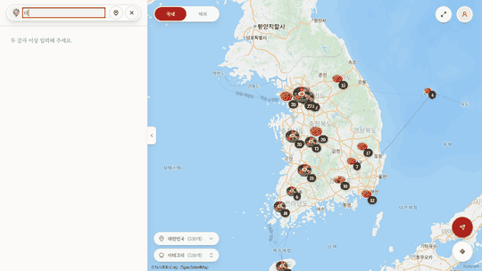
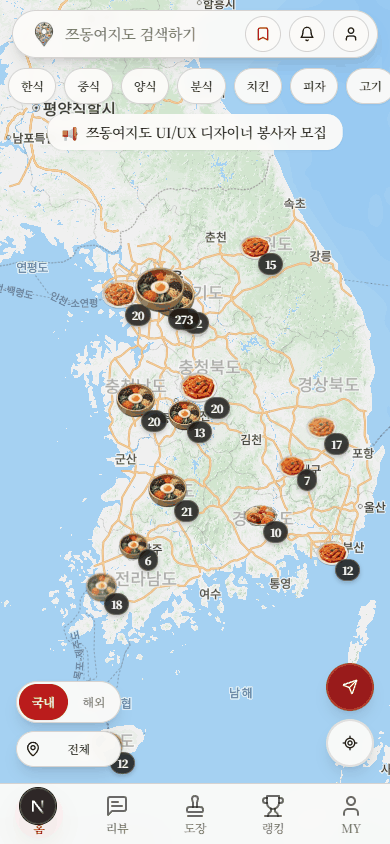
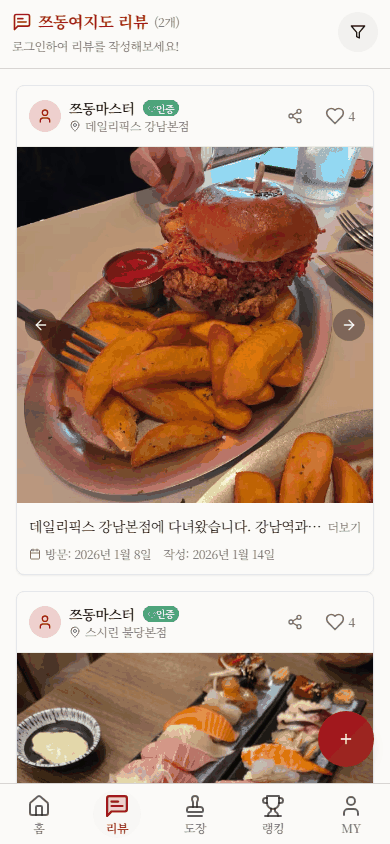
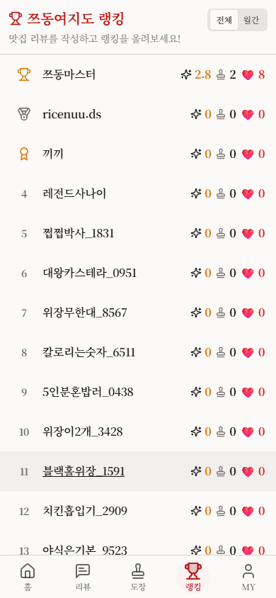
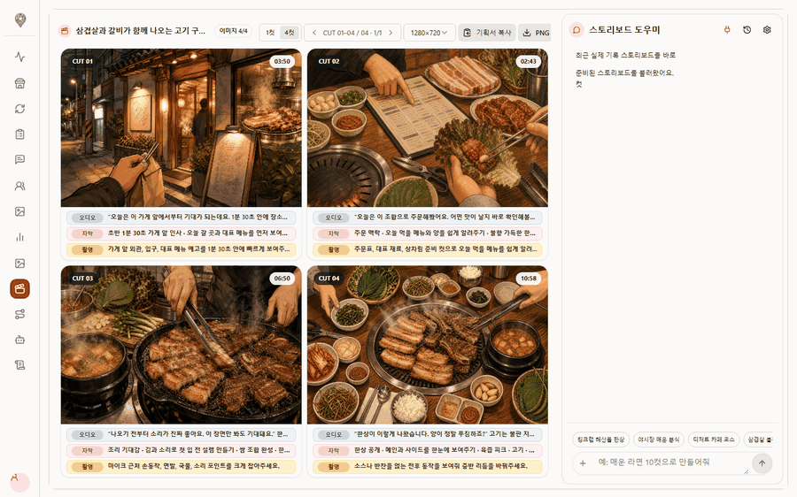

<div align="center">
  
  <h1>쯔동여지도 · Tzudong Map</h1>
  <p>쯔양 영상에 등장한 맛집을 지도에서 찾고, 방문 경험을 나누는 서비스입니다.</p>
  <p>
    <a href="https://www.tzudong.app">지도 둘러보기</a> ·
    <a href="docs/README.md">문서 안내</a> ·
    <a href="CONTRIBUTING.md">기여 안내</a> ·
    <a href="https://github.com/twoimo/tzudong/releases/latest">최신 정식 릴리스</a> ·
    <a href="README.md">English</a>
  </p>
</div>

## 기능

- **맛집 탐색:** 국내·해외 지도에서 맛집을 검색·필터링하고, 상세 패널에서 영상 출처를 확인합니다.
- **방문 경험 공유:** 리뷰, 도장, 랭킹, 좋아요, 프로필을 통해 방문 기록과 커뮤니티 활동을 이어갑니다.
- **데이터 관리:** 보호된 관리자 콘솔에서 검수, 출처 확인, 승인과 변경 이력을 관리합니다.
- **콘텐츠 제작:** 스토리보드·썸네일 워크스페이스에서 기획, 생성, 수정을 진행합니다.
- **영상 근거 처리:** 백엔드 워커가 크롤링, 평가, 미디어 처리와 공개용 데이터 생성을 담당합니다.

## 미리보기

저장소에 보존된 화면 시연입니다.

<p align="center">
  
</p>

<details>
<summary>모바일 화면과 스토리보드 워크스페이스</summary>

<table>
  <tr>
    <td width="50%"><strong>홈 지도</strong><br /></td>
    <td width="50%"><strong>리뷰 피드</strong><br /></td>
  </tr>
  <tr>
    <td width="50%"><strong>도장</strong><br /></td>
    <td width="50%"><strong>랭킹·프로필</strong><br /></td>
  </tr>
</table>



</details>

## 로컬 개발

[apps/web/package.json](apps/web/package.json)에 선언된 **Node.js 24.x**와 **npm 11.6.2**를 사용합니다. 로컬 데이터베이스에는 Python 3와 Docker Compose도 필요합니다. 고정된 도구 버전과 준비 사항은 [로컬 스택 운영 안내](docs/operations/nightly-regression.md#local-compose-bootstrap)를 따릅니다.

1. 저장소를 복제하고 웹 의존성을 설치합니다.

   ```sh
   git clone --branch main https://github.com/twoimo/tzudong.git
   cd tzudong/apps/web
   npm ci
   ```

2. 저장소 루트에서 [준비 절차](docs/operations/nightly-regression.md#local-compose-bootstrap)에 따라 저장소가 관리하는 [로컬 Supabase 스택](backend/supabase/README.md)을 생성하고 마이그레이션합니다.
3. `apps/web`로 돌아와 개발 서버를 실행합니다.

   ```sh
   npm run dev
   ```

[http://127.0.0.1:3000](http://127.0.0.1:3000)을 엽니다. 실행기는 생성된 로컬 환경, 서비스 준비 상태, 브라우저 origin, 마이그레이션 대장을 확인한 뒤 Next.js를 시작합니다. Hosted 디버깅과 지도 공급자 설정은 [웹 개발 안내](apps/web/README.md)를 참고하세요.

일상 개발에는 Bun도 사용할 수 있으며, 웹 단위 테스트 실행기에는 Bun이 필요합니다. 릴리스 패키지의 기준은 npm manifest와 lockfile입니다. 작업 브랜치, 도구 버전, 구성 요소별 검사 명령은 [기여 안내](CONTRIBUTING.md)에 모았습니다.

## 저장소 구성

| 경로 | 역할 |
| --- | --- |
| [apps/web/](apps/web/README.md) | Next.js 공개 앱, 맛집 지도, 커뮤니티, 보호된 관리자 콘솔. |
| [backend/](backend/README.md) | 파이프라인 제어, 크롤러, 평가, 미디어 워커, Supabase 마이그레이션. |
| [docs/](docs/README.md) | 제품 설계, 아키텍처, 운영, 릴리스 안내와 과거 검증 근거. |
| [scripts/](scripts/README.md) | 저장소 공통 운영 도구와 보안 검사. |
| [.github/](.github/README.md) | CI, 승격 정책, 기여 양식, 릴리스 노트 분류. |

새 파일의 위치, 패키지별 문서, 자산과 검증 근거의 보관 위치는 [저장소 지도](docs/repository-layout.md)에서 확인할 수 있습니다.

웹 앱과 백엔드 워커는 Supabase를 데이터 저장 경계로 사용합니다. 오래 걸리는 크롤링·미디어 처리는 백엔드 워커가 맡습니다. 상세 흐름은 [백엔드 아키텍처](backend/ARCHITECTURE.md)와 [데이터 계약](backend/DATA_CONTRACTS.md)에 있습니다.

| 웹 스택 | 도구·서비스 |
| --- | --- |
| Next.js 16 · React 19 · TypeScript | Tailwind CSS · Radix UI · Lucide |
| Node.js 24.x · npm 11.6.2 | 일상 개발용 Bun |
| Supabase | PostgreSQL · Auth · Storage |

정확한 의존성은 [package.json](apps/web/package.json)과 [package-lock.json](apps/web/package-lock.json)을 기준으로 확인합니다.

## 문서 안내

| 시작점 | 내용 |
| --- | --- |
| [문서 색인](docs/README.md) | 개발·운영·릴리스·검증 근거 등 목적별 안내. |
| [기여 안내](CONTRIBUTING.md) | 작업 브랜치, 변경 범위별 검사, 버그 제보와 PR. |
| [웹 개발](apps/web/README.md) | 로컬·Hosted 개발, 환경 설정, 웹 명령. |
| [백엔드 운영](backend/README.md) | 파이프라인 진입점, 환경변수 계약, 실행 요약. |
| [제품 설계](docs/product/README.md) · [아키텍처 도식](docs/architecture/README.md) | 제품 화면과 시스템 구조. |
| [운영](docs/operations/README.md) · [검증](docs/agents/verification.md) | 운영 절차, Nightly 회귀 검사, 변경 범위별 검사. |
| [검증 근거](docs/evidence/README.md) · [보관 문서](docs/archive/README.md) | 측정 시점·범위·한계와 과거 기록. |

## 릴리스

게시된 변경은 [최신 정식 소스 릴리스](https://github.com/twoimo/tzudong/releases/latest)와 [변경 기록](CHANGELOG.ko.md)에서 확인합니다. [릴리스 안내](docs/releases/README.md)에는 정식·Nightly·로컬 스택 채널의 용도와 릴리스 노트 양식이 있습니다.

기능·의존성 PR은 [main 중심 전환](docs/operations/main-first-transition.md)을 설치하고 확인한 뒤 보호된 `main`을 대상으로 합니다. 정책 자체는 기존 `develop → data → main` 경로로 한 번 더 설치하며, `data`는 기존 데이터 소비자를 위해 유지합니다. Nightly·로컬 스택 prerelease는 로컬 검증을 기록합니다. 운영은 정확히 승인된 커밋, 사전 검증한 운영 빌드, 수동 승격과 공급자 확인을 [릴리스 정책](docs/agents/release.md)에 따라 별도로 기록합니다.

## 보안과 라이선스

보안 문제는 [SECURITY.md](SECURITY.md)에 따라 제보해 주세요. 소스 라이선스는 [MIT](LICENSE)입니다.
