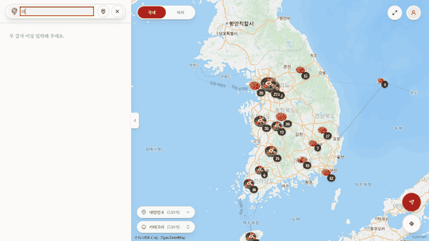
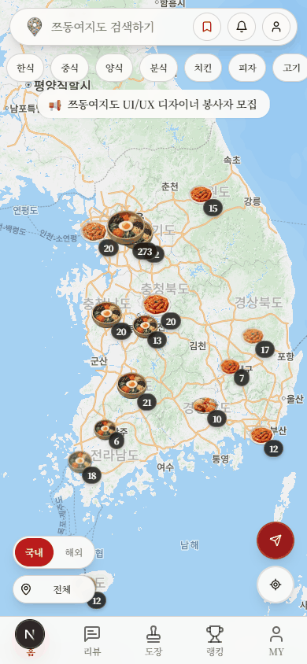
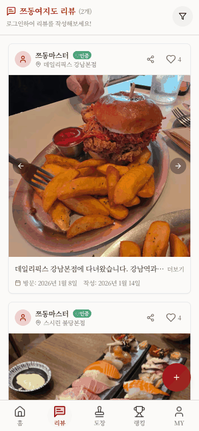
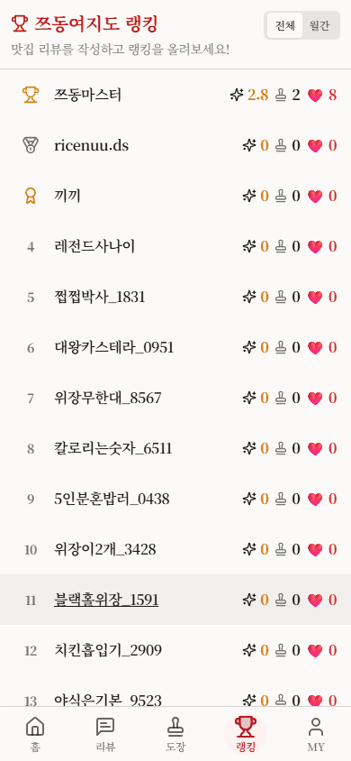
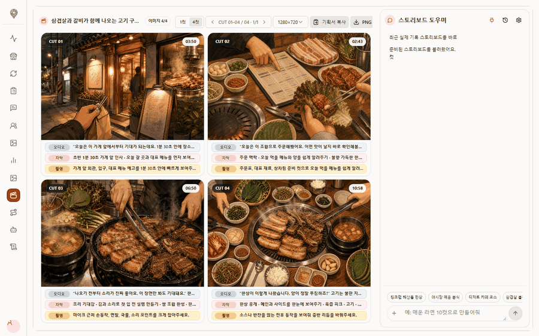

<div align="center">
  
  <h1>Tzudong Map · 쯔동여지도</h1>
  <p>A restaurant map built around places featured in Tzuyang videos.</p>
  <p>
    <a href="https://www.tzudong.app">Explore the map</a> ·
    <a href="docs/README.md">Documentation</a> ·
    <a href="CONTRIBUTING.md">Contributing</a> ·
    <a href="https://github.com/twoimo/tzudong/releases/latest">Latest stable release</a> ·
    <a href="README.ko.md">한국어</a>
  </p>
</div>

## Features

- **Discover restaurants:** browse domestic and overseas maps, search and filter places, and open restaurant details with video sources.
- **Keep track of visits:** reviews, stamps, rankings, likes, and profiles connect discovery with community activity.
- **Manage the data:** the guarded admin console supports review, moderation, source checks, and audited changes.
- **Prepare visual content:** storyboard and thumbnail workspaces support planning, generation, and revision.
- **Process video evidence:** backend workers handle crawling, evaluation, media processing, and publication payloads.

## Preview

Recorded interface demos from the repository:

<p align="center">
  
</p>

<details>
<summary>Mobile screens and storyboard workspace</summary>

<table>
  <tr>
    <td width="50%"><strong>Home map</strong><br /></td>
    <td width="50%"><strong>Review feed</strong><br /></td>
  </tr>
  <tr>
    <td width="50%"><strong>Stamp passport</strong><br /></td>
    <td width="50%"><strong>Ranking and profile</strong><br /></td>
  </tr>
</table>



</details>

## Local development

Use **Node.js 24.x** and **npm 11.6.2**, as declared in [apps/web/package.json](apps/web/package.json). The local database setup also needs Python 3 and Docker with Compose; follow the pinned prerequisites in the [local stack runbook](docs/operations/nightly-regression.md#local-compose-bootstrap).

1. Clone the repository and install the web dependencies:

   ```sh
   git clone --branch develop https://github.com/twoimo/tzudong.git
   cd tzudong/apps/web
   npm ci
   ```

2. From the repository root, prepare and migrate the repository-managed [local Supabase stack](backend/supabase/README.md) using the [bootstrap instructions](docs/operations/nightly-regression.md#local-compose-bootstrap).
3. Return to `apps/web` and start the development server:

   ```sh
   npm run dev
   ```

Open [http://127.0.0.1:3000](http://127.0.0.1:3000). The runner checks the generated local environment, service readiness, browser origin, and migration ledger before starting Next.js. Hosted debugging and map-provider configuration have separate setup instructions in the [web development guide](apps/web/README.md).

Bun is supported for everyday development and is required by the web unit-test runner. npm's manifest and lockfile remain the release package authority. See [Contributing](CONTRIBUTING.md) for branch setup, tool versions, and checks for each component.

## Repository

| Path | Responsibility |
| --- | --- |
| [apps/web/](apps/web/README.md) | Next.js public app, restaurant maps, community features, and guarded admin console. |
| [backend/](backend/README.md) | Pipeline control, crawlers, evaluation, media workers, and Supabase migrations. |
| [docs/](docs/README.md) | Product design, architecture, operations, release guidance, and historical evidence. |
| [scripts/](scripts/README.md) | Repository-level operator tools and security checks. |
| [.github/](.github/README.md) | CI, promotion policy, contribution templates, and release-note configuration. |

The [repository map](docs/repository-layout.md) explains where new files belong, including package-local docs, assets, and retained evidence.

The web app and backend workers share Supabase as their persistence boundary. Long-running crawling and media work belongs to backend workers. See the [backend architecture](backend/ARCHITECTURE.md) and [data contracts](backend/DATA_CONTRACTS.md) for the detailed flow.

| Web stack | Tooling and services |
| --- | --- |
| Next.js 16 · React 19 · TypeScript | Tailwind CSS · Radix UI · Lucide |
| Node.js 24.x · npm 11.6.2 | Bun for everyday development |
| Supabase | PostgreSQL · Auth · Storage |

Exact dependencies are in [package.json](apps/web/package.json) and [package-lock.json](apps/web/package-lock.json).

## Documentation

| Start here | Contents |
| --- | --- |
| [Documentation index](docs/README.md) | Find a guide by task: develop, operate, release, or inspect evidence. |
| [Contributing](CONTRIBUTING.md) | Development branches, scoped verification, bug reports, and pull requests. |
| [Web development](apps/web/README.md) | Local and hosted development, configuration, and web commands. |
| [Backend operations](backend/README.md) | Pipeline entry points, environment contracts, and run summaries. |
| [Product design](docs/product/README.md) · [Architecture diagrams](docs/architecture/README.md) | Product surfaces and system diagrams. |
| [Operations](docs/operations/README.md) · [Verification](docs/agents/verification.md) | Runbooks, Nightly regression, and checks for the affected behavior. |
| [Evidence](docs/evidence/README.md) · [Archive](docs/archive/README.md) | Dated measurements, preserved records, and their scope and limits. |

## Releases

Use the [latest stable source release](https://github.com/twoimo/tzudong/releases/latest) and the [changelog](CHANGELOG.md) for published changes. The [release guide](docs/releases/README.md) explains stable, nightly, and local-stack channels and provides a release-note template.

Changes follow the protected `develop → data → main` path. Nightly and local-stack prereleases describe local verification. Production deployment has its own commit and readback, recorded according to the [release policy](docs/agents/release.md).

## Security and license

Report security issues using [SECURITY.md](SECURITY.md). Source license: [MIT](LICENSE).
