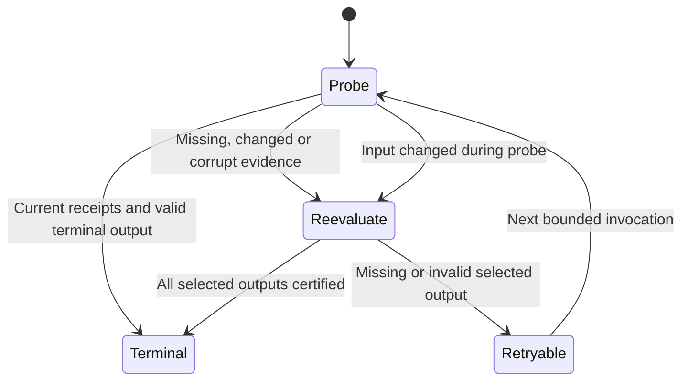

# Local evaluation reuse contract

Terminal-looking output is not sufficient evidence that the current input was evaluated.
For each numbered stage, the producer and the read-only probe now construct the same
fingerprint of its input bytes, selected metadata, implementation assets and resolved
settings. A receipt also binds the output bytes. The channel configuration's selected
path and contents participate in the crawling recipe.

For a selected video, local completion requires current crawl, selection, rule, LAAJ
and transform receipts, together with valid terminal rows for every selected restaurant.
Valid negative evaluations remain terminal. Explicit no-restaurant results and valid
Short exclusions have their own current-input checks; they do not require a fabricated
positive restaurant evaluation.

If `P_s` is the current recipe digest and `O_s` the observed output digest vector, reuse
requires `receipt.inputHash = P_s` and `receipt.outputs = O_s` for every required stage.
The evaluator admits a batch only when its observed filesystem signatures also agree
before and after those content-hash probes. Each later admission computes a fresh
batch; no memo survives between invocations or between initial and final admission.

The stage writer retains its existing exclusive lock through execution and receipt
publication. Batch probes hash shared assets once per invocation. Five direct stage
probes replace repeated per-video launches; the batch still checks individual outputs.
Malformed duration values, including booleans and negative/infinite values, cannot
create a numeric Short exclusion.

This is a bounded local-file consistency check, not a filesystem transaction or a proof
of remote freshness. It assumes ordinary filesystem metadata semantics. A mutation
after the admission window is outside that observation. The whole-transform receipt
is deliberately conservative: changing a different video's metadata can invalidate
otherwise unchanged warm videos. No per-video proof is invented to hide that miss.

Validation: 119 focused offline tests passed using the installed crawler Python runtime,
including changed/corrupt sources, configuration changes, negative terminal states,
concurrent mutations and real shell coordination. Empty-string unknown names match
the selection producer, and automatic Web fallback resolves the same recipe mode
without probing a browser or initializing a provider. The clean-source orchestration
readiness check passed 217 tests using the project test environment; these suites
overlap and must not be added as a unique test count. Two initial shell fixture failures
were caused by interpreter paths containing spaces and were corrected using the
fixture-owned Python symlink. The failed run is retained in the task's evidence directory.

The archive microbenchmark has one observation per size and version; it does not
establish a confidence interval, hosted latency improvement or token savings. This
change also does not repair partial multi-row hosted delivery, create shared Mac/GHA
delivery custody, or restore negative outcomes into fresh GitHub Actions checkouts.
