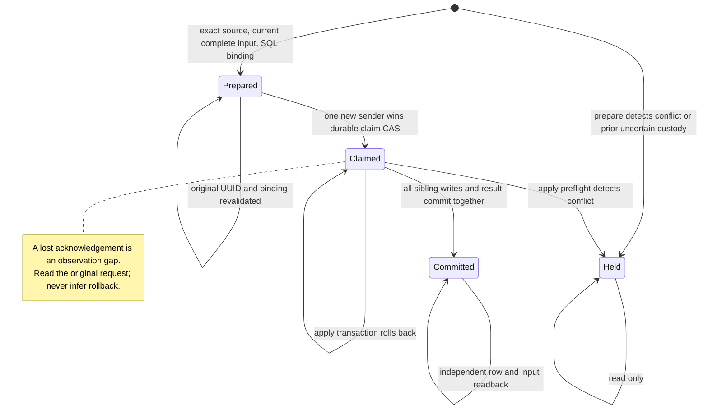

# Hosted pending custody — candidate

This candidate replaces per-row pending inserts with one database transaction for a complete, currently admitted video set. It has not been installed in production. The production ledger was observed at 93 entries on 2026-10-25; count alone is not an installation precondition.

## Defect and acceptance

The previous A201/B503 and A201/B409 reproductions could report the video as applied after only A was stored. A later hosted snapshot could then skip B. A successful set must account for every current sibling through an inserted row or an independently reconciled existing active row. Deleted rows and ambiguous canonical/alias/name/trace matches hold the set. Existing administrator edits remain unchanged.

The diagram is a contract description, not an exhaustive formal proof. An unknown acknowledgement can conceal a committed transaction; an observed claim with zero rows does not prove rollback. A caller sends apply only after its own fresh claim response explicitly says `claimed=true` and `state=claimed`. A separate invocation may resume a definitely PREPARED original only after full input, UUID and binding admission and a new claim CAS. CLAIMED/HELD never permit replay.

For a set with k eligible siblings, the database transaction accounts for all k or rolls back its new row writes. The separately committed claim remains. This is not a claim that every requested video eventually progresses: conflicting holds, changed sources, missing inputs, transport failures and bounded discovery can prevent progress. No automatic custody reset exists.

Uncertainty dominates historical success in discovery, independently of iteration order. A historical committed snapshot does not prove that current remote YouTube metadata or captions were fetched. Hashes bind bytes; they do not authenticate a source or prove protected-branch ancestry.

## Evidence scopes

- Local baseline counterexamples reproduce partial reflection and whole-video skipping.
- Actual local PostgreSQL 17.6 evidence covers SQL transactions, two-connection claim races, sibling rollback and role boundaries for the preserved installer bytes.
- Local PostgREST 14.1 evidence covers HTTP argument routing, service-only RPC access and commit followed by lost acknowledgement. It does not establish the hosted gateway's configuration.
- The combined caller/source/recovery/Linux fixture suite passed 84 methods. Linux fixture paths are not an observation of GitHub-hosted runner ownership or permissions.
- The explanatory installer header changed after the earlier PG receipts. A separate exact-byte PG17.6 compiler installation bound its new source and 65-statement vector, advanced a new local clone from ledger93 to94 and independently reconciled it as committed. Earlier behavior receipts retain their original byte scope. This remains local evidence, not operating admission.
- PR #3548's actual GitHub source observer accepted the native runner's clean checkout and ancestor ownership/modes at source39e24ee9. The following test bundle failed five freshness methods because its clean Python environment lacked `requests`, imported by the real rule cache probe. A disposable Python3.11.17 reproduction failed the same five of six methods without that dependency and passed all six with the existing component pin2.34.2. The focused test manifest now declares that dependency. This observation establishes neither protected-main admission nor an operating custody installation.
- At sourcef1260ac0 the 83-method bundle passed on GitHub; the later 295-method readiness run exposed four Mac-archive fixture failures on Linux. Those fixtures now explicitly select the Mac adapter through a module-local platform view, so their mutation cases reach the intended checks on both hosts. A separate Linux archive-rejection case preserves the real platform boundary. The native GitHub Git-source observer is unchanged.

These cases have different denominators and must not be added together. They do not estimate production accuracy, latency, cost or a statistical 95% interval.

## Remaining operating work

1. Finish CI/review and protected promotion for the fixed admission, operator and CLI-generated migration `20261025063810_hosted_pending_atomic_delivery.sql`. The prepared source has 82 statements; its source/vector and actual 18-field operating prior are pinned in `.github/hosted-pending-custody-install.v1.json`. The operating database remains at 93 entries. Preparation is not an installation receipt.
2. Record the original operation in an owner-only durable journal before the sole apply dispatch. An accepted or uncertain dispatch consumes that attempt; reconcile its original run and migration before any further decision. The runner sends once per invocation; that alone does not prevent a separate invocation. Keep the journal and original evidence rather than creating a replacement identity.
3. Fence both the installed Mac writer and GitHub Actions, verify no in-flight operation, install and independently read back the admitted SQL, then bind both writers to the final source. The manual owner-only workflow independently checks the GitHub fence; it cannot inspect the local launchd label. `G037_WRITE_FREEZE=active` remains unchanged and does not stop the old pending-insert path.
4. Verify the actual hosted RPC boundary, a complete new video set, the review queue and public marker readback. Preserve uncertain original requests, administrator results and existing external audit reservations.

A web deployment rollback is not a producer or database rollback. After custody is installed, keep both writer fences in place if the compatible producer cannot start. An older producer's direct POST path must not resume merely because the web alias points to the previous deployment. Preserve custody tables, original requests and migration history; do not drop them or reset claims as an automatic rollback.

A local PG17.6 probe observed a queued legacy insert succeed after a table lock without a privilege fence, and fail with 42501 after table INSERT was revoked. A previously prepared statement was also denied; an already inserted, uncommitted row forced cutover to wait and was then visible to the snapshot. Revoking all INSERT also broke the existing SECURITY INVOKER administrator creation and new-submission approval paths, so the new source uses the tested column-grant alternative below. The first unbounded full-row legacy-seed proposal remains unadmitted.

The earlier 65-statement installer and component draft remain under `backend/supabase/candidates/` with their original evidence. The new 82-statement migration includes the bounded cutover below. It is not applied. No direct-POST fallback, key, model, quota, schedule or security exception is introduced.

## Bounded cutover and its limits

The new source requires READ COMMITTED and holds the restaurant table lock through the seed and privilege transition. The projection statement starts after that lock is acquired, so it sees rows committed while the lock was waiting. Every retained status, deleted row, and recognized link/metadata video ID enters the conservative hold set. A current row does not establish complete delivery, and a zero-row old request is not marked successful or rolled back.

The projection accepts at most 50,000 restaurant rows and 150,000 video/UUID pairs. Links above 4KiB reject the transaction; pair payload and seed-digest inputs are bounded at 8MiB and 16MiB. Lock wait is 2 seconds and the cutover statements have a 15 second timeout. `work_mem=4MB` is not an RSS ceiling; JSONB access can decompress existing metadata. These are projection/input bounds, not proof of every internal PostgreSQL allocation.

The service role loses table INSERT and retains INSERT on the exact 12 columns used by the existing guarded administrator creation helper. Actual local Preview/Apply/readback for administrator creation and new-submission approval passed after this change. The old Mac `5df7c3f8` and GitHub `6bd1602d` sources emit the same 24-column payload including `origin_name`, which is denied after cutover. A caller using only the permitted 12 columns can still insert directly; this is a fence for the pinned old route, not a universal service-role write prohibition. Alternate definer/SQL entrypoints and privileged writers require separate custody.

The private singleton retains the original hold count and digest. Terminal readback compares the bounded current holds with that original record. Its `source_rows` describes the cutover snapshot, not the restaurant count after later legitimate administrator writes. No client API resets holds or reconstructs an old request UUID.

## Final local admission evidence

The exact new source/vector completed a local compiler install 93→94 and independent reconciliation. Its extended readback now binds foreign-key targets/actions, index definitions/options/collations/operator classes, and all new-table triggers. Six rolled-back catalog changes were missed by the previous projection and detected by the new one. Internal trigger names containing allocated OIDs are excluded while their constraint/function identity and execution properties remain bound. A separate legitimate installation with different new-object OIDs produced the same normalized structure.

Both catalog reads use an empty transaction-local `search_path`. Existing operating OIDs and role/default/function/relation digests remain actual operating values; only source-defined additions and explicit ACL deltas come from local proof. This is a scoped ordinary-table catalog contract, not a generic proof over every PostgreSQL property or future inherited/partitioned schema.

Nine operator tests cover byte drift, wrong target, prior-state drift, missing confirmation, already-committed state, rollback drift, and lost acknowledgement without resubmission inside the invocation. They are deterministic checks, not production accuracy, latency, cost or 95-percent-confidence estimates. The new source still requires its own protected CI and hosted execution evidence.

## Source-only PG15 catalog replay

The first Catalog CI run at source `2cd2b8f9` rejected the unchanged operating installer with `pending_custody_install_executor_denied`. The canonical reconstruction database uses PostgreSQL 15 and the legacy G014 owner contract, not the operating PostgreSQL 17.6 catalog or migration ledger.

The exact-source replay adapter changes only executor version admission, the legacy owner assertion body hash, PG15 membership syntax and baseline, and the table ACL spelling without PG17's MAINTAIN privilege. Its output must reverse to the identical original migration bytes. The replay rejects a database containing `supabase_migrations`, keeps the nonsuperuser/caller/read-write/READ COMMITTED guards, and executes the entire adapted migration with `psql --single-transaction`. Feature function bodies and wrappers, all source/identity checks, bounded cutover, before/after preservation snapshots, and G014 assertions still run. The original operating migration, 82-statement vector and fixed contract are unchanged.

The generator binds the adapter and transformed SQL in its chain and retains the SQL and disposition receipt as artifacts. This replay verifies the reconstructed schema and ACL/cutover behavior. It does not verify operating ledger admission, PG17 membership options, operating execution, hosted RPC behavior, or producer activation. Those remain separate acceptance gates.
