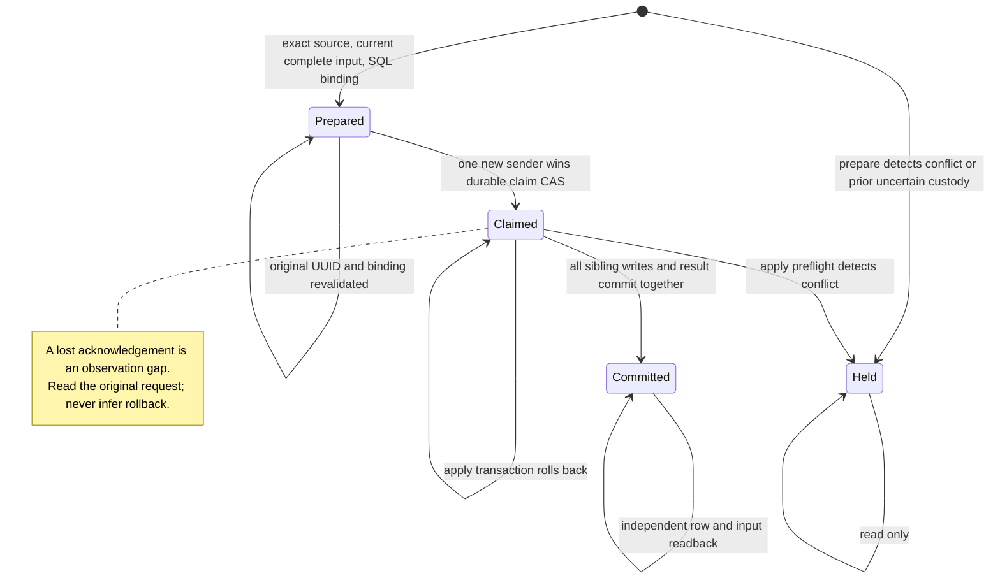

# Hosted pending custody — candidate

This candidate replaces per-row pending inserts with one database transaction for a complete, currently admitted video set. It has not been installed in production. The production ledger was observed at 93 entries on 2026-10-25; count alone is not an installation precondition.

## Defect and acceptance

The previous A201/B503 and A201/B409 reproductions could report the video as applied after only A was stored. A later hosted snapshot could then skip B. A successful set must account for every current sibling through an inserted row or an independently reconciled existing active row. Deleted rows and ambiguous canonical/alias/name/trace matches hold the set. Existing administrator edits remain unchanged.

The diagram is a contract description, not an exhaustive formal proof. An unknown acknowledgement can conceal a committed transaction; an observed claim with zero rows does not prove rollback. A caller sends apply only after its own fresh claim response explicitly says `claimed=true` and `state=claimed`. A separate invocation may resume a definitely PREPARED original only after full input, UUID and binding admission and a new claim CAS. CLAIMED/HELD never permit replay.

For a set with k eligible siblings, the database transaction accounts for all k or rolls back its new row writes. The separately committed claim remains. This is not a claim that every requested video eventually progresses: conflicting holds, changed sources, missing inputs, transport failures and bounded discovery can prevent progress. No automatic custody reset exists.

Uncertainty dominates historical success in discovery, independently of iteration order. A historical committed snapshot does not prove that current remote YouTube metadata or captions were fetched. Hashes bind bytes; they do not authenticate a source or prove protected-branch ancestry.

## Evidence scopes

- Local baseline counterexamples reproduce partial reflection and whole-video skipping.
- Actual local PostgreSQL 17.6 evidence covers SQL transactions, two-connection claim races, sibling rollback and role boundaries for the preserved installer bytes.
- Local PostgREST 14.1 evidence covers HTTP argument routing, service-only RPC access and commit followed by lost acknowledgement. It does not establish the hosted gateway's configuration.
- The combined caller/source/recovery/Linux fixture suite passed 84 methods. Linux fixture paths are not an observation of GitHub-hosted runner ownership or permissions.
- The explanatory installer header changed after the earlier PG receipts. A separate exact-byte PG17.6 compiler installation bound its new source and 65-statement vector, advanced a new local clone from ledger93 to94 and independently reconciled it as committed. Earlier behavior receipts retain their original byte scope. This remains local evidence, not operating admission.
- PR #3548's actual GitHub source observer accepted the native runner's clean checkout and ancestor ownership/modes at source39e24ee9. The following test bundle failed five freshness methods because its clean Python environment lacked `requests`, imported by the real rule cache probe. A disposable Python3.11.17 reproduction failed the same five of six methods without that dependency and passed all six with the existing component pin2.34.2. The focused test manifest now declares that dependency. This observation establishes neither protected-main admission nor an operating custody installation.

These cases have different denominators and must not be added together. They do not estimate production accuracy, latency, cost or a statistical 95% interval.

## Remaining operating work

1. Bind the final protected source, parser statement vector, migration slot, actual full ledger and current catalog/role/default-ACL state in a dedicated fixed admission. Preserve the original one-attempt journal and reconcile unknown acknowledgement before any retry.
2. Inventory legacy direct-POST requests using original evidence. An existing restaurant row is not proof that the video's entire sibling set was delivered. Preserve unresolved legacy videos in durable custody before the first new prepare; do not invent an empty inventory from a quiet queue.
3. Fence both the installed Mac writer and GitHub Actions during cutover, verify no in-flight operation, install and read back the admitted SQL, then bind both writers to the final source. `G037_WRITE_FREEZE=active` does not stop this pending-insert path.
4. Verify the actual hosted RPC boundary, a complete new video set, the review queue and public marker readback. Keep uncertain original requests and administrator results intact.

A web deployment rollback is not a producer or database rollback. After custody is installed, keep both writer fences in place if the compatible producer cannot start. An older producer's direct POST path must not resume merely because the web alias points to the previous deployment. Preserve custody tables, original requests and migration history; do not drop them or reset claims as an automatic rollback.

A local PG17.6 cutover probe observed a queued legacy insert succeed after a table lock when no privilege fence existed, and fail with42501 when table INSERT was revoked before lock release. A previously prepared statement was also denied; an already inserted, uncommitted row forced cutover to wait and was then visible to the snapshot. This is a local boundary experiment, not the chosen operating change: revoking all INSERT also breaks the existing SECURITY INVOKER administrator creation and new-submission approval paths. A narrower column-grant alternative and its normal-path regressions remain under investigation. The first unbounded full-row legacy-seed proposal is not admitted.

The full installer and draft SQL live under `backend/supabase/candidates/`; neither is an applied migration. No direct-POST fallback, key, model, quota, schedule or security exception is introduced by this document.
