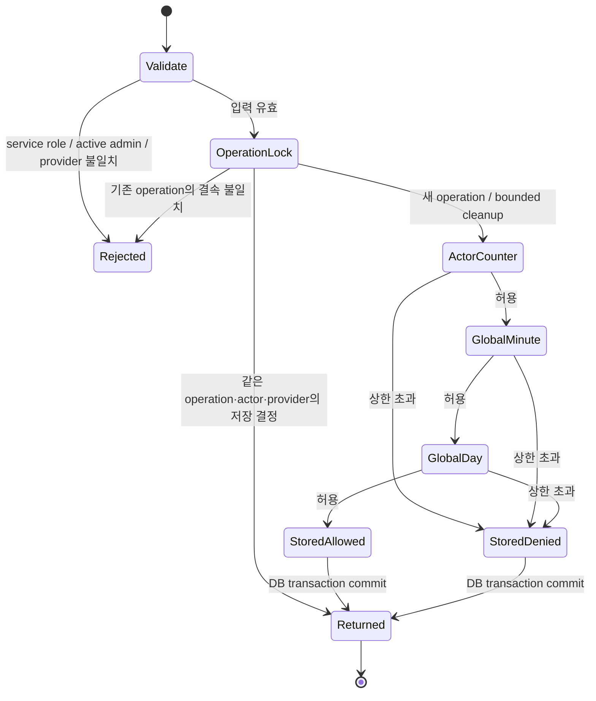

# 동선 예산 RPC 복구 후보 — 운영 미적용

운영 동선 추천은 `naver-directions-budget-unavailable`로 도로 경로 대신 로컬 후보를 표시했다. 읽기 전용 catalog에서 공개 RPC의 실행 소유자는 `privacy_workflow_owner`지만 `provider_budget_private`의 USAGE와 테이블 권한이 없고, Directions 정책도 없음을 확인했다. 현재 공개 RPC와 비공개 counter의 본문 SHA-256은 각각 `bc52ec03840caefdd3f90deb8c00ebf608fc9e1adde0b1b0be5aedf24203386e`, `941ddc06b34547bdfa703094d9175f800cf9921bc869e739e48198c8e0cc9763`으로 원본 G013과 같다. 실제 격리 DB에서 첫 공개 호출의 `42501`과 counter 첫 호출의 `42883`을 재현했다. 후자는 `pg_catalog.greatest`가 함수가 아니라 SQL 조건식 구문인 데서 발생한다.

후보는 [SQL](../../backend/supabase/candidates/20261024_provider_budget_private_bridge.sql)과 [실행 검사](../../backend/supabase/tests/test_provider_budget_bridge_pg17.py)다. applied migration과 고정 release manifest는 수정하지 않는다. `20260713000400`은 현행 hosted closure의 excluded/forbidden 목록에 있으므로 그 과거 extension을 직접 재실행하지 않는다.

## 선택한 권한 경계

워크플로 소유자에게 세 비공개 테이블의 읽기·쓰기와 RLS 정책을 넓게 추가하는 대신, 기존 비공개 소유자 `postgres`의 함수 안에 예산 상태를 유지한다. 공개 RPC의 이름·인자·TABLE 반환·definer·소유자·EXECUTE ACL은 보존하고 비공개 core를 호출한다. 워크플로 소유자는 해당 core의 EXECUTE와 schema USAGE만 받는다. browser와 service_role에는 비공개 테이블·core의 직접 접근을 추가하지 않는다.

기존 세 정책과 한도, operation/actor/provider 결속, 만료 처리 및 counter의 원자적 UPSERT는 유지한다. Directions 한 행만 기존 소스에 명시된 20/actor-minute, 200/global-minute, 10,000/global-day로 추가하고 다른 LLM 정책은 추가하지 않는다. 이는 공급자의 실제 잔여량이나 새로운 유료 한도를 뜻하지 않는다. NULL JWT role은 명시적으로 거부하고 counter의 잘못된 함수 구문을 수정한다.

## 상태 전이와 검증 범위



이 그림은 SQL의 검토 표면이며 형식 증명이 아니다. operation advisory lock과 counter UPSERT는 서로 다른 실제 경계이고, RPC transaction 실패는 전체 변경을 rollback한다. 공급자 호출은 이 transaction 밖에 있으므로 공급자 청구의 exactly-once나 eventual completion을 증명하지 않는다. 저장 결정의 기존 보존 기간을 벗어난 재실행도 무조건적 중복 방지 주장에 포함하지 않는다.

정책 수 P, counter 행 C, 결정 행 D, 정리 상한 B=100일 때 기존 B-tree와 정상 계획을 가정한 한 요청의 탐색/정리 비용은 `O(log P + log C + log D + B(log C + log D))`로 모델링한다. 새 함수 경계는 상수 개수이며 점근적 개선을 주장하지 않는다. lock 대기 시간·실제 provider 지연은 이 모델 밖이다.

## 실제 격리 검증

```text
/Users/twoimo/Documents/projects/tzudong/.venv/bin/python3 -m unittest backend.supabase.tests.test_provider_budget_bridge_pg17
```

PostgreSQL 17.11에서 **16개 통과**. 실제 비슈퍼유저 postgres와 별도로 제공한 owner lease로 실행했다. 같은 operation의 동시 16건은 결정 1행·counter 각 1회, 고유 operation 40건은 허용 20건·차단 20건이었다. actor/global-minute/global-day 상한, 비관리자·비활성 관리자·NULL/다른 JWT role·browser 거부, 결속 불일치, 재적용·기존 정책/ACL/RLS 변경 거부와 rehearsal/후반 오류 rollback을 확인했다. NULL role guard 제거와 잘못된 GREATEST 구문 복원은 각각 잘못된 허용과 `42883`을 실제 DB에서 검출했다. 이 두 negative control은 시험 DB만 변경한다.

[실행 영수증](../evidence/provider-budget-bridge-20261024/summary.json)은 소스별 SHA, 실제 전후 영수증과 종료 확인에 결속된다. 세 기존 정책과 공개 함수 metadata/ACL, private table ACL/RLS/policy, 역할·membership·default ACL의 불변을 확인했다. 결정적 한정 사례이므로 95% 모집단 구간이나 운영 성공률·속도·비용 절감으로 환산하지 않는다. 운영 DB 쓰기·실제 provider 호출은 0회다.

## 운영 전달 전에 남은 조건

현재 후보는 실행 명세·ledger·writer fence를 가진 migration이 아니다. 현재 권한이 거절된 MCP 연결자에서 SET ROLE이나 GRANT로 우회 실행하지 않는다. 별도로 검증한 postgres migration executor와 임시 owner lease, 현재 ledger prefix, 전체 G014 전후 계약, 실제 운영 버전 PG17.6 및 새 admission의 atomic apply/readback이 필요하다. 로컬 fixture의 modeled lease는 이 권한의 운영 영수증이 아니다.

후속 통합에서 선택적 `psycopg2`가 없는 환경의 test discovery 실패를 재현하고, driver 부재는 명시적 prerequisite skip으로 처리했다. 해당 controlled probe는 모듈 로드 성공·DB 실행 0·class skip 1이며 DB 통과가 아니다. driver가 설치된 실제 PG17.11의 16개 검사는 다시 통과했고 source stable과 cluster 종료를 확인했다. 원래 영수증을 덮지 않은 [후속 영수증](../evidence/thumbnail-integration-20261024/provider-budget-pg17-portable.json)과 [부재 probe](../evidence/thumbnail-integration-20261024/provider-budget-missing-driver.json)를 보존한다.

정확한 소스의 Pro thesis → Gemini 최대 사고 반대 검토 → Pro 역검증도 미완료다. 기존 원본 예약과 bundle은 보존한다. 현재 production은 별도 작업으로 `1b5230ac93021c72499f4950bff6cda24e2515e5` / `dpl_FiHvmpQdmnDLNYXL9dquSFTFMpoB`로 이동한 것을 읽기 확인했으며 이 후보의 배포는 아니다. 실제 적용 직전에 rollback SHA와 writer fence를 다시 확인하고, 정상 `develop → data → main` 이후 인증된 UI에서 도로 경로·제어된 실패·기존 캐시/반환 계약을 확인해야 한다. 이미 생성된 결정이나 counter를 삭제하는 자동 rollback은 만들지 않는다.

## 후속: 썸네일 설치 이후 실제 PG17.6 검증

위의 PG17.6·전체 G014 미검증 상태는 다음 [새 영수증](../evidence/provider-budget-bridge-20261024/full-pg176-after-thumbnail.json)으로 보완했다. 시험한 base는 `6539427742b2542dcfe471a0c399c2ba7c4177cd`, 예산 후보 SHA는 `7f6847fa83f7e1f87ce8ff289623796182a323a245a3308007fd689aa6ff3c24` 그대로다. 운영 적용은 여전히 0회다.

원문 ledger 89행에서 썸네일 전체 설치를 마친 90행의 격리 PG17.6 DB를 새 DB로 복제했다. 현재 운영의 사전 23항목과 기존 예산 정책 3행을 **별도 REPEATABLE READ READ ONLY** 관측에서 확인했으며 사용자·counter·decision 행은 복사하지 않았다. 논리 dump가 생략한 private schema의 명시적 소유자 기본 ACL은 이 별도 관측의 원래 raw ACL과 같게 일반 GRANT/REVOKE로 복원했다. 제품 guard·원본 assertion·registry는 완화하거나 투영하지 않았다. 이 보충 관측은 앞선 전체 schema snapshot과 같은 시점이라고 하지 않는다.

복제는 소유 fixture의 원본 DB 연결 0건을 확인한 뒤 [PostgreSQL 17의 CREATE DATABASE TEMPLATE](https://www.postgresql.org/docs/17/sql-createdatabase.html)를 사용했다. [Supabase의 17.11 변경 공지](https://supabase.com/changelog/postgres-15-19-17-11-breaking-changes)도 대조했으며, 이번 검증을 위해 운영이나 고정 17.6 이미지·확장 버전을 변경하지 않았다.

| 실제 경계 | 결과 |
| --- | --- |
| 전체 G014·썸네일 상태 | 원래 assertion 4개 전후 통과, 썸네일 종료 23항목 전후 일치, 원본 DB 보존 |
| 임시 owner lease | 없는 lease·남아 있는 lease 각각 거부, 정상 경로 membership 완전 복원 |
| 후반 오류·재적용 | 전체 post 검사 뒤 오류를 넣어 원상 복구 확인, 정상 commit 뒤 재적용 거부 |
| 기존 계약 | 공개 RPC metadata·ACL과 원장 90행·digest 불변, 기존 정책 3행 보존, Directions `[20,200,10000]` 한 행만 추가 |

이어 별도 복제 DB에 가상 계정 **3개**를 만들고 원래 auth 함수·trigger·RLS를 유지한 채 공개 RPC를 실행했다. 정상 호출과 실제 `auth.role()`의 JSON claims fallback은 성공했고 같은 operation 재요청은 counter/decision을 추가하지 않았다. **고유 operation 21건은 허용 20·차단 1**이며 actor/global-minute/global-day counter는 **21/20/20**이었다. NULL JWT role·browser·비관리자·비활성 관리자와 service_role의 private core 직접 호출은 모두 거부됐고 예산 행 변경이 없었다. 이는 설정한 로컬 한도 경계의 결정적 결과이며 운영 성공률 표본이 아니다.

실제 원본 공개 함수는 이 전체 환경에서 먼저 **auth schema 권한 `42501`**로 실패했다. 앞선 최소 fixture의 private-budget 권한 실패와 구별한다. 비공개 테이블 권한을 늘리지 않는 private core 경계가 정상 호출을 가능하게 했다. 원래 counter 본문을 시험 transaction에 복원하면 초과 경로에서 `42883`이 발생했고, NULL guard를 `<>`로 약화한 변형은 NULL role 요청을 잘못 허용했다. 세 negative control 뒤 실제 고정 소스와 상태가 rollback됐고 마지막 전체 G014도 통과했다.

초기 시험의 DDL 연결/출력 파싱 오류와 단독 활성 관리자를 비활성화하려다 기존 G014 보호 장치가 올바르게 거절한 이력은 실패 영수증으로 보존했다. 비활성 가상 계정을 별도로 준비해 기존 보호 장치를 우회하지 않았다. 소유 컨테이너는 정지했고 다른 소유자의 자원 변경은 0이다. 실제 provider 호출·운영 사용자 복사·운영 DB 쓰기는 0이며, 아직 **새 budget forward와 90→91 원장 계약·운영 admission·HTTP/UI 검증**의 증거는 아니다.

썸네일은 고정 **89→90**을 전제로 하고 기존 review-media predecessor는 **89→100**에 결속돼 있다. 예산 후보의 G014 assertion 직접 수정은 없으며 실제 위 순서에서 공존을 확인했다. 서로 다른 successor를 원장 수만 고쳐 이어 붙이지 않는다. 먼저 채택되는 forward 이후에는 새 prefix·terminal과 새 영수증을 결속해야 한다. 기존 frozen manifest와 applied migration은 보존한다.

## 후속: 원장 90→91 원자적 설치 초안

새 [전체 설치 후보](../../backend/supabase/candidates/20261024_provider_budget_install.sql)와 [전용 draft](../../.github/provider-budget-installation.draft.v1.json)는 기존 예산 본문 `7f6847fa…ff3c24`를 **원문 바이트 그대로** 포함한다. 새 후보는 **26,003 bytes / 24 statements**, SHA-256 `3503957bb65c602d559b789e59cfda343cfdcd0b75ccfe94a3b1fae678492092`이며 공식 original-vector SHA-256은 `7b9501d8d9ef4e5c45fedf75fb0d7bad91e4c9382648672ac4827edec5819031`이다. draft SHA-256은 `7fa566baf28aeefb6368eafedfd8dc5a6ca65fe42d842a30bf39d50fdcff90d6`이다. 기존 후보·applied migration·frozen manifest·compiler·caller는 이 작업에서 변경하지 않았다.

새 ledger identity는 `20261024130000 / provider_budget_install`이다. 미래 migration 경로는 `backend/supabase/migrations/20261024130000_provider_budget_install.sql`로 기록하지만, 아직 해당 경로를 applied migration으로 만들지 않는다. 기존 공식 parser는 14자리 timestamp 파일명을 검사하므로, 검증 시 8자리 후보의 **같은 바이트**를 전용 임시 디렉토리의 위 파일명으로 exclusive copy한 뒤 `readOriginalStatementVector`를 호출했다. 해시·크기·vector가 모두 일치해야 하며 임의 parser나 문자열 분할로 대체하지 않는다. 향후 고정 caller에도 이 경로 처리가 필요하다.

실행 순서는 하나의 caller transaction 안에서 다음과 같다. draft의 `serializerSql`로 기존 공통 key `tzudong:review-media-sql-successor:workflow:v1`를 먼저 확보하고, 변경하지 않은 `atomicMigrationSql`이 원장을 EXCLUSIVE lock한 뒤 exact prior를 검사한다. 이어 후보가 임시 owner bridge를 만들고 자기 SET grant를 제거한 상태에서 전체 G014 pre를 실행한다. 정확한 예산 본문에만 SET lease를 제공하고 자기 grant를 회수한 뒤, membership·role·default ACL·공개/기존 counter 함수 metadata·private table ACL/RLS/policy와 G014 전체 본문의 불변을 확인한다. 전체 G014 post 뒤 임시 객체를 제거하고, compiler가 원문 vector를 원장에 추가하고 terminal을 검사한 후 commit한다. serializer를 원장 lock 뒤나 별도 연결에서 잡으면 이 계약이 아니다.

prior는 **90행 / latest `20261024071000` / digest `b466a2ac7ade777f3948c9716a3c04cc4c1197b523d0de18f21c437b1fe0e45e`**를 요구한다. terminal은 실제 원장 91행과 새 target을 요구하면서 이 90행 prefix를 그대로 검증한다. 기존 썸네일 terminal query의 원장 참조만 새 budget version을 제외하는 CTE로 투영해 종료 23항목을 재사용한다. 이는 frozen 파일의 변경이 아니며, 바깥의 실제 원장 수·target vector·prefix 검사가 있으므로 추가 원장행이나 기존 행 변화를 숨기지 않는다. 새 private core·공개 wrapper/counter 본문, owner/ACL/config, 기존 세 정책과 Directions `[20,200,10000]`, CHECK·immutable trigger도 정확히 비교한다. 일반 counter/decision 내용은 사전 0행을 요구하지 않는다.

지정된 기존 소유 컨테이너의 **새 DB `budget_install_90_91_20261024`**에서 실제 PG17.6 일반 runtime, 비슈퍼유저 `postgres`로 다음을 확인했다. 원본 DB에는 읽기만 수행했고, 원문 G014 4개나 registry를 수정하지 않았다. schema-only 원본의 정책 3행·명시적 owner-default ACL 보충은 앞선 별도 읽기 영수증과 동일한 일반 DCL이며 새 clone에만 수행했다. 원본 snapshot과 보충 관측의 시점이 같다고 주장하지 않는다.

| 원자적 설치 경계 | 실제 결과 |
| --- | --- |
| exact compiler commit | 90→91, 원문 target vector 일치, 독립 readback과 read-only reconciliation의 committed 일치 |
| 전체 G014와 기존 상태 | pre/post 4개 통과, rollback/commit 뒤 독립 전체 검사 통과, 썸네일 종료 23항목과 기존 정책·권한 보존 |
| COMMIT 전 후반 오류 | 원장 insert·terminal 검사 후 주입한 오류로 prior 90행·예산 상태·임시 권한 전체 rollback |
| prior 변경 | 원장 prefix, 기존 정책 한도, 남아 있는 SET lease를 각각 실제 transaction에서 변경하면 소스 실행 전 거부·rollback |
| 잘못된 실행·종료 상태 | raw per-statement autocommit, 이미 적용된 후보, terminal 추가 원장행, target vector 변경 각각 거부 |
| 자원·데이터 | 원본 template 전후 일치, 복제 DB 보존, 컨테이너는 처음과 같이 정지, 사용자 복사·운영 쓰기·provider 호출 0 |

해당 private 실행 영수증은 `budget-install-90-91-20261024/receipt.json`이고 SHA-256은 `179e0756446f2a679b9bcc0a2361c916a06eff255a7629046fc80ee0da118fe6`이다. 원본 출력과 runner, 생성한 SQL/vector, 종료 영수증은 소유자의 영속 `thumbnail-production-rehearsal-20261024` cache에 보존한다. 이 검사는 installation/ledger/rollback 범위이며 앞선 기능·동시성 시험의 숫자를 새 운영 증거로 합치지 않는다. parser/compiler [전용 unit 검사](../../apps/web/tests-unit/provider-budget-installation.test.ts)는 source/vector drift, transaction escape, mutating readback, 원장·권한·한도 drift의 reconciliation conflict와 기존 caller의 미허용을 검사한다.

draft는 계속 **`DRAFT_UNAPPLIED`, `executionEnabled=false`**다. budget 전용 fixed caller/release admission과 영속 pre-send journal은 아직 없다. 운영 전달에는 현재 clean detached protected source, 실제 authenticated owner, 고정 TLS target/credential transport, fresh exact prior, 그리고 concurrent privileged catalog/ledger writer를 원래 attempt의 reconciliation까지 통제하는 custody를 연결해야 한다. 일반 business DML/HTTP를 모두 중지하는 별도 인간 승인 gate를 추가하지 않는다. 정책 table의 ACCESS EXCLUSIVE lock은 요청의 대기·실패라는 가용성 영향을 줄 수 있다.

썸네일의 원래 attempt를 먼저 committed로 확정하고 영수증을 보존한 뒤 budget을 시작해야 한다. budget 적용 후에는 썸네일의 기존 exact terminal 90행이 현재 상태와 다르므로, 그것을 다시 호출해 현재 terminal로 인정하거나 원래 기록을 덮지 않는다. ACK loss 뒤 `reconciliationOutcome='not_applied'`는 **prior 관측일 뿐 원래 backend의 종료 증거가 아니다**. 향후 caller는 이를 `prior_observed / UNCONFIRMED`로 다루고 같은 custody를 보존하며 자동 재전송하지 않아야 한다. 이번 실행에는 별도의 ACK-loss process-kill 실험이나 운영 admission·HTTP/UI 전달 검증이 포함되지 않는다. 외부 교차검토 미완료는 그대로 보고하되 사용자의 기존 운영 지시 위에 새로운 승인 gate로 해석하지 않는다.

## 후속: budget 전용 운영 caller 구현 후보

앞 절에서 미구현으로 남긴 경계에 전용 [caller](../../apps/web/scripts/provider-budget-production-successor.mjs), [collector](../../apps/web/scripts/provider-budget-operating-collector.mjs), [고정 release](../../.github/provider-budget-production-successor.v1.json), [집중 검사](../../apps/web/tests-unit/provider-budget-production-successor.test.ts)를 추가했다. 이는 별도 검토·PR용 로컬 구현이며 운영 실행 영수증이 아니다. 기존 budget SQL·draft와 thumbnail caller·frozen helper는 변경하지 않았다. draft의 `executionEnabled=false`는 유지하고, 새 release의 정확한 canonical SHA `b7e9284f0af15def66fa6881284fe68efb5a85dac944acef2f1df8c8739f61fe`를 독립 admission으로 사용한다. release 파일이 존재하는 것만으로 실행되지는 않는다.

공개 운영 진입점은 collector의 `--mode inspect|apply|reconcile`이며 `--confirmation`은 apply에서만 받는다. SQL·manifest·custody 경로·ready·검증 우회 인자는 없다. apply는 현재 clean detached protected main, 기존 로컬 gh의 실제 repository-owner 관측, `PROVIDER_BUDGET_PRIVILEGED_CUSTODY=true`, `apply:<현재 source revision>:<고정 draft SHA>`를 요구한다. 기존 owner 관측은 권한을 새로 부여하지 않으며 native UID/HOME은 경로 결속이지 하드웨어 인증이 아니다. inspect에는 credential·owner·DB 조회가 없다.

collector는 고정 target을 확인한 뒤 기존 thumbnail caller의 **원래 custody에 대한 read-only reconcile**에서 committed를 요구한다. 그 attempt와 고정 thumbnail manifest를 `thumbnail-predecessor.json`에 보존하고 budget admission에 그 파일의 hash를 결속한다. 이어 고정 PG17.6 identity와 exact prior 90행을 조회한다. 기존 선행 관측이 prior/unknown/conflict면 새 custody를 발급하지 않는다. budget의 reconcile은 이 collector나 thumbnail 선행 조회를 다시 호출하지 않는다. 따라서 91행 이후 원래 thumbnail terminal 90행과 충돌하여 복구가 막히거나 과거 기록이 재발급되는 경로가 없다.

영속 custody는 native OS HOME 아래 `.codex/runtime-cache/provider-budget-production-successor/<project>/<draft SHA>` 한 곳이다. 0700 디렉토리·0600 입력을 exclusive 생성하고 파일·부모 fsync를 수행한다. 기존 경로, symlink/hardlink, 다른 owner, 부적절한 권한은 거부한다. 일부 입력만 생긴 publication이나 journal 실패도 삭제·덮어쓰기·자동 재발급하지 않는다. admission/attempt/최종 SQL hash를 결속한 journal 첫 줄이 내구성 있게 기록된 뒤에만 원래 transaction을 한 번 전송한다. 같은 host/HOME의 이 기록을 trusted owner가 삭제·복제하거나 다른 checkout으로 우회하지 않는 전제가 남는다.

custody evidence는 `privilegedCatalogWriters=controlled`, `basis=authenticated-owner-custody` 하나다. worker provisioning이나 일반 HTTP/DML 중단을 관측했다고 주장하지 않는다. 실제 machine 경계는 source/vector/target 검증, 전송 직전 exact prior, 동일 transaction의 공통 serializer·원장/정책 table lock·전체 G014·terminal 검사다. SQL 권한 변경과 원장 변경을 수행할 수 있는 다른 privileged writer는 reconciliation까지 owner가 통제한다. 실패 뒤 writer 자동 재개는 없다.

로컬 집중 검사는 **20개 / 220 assertions 통과**, 실패 0이다. 실제 pinned parser/compiler와 release/admission parser, 실제 private 파일·fsync를 사용했다. 외부 owner/source/선행 관측·DB transport만 test DI이며 이 값들을 hosted 증거로 취급하지 않는다. 단일 정상 전송, release/hash/source/target/만료 거부, 선행 미확정 거부, 부분 publication·journal fsync·부분 append, ACK loss 뒤 prior 관측과 후속 committed, main 이동 뒤 원래 custody 불변, target vector·prefix·추가 원장행·정책 drift conflict를 검사했다. 테스트 assertion 두 곳을 명확히 한 뒤 해당 **2개 / 11 assertions**만 다시 통과했으며 이는 20개에 포함된다. 새 코드 3파일 lint와 Node 24의 두 mjs syntax 검사도 통과했다.

다음 실제 단계는 이 구현의 독립 읽기 검토와 별도 protected 승격, 원래 thumbnail 운영 commit 확정, 현재 owner/TLS/prior90/custody 관측, 전송과 독립 terminal91 reconciliation이다. 이번 작업에서는 Git stage/commit/push·원격 쓰기·hosted DB·컨테이너·provider·외부 모델 호출을 실행하지 않았다. 앞선 PG17.6 clone 설치 증거는 유지되지만 새 caller의 실제 운영 전송/ACK-loss 실행을 증명하지 않는다.

## 후속: 운영 raw ACL 관측에 결속한 v2 admission

2026-10-24 14:54:34.536655+00의 RR/RO 운영 prior 관측은 기존 15개 top-level 필드 중 14개가 일치했다. 다른 필드는 `tables` 하나이며, counters·decisions·policies 세 테이블의 raw ACL이 기존 draft의 `NULL` 대신 `{postgres=arwdDxtm/postgres}`였다. 해당 읽기 영수증 SHA는 `6db29dfba7f6803cf1cf923ce97daed2a05d4eadf2d95b2fd6473427ee94429f`다. 이 거절 뒤 실제 budget 적용은 0회이며, 운영 ACL을 NULL로 맞추는 DDL은 수행하지 않았다.

원본 disabled draft와 v1 release는 그대로 보존했다. 새 [operating manifest](../../.github/provider-budget-installation.operating.v1.json)는 부모 draft·읽기 영수증 hash·관측 시점·세 delta를 명시한다. migration 객체의 변경은 prior/terminal 각각 세 테이블의 raw ACL 값뿐이다. SQL 26,003 bytes·24문장·원문 vector·readback query·한도·권한 검사에는 변경이 없다. 새 manifest도 `executionEnabled=false`이며 별도 [v2 release](../../.github/provider-budget-production-successor.v2.json)에만 정확히 결속한다. caller의 실제 loader는 이제 v2와 새 manifest를 요구하고, v1 release를 받아들이지 않는다. 운영의 새로운 fresh prior와 source/owner/custody 검사는 여전히 필요하다.

| 고정 artifact | SHA-256 |
| --- | --- |
| operating manifest | `fdc67b1d2a8b1a69bae70b75c659eb3726a423c13c00dbbe1f7c1ee50b44dfd9` |
| v2 release | `def7d5b6cbd44bb6ee1a0ce0cdd6ef86a3f179e4647b025f430a8db9b6c5c494` |
| 변경 없는 SQL | `3503957bb65c602d559b789e59cfda343cfdcd0b75ccfe94a3b1fae678492092` |
| 변경 없는 vector | `7b9501d8d9ef4e5c45fedf75fb0d7bad91e4c9382648672ac4827edec5819031` |

지정한 기존 owned PG17.6 컨테이너의 새로운 `budget_operating_acl_v2_20261024` DB에만 일반 `GRANT ALL PRIVILEGES ... TO postgres`로 owner의 명시적 ACL 형태를 재현했다. 기존 schema-only template의 정책 3행·namespace owner-default ACL 보충은 앞선 별도 영수증과 동일한 방식으로 이 clone에만 수행했다. source DB에는 read-only transaction만 사용했다. 세 table × 다섯 역할 × 여덟 privilege의 **120개 effective privilege 값**은 ACL 명시 전·후·설치 후 모두 같았다. 원본 SQL의 `c.relacl` 전후 snapshot 비교와 전체 G014를 유지했으며 새 manifest의 정확한 raw ACL과 일치했다. 이는 검사한 역할·권한 범위의 실제 결과이며 운영 권한 변경 영수증이 아니다.

동일 source 24문장과 기존 compiler/pinned serializer에서 원장 **90→91 commit**, 정확한 원문 vector, 독립 terminal/reconciliation committed, G014 4개 사전·rollback 후·commit 후 검사가 통과했다. compiler의 원장 insert와 terminal 뒤 오류를 주입하면 raw ACL을 포함한 prior 전체가 복원됐다. 원본 NULL-ACL manifest, owner `MAINTAIN` 회수 drift, 원장 prefix drift와 재적용은 각각 거부됐다. source template은 전후 동일하며 clone을 보존하고 컨테이너를 원래 **stopped** 상태로 복원했다. 다른 context/container/volume 변경·hosted 쓰기·provider 호출·사용자 행 복사는 0이다.

이 검사의 영수증은 private cache의 `budget-operating-acl-v2-20261024/continuation/receipt.json`, SHA `b017ad72d94c80b9b64072b1c5eadd506a4be9bc872be4e3791d38cf6c1a6a6b`이다. 초기 helper 로딩의 `__file__` 누락은 DB 명령 전에 실패했고 보존한 뒤 수정했다. 다음 시도에서는 **운영 caller의 `current_database()='postgres'` guard가 이름이 다른 clone을 올바르게 거절**했으며 transaction rollback·stopped 복원을 확인했다. 그 guard나 운영 source를 완화하지 않고, 별도 continuation에서 요청 범위인 원문 SQL+기존 compiler를 검증했다. 따라서 이 영수증은 named clone의 SQL/compiler 실행 증거이며 실제 운영 caller 전송·credential/admission 검증을 대신하지 않는다. 초기 실패와 출력, continuation, 종료 영수증을 모두 보존했다.

영향받는 새 caller suite는 **22 tests / 253 assertions / 실패 0**, 변경한 caller·test의 lint와 caller Node 24 syntax 검사는 통과했다. 기존 installation 7개는 이번 수치에 포함하지 않았고 재실행하지 않았다. 새 검사는 부모 draft·v1 release 바이트 보존, migration에서 정확히 여섯 ACL cell만 변경, old NULL·변경된 owner grant·다른 grantee의 raw ACL 거부를 포함한다. 독립 읽기 검토·별도 protected 승격과 실제 운영 전송은 후속 단계이며, 이 작업은 stage/commit/push를 하지 않았다.

## Root 독립 검토와 fresh 운영 prior

2026-10-24 15:24:27.499946+00의 새 RR/RO 관측에서 operating manifest의 prior **15/15 필드**가 일치했다. 운영 쓰기와 사용자 행 복사는 0이다. 영수증 SHA-256은 `4273988dcd198d2a168afff61b3f872c41718ca81acf1c6987d423d196e7b6d9`다. 이 관측은 만료 없는 실행 허가가 아니며, protected main의 새 admission과 전송 직전 prior 검사는 유지한다.

Root는 migration delta가 prior/terminal의 raw ACL 세 cell씩뿐임을 독립 비교했고, 실제 loader/parser/compiler와 고정 v2 release를 inspect 모드에서 확인했다. 최종 영향 suite는 **22 tests / 253 assertions / 0 failures**이며 앞선 20개와 합산하지 않는다. PG17.6의 90→91·rollback·권한 120개 비교는 로컬 clone 증거다. 독립 검토와 fresh prior가 운영 적용 완료를 뜻하지 않는다.

CI의 GitGuardian 탐지 `38946321`은 CLI 입력 비노출 테스트의 모의 표식 하나를 가리켰다. 실행 자격증명은 없으며 표식을 자격증명 형태가 없는 canary로 바꿨다. 변경 후 해당 테스트 **1개 / 9 assertions**가 통과했다. 이는 기존 22개에 포함되며 합산하지 않는다. 기존 탐지를 예외 처리하거나 보안 검사를 변경하지 않았다.

사용자가 현재 채팅에서 탐지 `#38946321` 한 건만 허용한 뒤, GitGuardian에서 `This is a test credential` 사유를 적용했다. 동일 incident를 새로고침해 `Ignored`·`Test credential`·`Reopen` 상태를 독립 확인했다. 다른 탐지나 보안 설정은 바꾸지 않았고 workflow를 재실행하지 않았다. 이 저장 영수증과 기존 head의 CI 체크 결과는 구분한다.

## 2026-10-25 운영 적용 — 원장 90→91 확정

위의 미적용·준비 상태와 로컬 검증은 각 단계의 이력으로 보존한다. 이후 정상 보호 브랜치 승격은 [PR #3519](https://github.com/twoimo/tzudong/pull/3519)의 develop `c336aadc4011750c5151274cfd041f78d4a6894d`, [PR #3520](https://github.com/twoimo/tzudong/pull/3520)의 data `9af12489c0c2392ab737d8cc7fe12d9b9c4455a2`, [PR #3521](https://github.com/twoimo/tzudong/pull/3521)의 main `7b287e2d4f74f5ab81ea811e2499aecda146b790` 순서로 완료됐다. 실제 GitHub 조회에서 main의 source tree는 `81afa98720043e3c45c8da710760d3bd24a03ad4`였고 세 PR의 필수 Release·Promotion Path 체크는 성공했다. 재사용한 보호 승격 조회 영수증 SHA-256은 `f160f5245c687302dd1f0dac6b5459f6e43fbc3338558edae07aa7601eb2387a`다. 선택 CI 일부는 그 조회 시점에도 진행 중이었으므로 전체 CI 완료로 확대하지 않는다.

같은 main 소스에서 고정 operating manifest `fdc67b1d2a8b1a69bae70b75c659eb3726a423c13c00dbbe1f7c1ee50b44dfd9`에 결속한 native caller를 실행했다. 원래 attempt는 `3bfe3ef2-c133-4b7a-b341-8c61f1174642`다. 2026-10-25 **01:35:17–01:35:33 KST**의 apply가 `status=committed`, `code=PROVIDER_BUDGET_COMMITTED`로 끝났고, **01:36:26–01:36:28 KST**의 별도 read-only reconcile은 같은 attempt에 대해 `status=reconciliation`, `disposition=committed`를 반환했다. 두 실행 모두 exit 0, `replayAllowed=false`다. 이는 해당 manifest의 정확한 **원장 90→91 terminal**에 결속된 운영 적용·독립 확인이며, 앞선 clone 시험의 횟수와 합산하지 않는다.

| 운영 영수증 | SHA-256 |
| --- | --- |
| 원래 attempt의 native apply | `1283d1827cf009ca937ac5af0c7fc25f1d8b1f875c141f7fd653726ee16e4b83` |
| 같은 attempt의 독립 read-only reconcile | `dff7a86d49b991dc1587735d39552d26df06d72246cc04816a42fa657bfaad61` |

원본 영수증의 바이트 해시·attempt·결과를 직접 대조했다. 각 영수증은 provider 호출 0과 raw diagnostics 미보존을 기록한다. 원본 private 경로와 자격증명은 공개 문서에 옮기지 않는다. immutable draft/operating manifest의 비활성 표시는 그대로 두며 실제 적용 상태는 별도 release와 이 운영 영수증으로 구분한다.

이후 [activation lock forward](restaurant-review-activation-lock-20261025.md#2026-10-25-운영-적용--원장-9192-확정)가 원장을 **92**로 진행했다. 원장 90·91을 exact terminal로 요구하는 이전 thumbnail/budget reconcile을 현재 원장에 다시 호출하지 않는다. 원래 admission·journal·committed 영수증을 보존하며 새 attempt로 재전송하거나 과거 결과를 덮지 않는다. 이 문서 갱신에서는 운영 명령을 다시 실행하지 않았다.

운영 SQL 적용과 웹·UI 완료는 별개다. 이 절 작성 시 전달된 main `7b287e2d…` 웹 배포 상태는 아직 `BUILDING`이며, 마지막 UI 상태는 `enabled=false`, `version=1`, 회당 50·하루 50이다. 웹 배포 완료·해당 소스의 실제 응답·새 미리보기 후 UI 활성화와 독립 상태 조회는 후속 작업으로 남긴다. 공급자 성공이나 실제 동선 추천 복구도 이 SQL 영수증만으로 확정하지 않는다. 외부 Pro→Gemini→Pro 검토는 기존 예약을 보존한 채 미완료이며, 정량 개선이나 95% 신뢰구간은 주장하지 않는다.

이후 2026-10-25 01:55:57 KST에 main `7b287e2d…`의 배포 READY·운영 도메인·실제 health 응답을 확인했고 새 미리보기 후 자동 승인을 활성화했다. 별도 정책 조회는 true/version2/50·50/이벤트1이었다. [상세 결과](restaurant-review-activation-lock-20261025.md#웹-배포와-실제-활성화-확인)와 [최소 운영 영수증](../evidence/provider-review-operating-20261025/operating-readback.json)을 참조한다. 이 결과를 실제 provider 호출·검수 처리·동선 추천 성공으로 확대하지 않는다.
