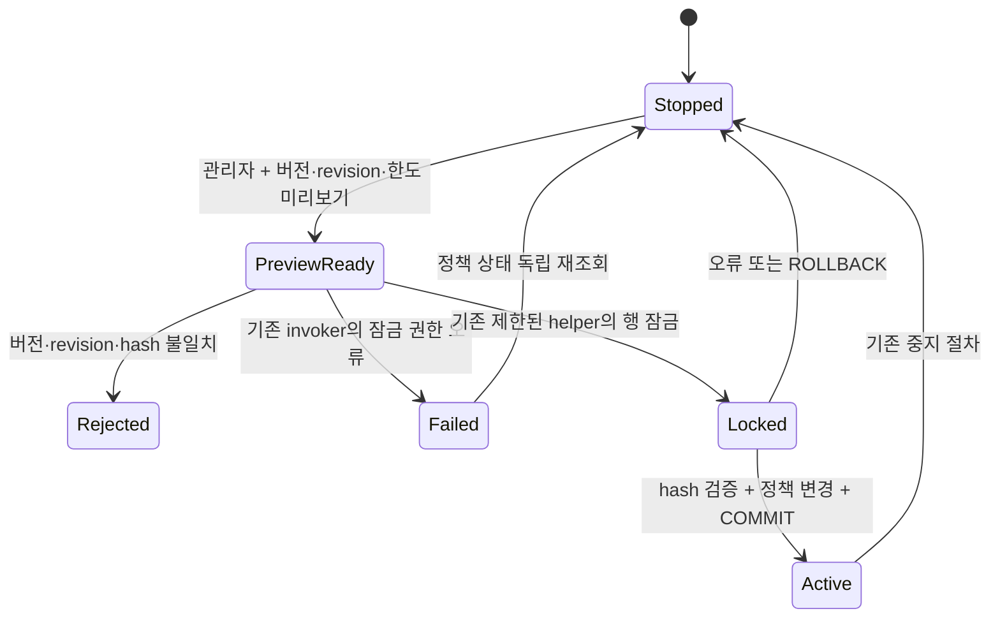

# 맛집 자동 승인 활성화 잠금 오류

## 실제 운영 관측

운영 소스 `6ccd33d5ccc09e607e8053a883087a9d0f3eab77` / 배포 `dpl_4ppHwfZBk4yaiVCEAoG2Y1aaZqoU`에서 기존 한도 50/50의 후보 미리보기는 성공했지만 자동 승인 시작 요청 1회는 고정 오류로 끝났다. 같은 요청을 재전송하지 않았다. 2026-10-24T15:40:36.531Z의 인증된 브라우저 GET 재조회는 `enabled=false`, `version=1`, 회당 50·하루 50, 정책 이벤트 0, 대기/실행/실패 큐 각각 0이었다. 실제 HTTP 오류 상태는 확보하지 못했다. 이 관측은 비활성 상태의 증거이며 불확실한 요청의 범용 rollback 증명은 아니다.

PostgreSQL 17에서 행 잠금 절은 SELECT에 더해 UPDATE 권한을 요구한다. FOR SHARE로 바꿔도 이 권한 조건은 남는다. [공식 SELECT 문서](https://www.postgresql.org/docs/17/sql-select.html)

서비스 역할은 revision 테이블의 SELECT만 허용받고 UPDATE는 거부된다. 기존 `SECURITY INVOKER` configure는 이 역할로 revision 행에 `FOR UPDATE`를 실행한다. 기존 수동 검수는 이미 설치된 무인자·고정 행 잠금 helper를 호출한다. helper는 postgres 소유 SECURITY DEFINER, 빈 search_path, 잠금 timeout 2초이며 PUBLIC/anon/authenticated에는 실행 권한이 없다.

실제 운영 catalog와 PG17.6 재현의 configure·helper·bump 본문 SHA가 일치했다. bump는 `ed162268…`이며 별도의 safeupdate forward는 이 작업에서 실행하지 않았다. 운영 사용자 행은 복사하지 않았다.

## 상태와 불변식

유지할 조건은 관리자 검증, 현재 버전·revision·한도에 결속된 preview hash, commit 시 버전 1 증가, commit까지 revision 잠금 유지, 기존 한도 보존이다. service_role에 revision UPDATE를 부여하지 않는다. 실패 응답만으로 미적용을 단정하거나 자동 재전송하지 않는다. 이 도식은 실제 실행 경로의 명세이며 모든 입력·스케줄에 대한 형식 증명은 아니다.

## 재현과 검증 범위

합성 사용자 3명과 기본 singleton 행의 PG17.6 clone에서 원본 preview는 성공하고 start는 `42501`로 실패했다. 잠금 호출 한 줄을 기존 helper 호출로 바꾸면 commit 후 독립 조회가 `true/version2/50/50`, 이벤트 1로 바뀌었다. stale version/hash·재사용은 거부됐고 anon/authenticated·비관리자·disabled 관리자는 거부됐다. service_role의 직접 revision UPDATE도 계속 거부됐다.

늦은 오류와 정상 start의 rollback은 함수·정책 변경을 되돌렸다. configure 반환 후 COMMIT 전 다른 revision writer는 `55P03`으로 거부됐고, COMMIT 뒤에는 성공했다. 먼저 revision을 변경한 writer가 commit하면 기다리던 activation은 오래된 preview를 거부했다. 이 결과를 운영 활성화나 생성 성공으로 확장하지 않는다.

최초 설치 초안은 postgres가 G014 assertion을 직접 호출해 별도의 `42501`을 냈다. 정확한 4,382바이트 실행 실패와 변경 없는 결과를 보존했다. assertion 권한을 넓히거나 검사를 생략하지 않고 기존 owner 소유 임시 검증 bridge 방식으로 보정한다.

| 증거 | SHA-256 |
| --- | --- |
| 운영 요청·독립 상태 조회 | `04af79451a3a1437b91745502507e62ad4cc483ab56de86d962f9d405ce5006e` |
| 운영 configure/helper catalog | `7c8fd401a1eb4eb37939e5ef9171de1d89d5cd4143a4ca318e0623e68290f1ca` |
| 운영 bump catalog | `e72a170ba15dd17e0d0132f7225495d52a79f03207d7cc370e5f7ac1bfc066e5` |
| PG17.6 기능 재현 | `de2afbbed040e7304ce9b6d779a3c7cbbe677c6802d2c850f83f3f04ce69eb08` |
| PG17.6 COMMIT 잠금 경계 | `b99fb6d60afc693f88b621b956668d45765c1c32c9139f62a5eb29b320226e26` |
| 최초 설치 초안 실패 | `7d1830a275d46efe53754729868d617cc7045c1aef1f6f8ac447f86a09134ceb` |

이는 결정적 계약·분기 검사다. 무작위 표본의 개선율·95% 신뢰구간, 운영 처리량·비용 절감은 측정하지 않았으므로 주장하지 않는다.

## 운영 적용 순서

예산 PR #3519의 보호 브랜치 승격과 별도 90→91 설치·독립 reconciliation 뒤, 이 forward의 정확한 91→92 계약을 새로 확인한다. 새 prior 91의 예상 digest는 운영 90행과 고정 budget 원문 vector를 read-only로 결합해 계산한 `fa0d91d7badd9ae960938fbb49a153d1b11eed77c147a869fd752bfb411c84e0`다. 이는 실제 91행 관측이 아니며 실행 직전의 정확한 prior 검사를 대신하지 않는다. 기존 draft·manifest·적용 migration·입력 한도는 변경하지 않는다.

운영 SQL은 원래 attempt의 단일 durable journal, 공통 serializer → compiler 원장 잠금 → 전체 G014 pre/post → terminal → COMMIT 순서를 보존한다. 불확실한 결과는 원래 attempt를 재조회한다. 수정 후 기존 화면의 새 미리보기에서 한도 50/50을 재확인하고 활성화를 한 번 수행해 정책·이벤트를 독립 재조회한다. 현재 운영 활성화는 미완료다. 외부 Pro→Gemini→Pro 검토도 기존 예약을 보존한 채 미완료로 남아 있다.

## 보정 v2와 소스 결속

보정 v2는 기존 owner 소유 `pg_temp` bridge만 생성하고, bridge 생성에 쓴 self-granted SET-only membership을 **G014 pre 전에 회수**한다. configure 본문 패치 동안 owner lease는 없다. 모든 membership·assertion 전체 metadata·roles·default ACL·기존 helper·pipeline 테이블 ACL/RLS와 namespace metadata를 전후 비교한다. 영구 assertion 권한과 service_role 테이블 권한을 늘리지 않는다.

정확한 v2 **16,677 bytes / 4문장**, SQL SHA `16da1c813db1cda3565bfe6f2f13c7c341667774215162956645d8d340ba1703`, vector SHA `65b506ca4d44ba47b96d5b2efa6c6b593d56bfe2db1f4226cf0069aaf3997c91`로 PG17.6 clone의 원장 **91→92**를 실행했다. 원장 삽입 뒤 강제 실패 시 전체 prior가 복원됐고, commit 뒤 원문 vector와 독립 readback/reconcile가 일치했다. autocommit·살아 있는 lease·helper/body/ACL/ledger drift와 재적용은 거부됐다. forward 내부 G014 pre 4개와 post 4개, 별도 네 시점의 전체 assertion도 통과했다. 실행 영수증 SHA는 `f923e9f95304ae8616c90437a35ca6d5518c87c346f6cf97b3feffdbeff72786`다. 설치 검증 뒤 기능 검사용 합성 사용자 3명과 기본 singleton 행을 추가했다. 설치와 기능 검증의 입력은 구분하며 실제 운영 caller/admission 증거로 확대하지 않는다.

새 [disabled 설치 manifest](../../.github/review-activation-lock-installation.v1.json)는 운영 RR/RO catalog 관측의 16개 필드에 결속한다. clone과 function/assertion metadata는 모두 같았고, ledger 상태 외에는 `rolesDigest`·`defaultAclDigest`가 달랐다. 새 manifest는 실제 운영 digest를 보존하며 clone에 맞추는 DDL을 하지 않는다. 미래 prior91 digest는 앞선 read-only 계산에 결속한다. 실제 운영91 관측과 새 실행 admission은 여전히 필요하다. Root는 해당 manifest와 정확한 candidate에서 공식 parser/compiler를 별도 inspect해 4문장·vector·91→92 계약을 확인했다(DB 호출 0).

현재 기본 migration/thumbnail/budget caller는 새 manifest를 허용하지 않는다. 과거 caller에 override를 넣거나 manifest를 true로 바꾸는 방법으로 적용하지 않는다. 별도 source-bound 단일 attempt 실행과 독립 reconciliation을 준비한 뒤 보호 브랜치·선행91·fresh 운영 검사를 거쳐 적용한다. 적용되지 않은 source 후보와 로컬 검증 결과를 운영 완료로 표시하지 않는다.

## 고정 운영 caller 구현

새 [caller](../../apps/web/scripts/review-activation-production-successor.mjs), [collector](../../apps/web/scripts/review-activation-operating-collector.mjs), [별도 release admission](../../.github/review-activation-production-successor.v1.json)을 구현했다. 원본 disabled manifest와 frozen caller는 보존한다. 새 release도 protected main·현재 인증 owner·정확한 source/target/vector·15분 admission·60초 privileged-writer fence가 없으면 실행하지 않는다.

prepare만 원래 budget attempt의 ledger91 committed reconciliation을 호출하고 원래 admission·전체 journal·첫 journal 항목의 SHA를 새 선행 영수증에 결속한다. activation의 ledger92 reconciliation은 보존한 영수증을 읽으며 budget caller를 다시 부르지 않는다. native OS HOME의 고정 custody를 exclusive private 파일·부모 fsync로 발행하고, durable 시작 journal 이후 단일 전송만 허용한다. ACK 유실·불완전 publication·부분 journal append는 삭제·덮어쓰기·재전송 사유가 되지 않는다. CLI path/SQL/transport override와 자동 writer resume는 없다.

영향 suite **23 tests / 272 assertions / 0 failures**가 통과했다. 실제 parser/compiler·파일·fsync·admission 검증을 사용했고 owner/source/transport는 테스트 DI다. 새 코드 3파일 lint와 Node24의 두 script syntax 검사도 통과했다. Root는 실제 loader/release inspect를 독립 확인했다(DB 호출 0). 이 검증은 운영 전송과 운영 caller의 실제 admission/readback 증거가 아니다.

재현 명령: `apps/web`에서 `bun test tests-unit/review-activation-production-successor.test.ts`. 기존 passing PG 검증은 새 caller 검증 때 반복하지 않았다. 별도의 guarded 운영 전송·독립 reconciliation·UI 활성화 결과는 실행 후 추가한다.

## 2026-10-25 운영 적용 — 원장 91→92 확정

앞선 미적용·준비 상태와 재현 결과는 당시의 이력으로 보존한다. 이후 [PR #3519](https://github.com/twoimo/tzudong/pull/3519) → [#3520](https://github.com/twoimo/tzudong/pull/3520) → [#3521](https://github.com/twoimo/tzudong/pull/3521)의 정상 승격으로 develop `c336aadc4011750c5151274cfd041f78d4a6894d`, data `9af12489c0c2392ab737d8cc7fe12d9b9c4455a2`, main `7b287e2d4f74f5ab81ea811e2499aecda146b790`이 결속됐다. 실제 GitHub 조회에서 main source tree `81afa98720043e3c45c8da710760d3bd24a03ad4`와 세 PR의 필수 Release·Promotion Path 성공을 확인했다. 보호 승격 조회 영수증 SHA-256은 `f160f5245c687302dd1f0dac6b5459f6e43fbc3338558edae07aa7601eb2387a`다. 선택 체크 일부의 당시 진행 상태를 전체 CI 완료로 바꾸어 해석하지 않는다.

선행 budget attempt `3bfe3ef2-c133-4b7a-b341-8c61f1174642`는 **90→91 committed** 뒤 같은 attempt의 독립 read-only reconciliation으로 확정됐다. 그 보존 영수증에 결속한 activation의 원래 attempt는 `10dcd54e-c25b-46e9-8144-d3391f584df8`다. 같은 main에서 설치 manifest `02d6af9397da4900ee9cd11047ea2481d64c47ead931597dd8c336b89dc24815`와 별도 고정 release를 사용했다. 2026-10-25 **01:37:33–01:37:47 KST**의 native apply는 `status=committed`, `code=REVIEW_ACTIVATION_COMMITTED`였고, **01:38:30–01:38:33 KST**의 독립 read-only reconcile은 같은 attempt의 `status=reconciliation`, `disposition=committed`를 반환했다. 두 실행 모두 exit 0, `replayAllowed=false`다. 정확한 manifest의 **원장 91→92 terminal**에 결속한 운영 증거이며 로컬 PG 검증과 구분한다.

| 운영 영수증 | SHA-256 |
| --- | --- |
| 원래 attempt의 native apply | `2bc56be5ddb54a5fca116d53e4823888a552c327851379002eeaefed359a21f8` |
| 같은 attempt의 독립 read-only reconcile | `775eda5d4de8d63a69af507c4e4e2f3fb135e0ad2fa41e1f59390abea11f609f` |

원본 영수증의 바이트 해시·attempt·결과를 직접 확인했다. 각 실행의 provider 호출은 0이며 raw diagnostics는 보존하지 않았다. 원본 private 경로와 민감값은 공개하지 않는다. disabled 설치 manifest와 과거 frozen 파일은 수정하지 않았다. 이 적용은 configure의 기존 잠금 helper 호출 복구이며 정책을 활성화하거나 한도를 바꾸는 작업이 아니다.

현재 원장은 **92**다. activation reconcile은 원래 선행 budget 영수증을 사용하며 budget caller를 다시 호출하지 않는다. 기존 thumbnail/budget의 exact terminal 90·91을 현재 원장에 재적용하지 않고 양쪽의 원래 admission·journal·committed 영수증을 유지한다. 문서 갱신을 위해 운영 명령을 다시 실행하거나 새 attempt를 만들지 않았다.

웹 배포와 실제 UI 활성화는 아직 별도 완료 증거가 필요하다. 이 절 작성 시 main `7b287e2d…`의 웹 배포는 `BUILDING`으로 전달됐으며, 마지막 UI 조회는 `enabled=false`, `version=1`, 회당 50·하루 50이었다. 해당 배포의 완료·실제 소스 응답, 새 preview 후 활성화와 정책·이벤트의 독립 readback은 후속 작업으로 남긴다. 원장 92나 SQL committed 결과를 UI 활성화·자동 승인 처리 성공으로 표시하지 않는다. 외부 Pro→Gemini→Pro 검토는 기존 예약을 보존한 채 미완료이며, 운영 개선율·95% 신뢰구간·처리량이나 비용 절감은 주장하지 않는다.

## 웹 배포와 실제 활성화 확인

2026-10-25 01:55:57 KST에 배포 `dpl_GqkcM5Cv9Smf81c1KM2PoQTxARGV`의 READY와 운영 도메인 연결을 독립 확인했다. 인증된 Chrome에서 `www.tzudong.app/api/health`도 같은 배포 ID·main `7b287e2d4f74f5ab81ea811e2499aecda146b790`·정확한 프로젝트를 반환했다. 기존 운영 배포 `dpl_4ppHwfZBk4yaiVCEAoG2Y1aaZqoU` / `6ccd33d5…`를 rollback 대상으로 보존했다. 기존 승인 SHA 항목만 갱신했고 모델·자격증명·한도·보호 브랜치 설정은 바꾸지 않았다.

운영 관리자 화면에서 새 preview의 후보 0·재검수 0·보류 0·보호 0, 회당 50·하루 50을 확인했다. **01:56:53 KST**에 시작을 한 번 실행한 뒤 **01:57:02 KST**에 별도 GET으로 `enabled=true`, `version=2`, 정책 이벤트 1을 확인했다. 이전 값은 false/1/0이었다. Gemini 3.8 Flash·필수 판단·claim당 최대 1회 계약과 50/50 한도는 유지됐다. 이것은 활성화 저장의 증거이며 실제 판단·승인 처리나 지도 마커 게시 성공은 아니다. 해당 재조회에서 실행·처리 항목은 각각 0이었다.

민감값을 제외한 [운영 적용·웹·정책 영수증](../evidence/provider-review-operating-20261025/operating-readback.json)의 SHA-256은 `f80f4e3701478aa0d65c8dfeb2de9afb1ba2f20991a3f42468f17993785d720e`다. 운영 SQL을 재전송하지 않았으며 이전 caller의 exact-terminal 재조회도 다시 실행하지 않았다. 기존 예약의 외부 교차 검토와 실제 다음 크롤러 배치 결과는 별도 미완료 상태다.

같은 배포의 인증된 데스크톱(1920×929)에서 사이드바 15개 메뉴를 모두 눌러 데이터를 기다린 뒤 조회했다. 최종 15/15 화면에 H1·18px/650/24px 제목이 있었고 가로 넘침·비어 있지 않은 오류 알림·캡처된 console error는 각각 0이었다. 사이드바 접기/펼치기의 `aria-expanded=false→true`와 메뉴 15개 복원도 확인했다. 실제 테이블 행은 맛집 1,659·제보 3·리뷰 6·사용자 22·배너 4·오류 5·감사 로그 14였다. 이는 화면·조회 범위이며 모든 수정/삭제·유료 생성·모바일·marker 게시의 통과 증거가 아니다. [메뉴별 최소 영수증](../evidence/provider-review-operating-20261025/admin-browser-readback.json), SHA-256 `8daa2abe40d0307b106d75dc99048e6b285b78c1d6e72c21dc7b634ad4a6629b`에 범위와 남은 hold를 명시했다.
