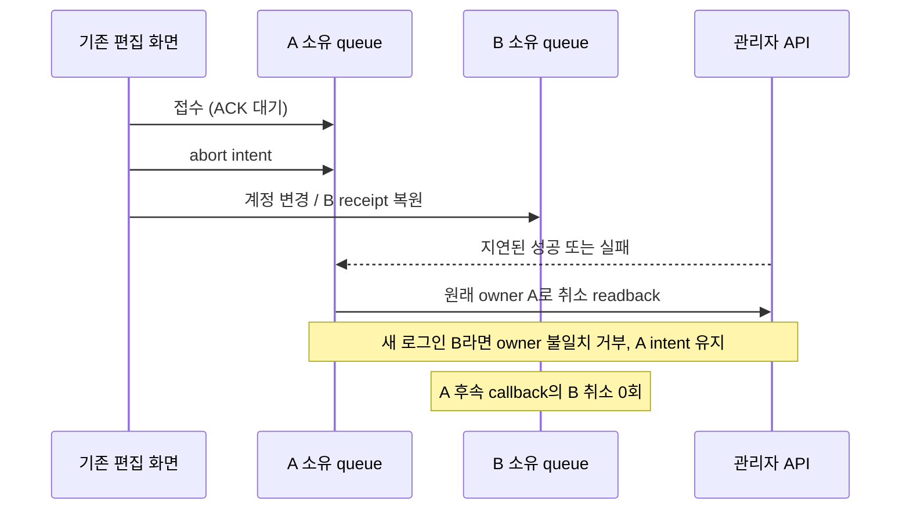
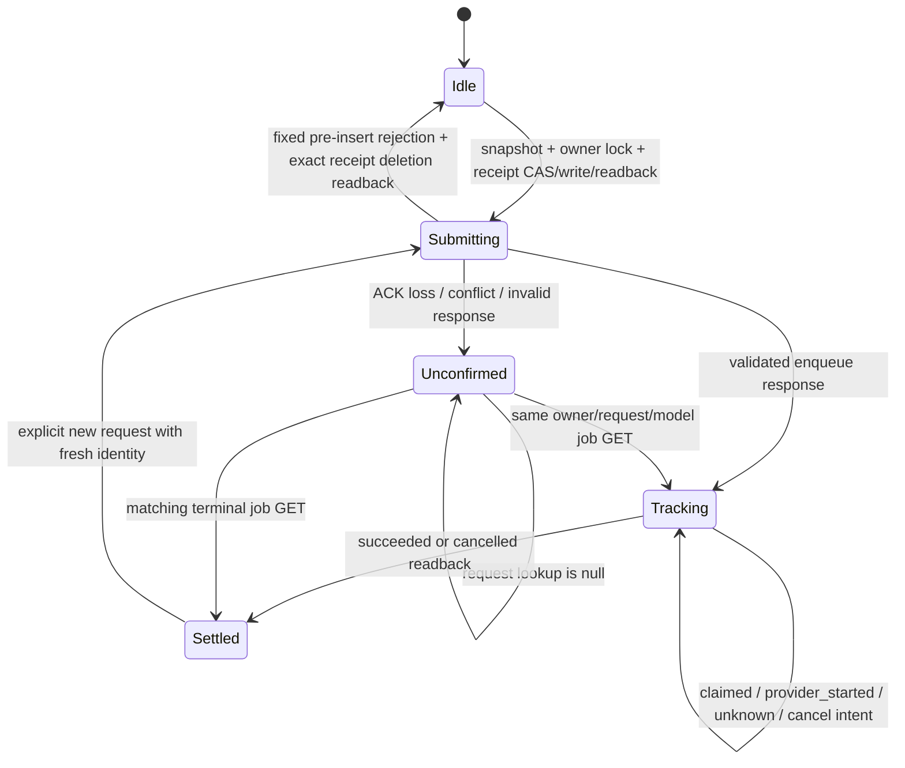

# Gemini thumbnail browser queue — connected local candidate

기존 `AdminYoutubeThumbnailGenerator.tsx`의 이미지 생성·상태·취소·이력을 새 Gemini 작업 큐에 연결했다. 자동 참조는 고정 쯔양 채널의 수집 메타데이터에서 최대 32개 후보를 읽고 실제 이미지 최대 2장을 준비한다. 전체 썸네일 참조이며 얼굴 추출 결과가 아니다. **운영 SQL/Storage/worker 설치·보호 브랜치 반영·운영 검증은 미완료다.** 레거시 텍스트 채팅 backend는 별도 Gemini 이행이 남아 있으며, 이미지 API 폐기만으로 모든 LLM 이행 완료를 주장하지 않는다.

## 편집기 연결 후 취소 반례

| 실제 순서 | 위험 | 수정·재현 검증 |
| --- | --- | --- |
| A 접수 ACK 지연 → 중단 → B 계정/receipt 복원 → A 응답 | 늦은 UI callback이 현재 B queue를 취소 | submit의 finally가 캡처한 A queue만 사용. 오래된 cancel callback도 owner 변경 뒤 무동작. 실제 React hook/Chrome의 성공·503 ACK 두 경우에 B 취소 POST 0회. 제거된 late-current-cancel 대조군은 B 취소 1회를 검출 |
| ACK 유실 → cancel의 조회 null → 취소 intent 저장 → 늦은 queued commit → reload/resume | intent가 화면만 보호하고 서버에는 전달되지 않음 | 같은 owner/request/model readback 뒤 저장된 취소를 별도 POST. 새로운 generation POST 없이 cancelled readback. 시작 전 취소와 시작 후 취소 flag는 구별 |

편집 문서는 최대 64개 레이어·48,000 UTF-8 bytes의 고정 schema로 검사하고 immutable private `input/editor.json`을 enqueue 전에 저장·readback한다. 실패하면 새 job을 접수하지 않는다. prompt/참조 digest와 owner/request가 일치하는 문서만 이력에서 복원한다. 원본·정규화 이미지와 편집 레이어를 분리하므로 원본 다운로드와 PNG 편집 export를 유지한다.

모든 레이어·문구·원본 변경과 이력 선택은 동기 revision을 증가시킨다. 실제 편집기/Canvas/프로젝트 CSS를 격리 Chrome에서 실행해 같은 revision 결과만 자동 적용, 뒤늦은 결과의 새 편집 보호, reload의 자동 적용 차단, 저장 문서 복원, PNG export와 취소 readback을 검증한다. 1440/768/390px에서 document 가로 넘침과 캔버스 최소 표시 크기를 검사한다. 모바일 도구는 한 줄 스크롤로 바꿔 버튼 그리드가 캔버스를 밀어내는 문제를 수정했다.

taste inspector 원본 결과는 보관한다. 그 도구의 `few-pictures`/`still-page` FAIL은 canvas 편집 도구를 랜딩 페이지로 평가한 규칙으로, 사진 4장·자동 진입 애니메이션을 추가하지 않았다. 이는 inspector pass가 아니다. Auth/API·생성 결과는 합성 seam이고 Next Image는 얇은 img seam이므로 전체 Next runtime·운영 로그인·Storage·실제 모델 호출의 증거가 아니다.

이번 연결의 수치: 대상 Bun 14파일 **226 pass / 0 fail / 1,787 assertions**, 실제 PG17.11 **27 methods pass / 0 fail**, native/compat type parity **3,417 logical inputs / diagnostics 0**, 대상 ESLint 오류·경고 0. Chrome의 document/viewport 폭은 각각 **1440/1440, 768/768, 390/390px**이며 캔버스 표시 크기는 **970×544.75, 638×358, 348×194.875px**였다. 이전 모바일 화면에서는 도구가 캔버스를 밀어내고 있었으며, 이 비교는 같은 기능 후보의 렌더링 결함 확인이다. 실행 시간은 검증 영수증에 보관하며 속도·비용·쿼타 절감의 대조 실험이 아니다. 무작위 표본이 없는 결정적 회귀 결과에 95% 신뢰구간을 붙이지 않는다.

재실행은 `apps/web`에서 `bun tests-unit/fixtures/thumbnail-editor-browser.ts`, `bun tests-unit/fixtures/thumbnail-hook-owner-browser.ts`, `bun tests-unit/fixtures/thumbnail-browser-locks.ts`를 사용한다. 첫 fixture에 `THUMBNAIL_RUN_TASTE_INSPECTOR=1`을 주면 원본 inspector 결과도 보관한다. PG 검증은 프로젝트 Python으로 `backend/supabase/tests/test_thumbnail_gemini_queue_pg17.py`를 실행하고 소유 cluster 종료·PID/socket 부재·TCP 닫힘을 별도로 확인한다. 증거와 source hash는 `thumbnail-editor-connected-20261023/` 체크포인트에 결속한다.

## 재현과 수정

native peer가 지적한 두 반례를 실제 candidate client에 재현했다. `browser-baseline-races.log`는 **2 fail / 0 pass**이며 당시 source/test bytes는 `browser-races-baseline-manifest.json`에 보존했다.

| 반례 | 원인 | 수정·검증 |
| --- | --- | --- |
| 같은 owner의 두 controller가 요청 receipt를 잃음 | 각 instance의 busy flag만 있고 다른 요청이 저장한 receipt를 고정 400 응답 뒤 무조건 삭제함 | owner 이름의 native Web Lock, 쓰기·삭제 전 현재 receipt와 정확한 비교. stale controller 및 비참여 writer 대체 검증 |
| 입력 충돌 뒤 과거 결과가 새 문구에 적용됨 | 이전 requestId의 결과를 GET으로 읽으면 새 revision에 대한 자동 적용 자격까지 부여됨 | 현재 receipt ID 재사용 금지. 자동 적용 자격은 성공한 enqueue 응답에만 부여하며 GET 복구가 되살리지 않음 |

추가로 lock admission이 비동기라 입력을 잠금 내부에서 복사하면 대기 중 편집을 잘못 접수할 수 있는 source 위험을 제거했다. 입력 JSON과 immutable File 순서는 **첫 await 전에** snapshot한다. 이 항목은 위 두 baseline 실패와 별개의 검토·회귀검증이며, 과거 운영 장애가 재현됐다고 주장하지 않는다.

## 상태와 소유권

`unknown`과 `cancelRequested`는 terminal 상태가 아니다. 관찰을 중단하거나 탭을 닫는 것은 취소 RPC가 아니다. cancel은 intent를 먼저 저장하고 requestId로 job을 찾은 뒤 별도 POST와 상태 readback을 사용한다. null 조회, 409, 5xx, malformed 응답, 통신 실패 뒤에는 POST 재전송·새 requestId 발급으로 복구하지 않는다. API가 삽입 전에 내보내는 고정 `invalid_request`/400, `request_too_large`/413, origin/owner 거부/403만 receipt 삭제가 가능하다. 다른 storage 값이 들어오면 삭제하지 않는다.

저장하는 필드는 requestId, model, editorSessionId, editorRevision, cancelRequested뿐이다. prompt, File bytes/name, 키, cookie와 session token은 browser receipt에 넣지 않는다. 생성 input/original은 기존 server-side immutable 계약을 따른다. receipt storage는 UI의 기존 세션 정책에 맞게 선택해야 하며, 임의 보관 기간이나 자동 삭제를 추가하지 않았다.

자동 적용은 같은 job, 같은 editor instance/session, 같은 revision, 취소 intent 없음, 그리고 해당 instance가 성공한 enqueue 응답을 직접 받은 경우에만 허용된다. reload나 불확실 ACK 뒤 복구한 결과는 이력에서 사용자가 선택한다. UI 연결의 로컬 검증과 사용자 운영 화면의 해결 여부는 별개다. 서버 또는 polling 지연 사이에 worker가 이미 시작할 수 있으므로 모든 취소가 비용 없이 실행된다는 주장은 하지 않는다.

owner Web Lock은 전체 receipt 변경과 단일 네트워크 시도를 감싼다. 잠금을 사용할 수 없으면 fail closed하며 per-instance mutex로 조용히 낮추지 않는다. `admission` 주입은 검증 harness용이다. 운영 UI는 이를 주입하지 않고 native 잠금을 사용해야 한다. 잠금 의미는 [Web Locks draft](https://www.w3.org/TR/web-locks/)와 [request API](https://developer.mozilla.org/en-US/docs/Web/API/LockManager/request)를 확인했다. 이 잠금은 같은 origin의 협력하는 context에 대한 것이며, 다른 브라우저·root/www origin·device·비참여 script 전체에 대한 전역 exactly-once 보장은 아니다.

## 이전 ec61a46c 프로토콜 체크포인트의 실행 증거

원본 증거 폴더: `/Users/twoimo/.codex/visualizations/2026/10/18/01a14e99-c202-7fa1-90c1-2e9cb7da815f/thumbnail-outbound-worker-20261023`.

| 경계 | 관측 | 한계 |
| --- | --- | --- |
| Bun 1.4.0 대상 suite | **201 pass / 0 fail / 1,673 assertions / 13.49s**, 7 files. 이 중 browser client 19개 | synthetic response/storage/admission을 사용하는 unit 사례 포함 |
| 실제 PG17.11 | **26 methods pass / 0 fail / 17.312s**, 16 covered source hash 검사 전후·최종 checkout 일치 | owned clone, psql RPC adapter. hosted PostgREST/Auth/Storage 증거 아님 |
| PG의 API/store/client method | 14개 journey. 기존 outbound 7개 + 새 browser protocol 3개 포함 | provider와 Storage는 synthetic, browser admission 주입됨 |
| 새 normal·enqueue ACK loss journey | browser POST 1, enqueue RPC 1, SDK 1, start 1, complete 1 | 실제 과금 호출 0 |
| 새 cancel ACK loss journey | browser POST 1, cancel POST 1, SDK 0, start 0, terminal cancelled readback | 실행 전 취소 fixture이며 실행 중 무료 취소 보장 아님 |
| 실제 Chrome 156.0.8078.47 | actual browser bundle, 두 page의 native Web Locks 배제, stale receipt 보존, 수정된 revision·reload 자동 적용 차단, locks 미지원 차단 | 격리 profile + loopback synthetic API. 실제 관리자 UI rendering/운영 로그인 증거 아님 |
| TypeScript native/compat | Node 24.22.0, **3,413 logical inputs / diagnostics 0** | 브라우저 동작·운영 설치 증거 아님 |
| 대상 ESLint | 오류·경고 0 | 전체 저장소 lint라고 주장하지 않음 |
| virtual source negative controls | 누락 조회 후 재접수, 편집 fence 제거, receipt 삭제 CAS 제거, 쓰기 CAS 제거 **4/4 의도한 실패 검출**, 실제 checkout hash 불변 | 선택한 bounded guard 검증. 전 상태·환경 증명 아님 |

공유 schema의 prompt byte limit는 `Buffer.byteLength` 대신 `TextEncoder`로 검사한다. 실제 browser bundle 및 Buffer 없는 child에서 한국어 prompt parsing을 실행했다. 제한 65,536 UTF-8 bytes는 바꾸지 않았다.

PG receipt SHA-256: `6f08ae1120b0bc3a41acfc67139b36977c25c7925dbf7e39b241f02b83e58b9a`. 소유 PG PID 93751 종료, pg_ctl status 3, PID/socket 없음, TCP 닫힘을 readback했다. native browser도 종료했다. runtime source에는 negative control을 직접 쓰지 않았다.

결정적 회귀 검증의 통과/실패에 95% 신뢰구간을 붙이지 않는다. 운영 latency·처리량·비용·quota 절감은 측정하지 않았으며 개선율이나 운영 성과로 환산하지 않는다.

## 남은 delivery gate

1. 기존 편집·보관 히스토리를 유지하면서 Gemini queue/status/protected original·normalized result를 연결한다. Gemini proof를 `local-codex/gpt-image-2/exact`로 바꾸지 않는다.
2. 현재 Vercel 경로가 생략하는 자동 쯔양 참조 검색을 생산 환경에서도 제공한다. 선택한 **실제 bytes·역할·순서**를 접수 전에 확정한다. 전체 썸네일을 host reference로 쓰는 기존 동작은 host crop·추출 성공 증거가 아니다. 업로드 전용/food-only UI로 요구를 축소하지 않는다.
3. legacy 보관 decoding/editing을 유지하고 OpenAI/LocalCodex/AnyCap 실행을 제거한다. 현재 운영에서 제거됐다는 증거는 없다.
4. 현재 hosted G014 catalog에 묶은 forward migration/private bucket/최소 worker provisioning과 필수 Pro→Gemini maximum→Pro reverse material-delta 감사를 끝낸다. 원래 7개 owned waiting 예약을 유지하며 중복 dispatch/force release/낮은 모델 대체를 하지 않았다. 예약 readback은 provider 실행 liveness 증거가 아니다.
5. 기존 운영 승인을 재요청하지 않고 필수 CI와 보호된 develop→data→main, rollback SHA, 정확한 Vercel 배포 SHA, 실제 관리자·Mac worker·생성/취소/원본 이력 readback까지 마친다. 아직 push·merge·DDL·배포·worker 활성화를 하지 않았다.

기존 전체 목표와 crawler/OCR/storyboard/KG/CMS/CI 작업은 이 client 구현으로 완료되지 않는다. 관련 경로와 다음 소유 작업은 별도 goal checkpoint에 남긴다.
