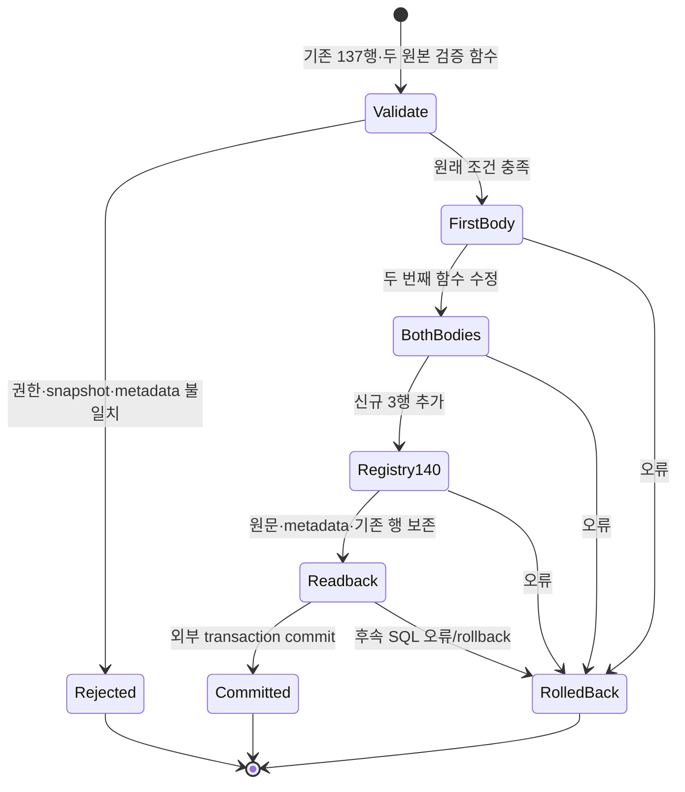
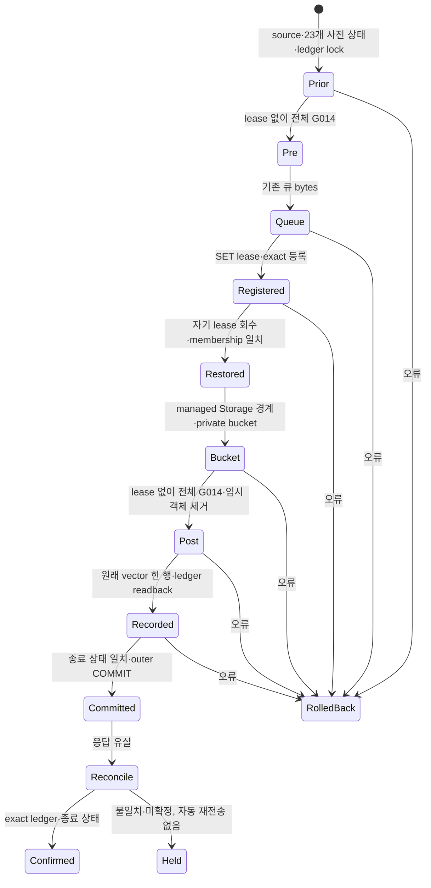
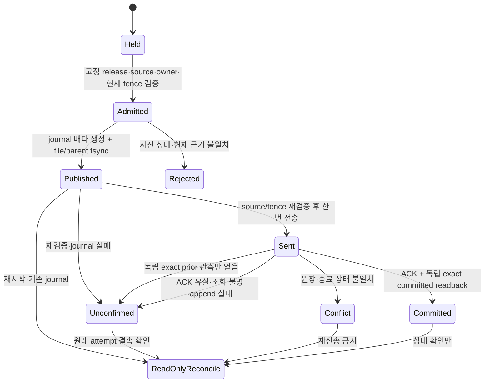
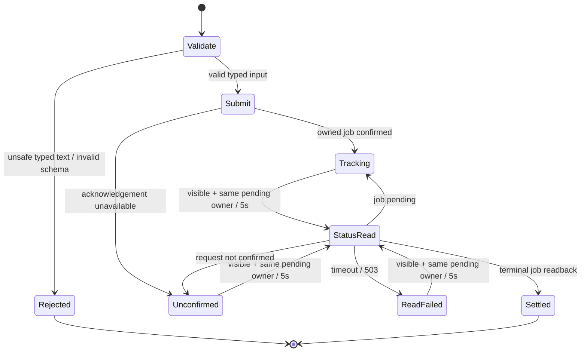

# 썸네일 G014 등록·설치와 운영 후속

[등록 SQL](../../backend/supabase/candidates/20261024_thumbnail_g014_registration.sql)은 기존 썸네일 큐 후보의 신규 RPC 3개를 현재 G014 분기와 등록부에 연결하는 **companion 후보**다. applied migration·고정 실행 명세는 수정하지 않는다. 큐·bucket·ledger를 설치하는 forward 명세나 전체 G014 인증은 아직 아니다.

기준은 [읽기 전용 source snapshot](../../backend/supabase/tests/fixtures/thumbnail-g014-hosted-preimage-20261024.json)의 기존 등록 137개와 두 검증 함수다. 등록 행 snapshot은 2026-10-23 자료이고, 2026-10-24 06:57:51 UTC 단일 읽기 조회에서 PG17.6의 전체 137행 digest와 두 함수 본문 SHA가 기준과 같음을 다시 확인했다. 해당 caller의 BYPASSRLS=true도 확인해 정책으로 가려진 137행만 센 경우와 구분했다. role/schema/table/policy 메타데이터는 별도의 10월24일 읽기 조회와 대조했다. [읽기 영수증](../evidence/thumbnail-g014-registration-20261024/hosted-preimage-readonly-065751.json)은 실제 assertion 실행·설치 admission·writer fence나 나중 적용 시점의 일치를 증명하지 않는다. 실행 시 기존 137행 digest가 다르면 수정 없이 거부한다.

## 실제 변경과 경계

신규 identity는 `thumbnail_production_auth_worker(text)`, `thumbnail_production_admin(uuid,text,uuid,uuid,text,text,jsonb)`, `thumbnail_production_worker(text,text,uuid,uuid,bigint,text,jsonb)`다. `identity_arguments`는 사람이 읽는 타입 목록이 아니라 실제 `pg_proc.proargtypes::text`에서 생성한다. 등록은 `service_role` 한 grantee만 추가한다.

현재 두 assertion의 service-only invoker 분기 25개에 위 세 identity만 추가한다. 원래 본문에서 추가 문자열을 제거하면 원문과 정확히 같아야 하며, 함수의 본문 외 `pg_proc` 메타데이터는 같아야 한다. 기존 137행과 registry/schema의 소유자·ACL·RLS·정책·제약·trigger, 역할·membership은 유지한다. 신규 RPC의 실제 본문 SHA·언어·반환형·인자 이름/기본값·함수 속성·search_path·소유자·최소 EXECUTE ACL을 확인한다. overload와 browser/PUBLIC 실행, grant option은 거부한다.

실행자는 비슈퍼유저 `postgres`와 별도로 검증해 제공한 owner SET lease를 요구한다. 후보는 역할을 생성하거나 lease를 부여하지 않는다. 임시 role 전환은 성공 후 `postgres`로 되돌린다. **전체 G014 pre와 post는 모두 SET lease가 없는 상태에서 실행한다.** 현재 owner 계약은 self-granted membership을 거부하므로, 등록 후 자기 grantor의 lease를 먼저 회수하고 원래 membership을 확인한 뒤 post를 호출해야 한다. 기존 `supabase_admin`의 ADMIN-only bootstrap 행은 보존한다. assertion 실행에는 기존 forward의 owner 소유 `pg_temp` bridge 패턴을 재사용할 수 있다. 이 회수와 현재 writer fence는 외부 설치 명세의 책임이며, 로컬 fixture가 운영 권한을 증명하지 않는다.

## 상태와 수학적 범위



하나의 DO와 호출자 transaction에서 자기 변경을 보존하거나 되돌린다는 범위다. 성공 시 `(기존 두 본문,137행) → (각 3개 identity만 추가한 두 본문,140행)`이고 오류 시 입력 상태를 보존한다. 이미 입력이 drift한 경우 그 상태를 임의로 정상화하지 않는다. 이 그림은 전체 시스템 형식 증명이나 다른 모든 reader의 관측·임의 DDL writer에 대한 보장이 아니다. advisory lock은 협력하는 등록 호출만 직렬화하므로 실제 설치에는 별도 writer fence가 필요하다.

집계 전 visible row 138개를 제한 조회해 정확히 137개인 경우만 진행하고, 등록 문자열 각 4,096 bytes와 함수 본문/기본값 각 65,536 bytes를 검사한다. 정상 메타데이터가 고정되고 문자열 비교·정렬과 보수적인 부분 문자열 검색을 가정하면 `R≤137`, 행 문자열 길이 `B`, 검증 함수 본문 길이 `L`에 대해 처리 비용을 `O(R·B·log R + L²)`, 메모리를 `O(R·B + L)`로 모델링한다. 물리 MVCC scan·catalog 접근 계획·lock 대기·임의의 privileged DDL은 이 모델 밖이다. 점근적·운영 성능 개선을 주장하지 않는다.

## 실제 검증

```text
/Users/twoimo/Documents/projects/tzudong/.venv/bin/python3 -m unittest backend.supabase.tests.test_thumbnail_g014_contract_pg17
```

실제 소유 PG17.11에서 최초 **16 methods pass·0 fail·0 error**, 2.407초였고, 설치 순서 회귀를 추가한 최종 실행은 **17 methods pass·0 fail·0 error**, 1.303초다. 작업량이 달라 속도 개선으로 비교하지 않는다. 실제 큐 SQL로 신규 RPC를 생성하고 실제 비슈퍼유저 postgres session에서 companion을 commit했다. 기존 137행·신규 3행, 두 assertion의 본문 외 메타데이터와 역할·membership 보존을 확인했다. 동시 호출 2건은 commit 1건·재등록 거부 1건이었다. 두 번째 assertion의 source drift와 외부 후속 오류 rollback, replay, 잘못된 actor/lease/isolation, ACL/RLS/trigger·본문·기본값·반환형·크기·overload drift를 확인했다.

추가 회귀는 현재 운영에서 읽은 `assert_g014_workflow_owner_contract()`의 실제 본문 SHA `345aed9acb1da06262740ef06d81e51855a44c7470aa8b431a23e6fa629aab1d` 전체를 실행한다. 격리 DB의 실제 PG17 membership과 `SET SESSION AUTHORIZATION postgres`에서 lease가 남은 post 순서는 `g014_pg17_workflow_owner_membership_denied`로 거부되고, 자기 grantor의 lease만 회수한 순서는 통과했다. ADMIN-only bootstrap 행 보존과 bridge 자체 제거를 확인했다. 기존 주석의 post→회수 지시를 회수→post로 수정했다. 이 검사는 **owner 함수 전체 한 개의 실행**이며 전체 G014 graph·운영 실행·원자적 설치 구현을 뜻하지 않는다.

두 검증 함수의 실제 선언·metadata lookup·invoker IF 분기를 그대로 추출해 신규 3개 identity에 실행했다. 전체 함수의 선행 helper·기존 137 identity dependency graph는 실행하지 않았다. 이는 **두 branch의 보충 검증**이며 전체 G014나 운영 PG17.6 통과가 아니다.

grant-option guard를 제거한 메모리 변형은 금지된 재위임 권한을 허용했고, 원래 G014 분기 검사가 다시 거부했다. 두 registry digest guard를 제거한 변형은 기존 행의 잘못된 OID 인자 값을 허용했다. 현재 후보는 두 사례를 정확한 고정 오류 사유로 거부한다. 변형은 시험 transaction 안에서만 실행했고 checkout 파일은 변경하지 않았다.

초기 harness의 암시적 ACL과 누락된 probe 문맥 변수 때문에 실패했던 실행은 성공 수치에 포함하지 않았다. 거부 검사는 SQLSTATE뿐 아니라 고정 원인을 비교해 엉뚱한 사전 실패를 통과로 세지 않는다. [증거 summary](../evidence/thumbnail-g014-registration-20261024/summary.json)는 실패·최종 실행을 분리하고 source SHA 및 PID/socket/TCP 종료에 결속한다. 결정적 시험이므로 모집단 95% 구간·비용 절감·운영 성공률로 환산하지 않는다. 운영 쓰기와 provider 호출은 0회다.

## 남은 운영 설치

전체 G014 pre를 큐 생성 **전·lease 없는 상태**에 실행하고, 큐·이 companion·private bucket을 설치한 뒤 **자기 lease 회수 → membership readback → 전체 G014 post → ledger 기록·readback**을 한 새로 검증한 설치 transaction에 결속해야 한다. 큐 후보의 내부 BEGIN/COMMIT은 기존 `migrationEnvelope`로 검증해 제거해야 하며 단순 연결하지 않는다. 아래 새 forward와 실행 비활성 draft가 이 순서를 구현하지만 실제 적용기의 새 admission은 아직 아니다. 뒤의 PG17.6 전체 설치 리허설은 이 로컬 공백을 검증한 후속 증빙이다. 현재 writer fence·credential/worker provisioning, 실제 독립 Pro → Gemini → Pro 검토, 보호 승격 및 배포 후 인증 업무 readback은 계속 미완료다. 기존 7개 외부 예약과 미적용 후보를 유지하며, 이 companion의 로컬 통과로 그 단계를 완료 처리하지 않는다.

## 하나의 새 forward와 Storage 경계 — 운영 미적용

[전체 후보](../../backend/supabase/candidates/20261024071000_thumbnail_production_install.sql)는 **64,927 bytes·43 statements**, SHA-256 `8019c4e7788cf6706094937a5d4111958201793192d918817e824791db471ac2`다. 기존 큐에서 compiler가 검증해 제거한 envelope 외 **30,384 bytes**, companion **16,406 bytes**를 그대로 담는다. applied migration, 기존 고정 manifest 및 역할·managed Storage 권한은 수정하지 않았다.

[draft 명세](../../.github/thumbnail-production-installation.draft.v1.json)는 `executionEnabled=false`다. 실제 caller는 아직 이 draft를 허용하지 않는다. 기존 단일 migration compiler에 전체 source를 그대로 전달하고, ledger의 exclusive lock·정확한 사전 상태·원래 문장 벡터 기록·종료 검사를 사용하는 후보다. 현재 관측한 **89행 prefix**의 digest와 최종 version을 보존하고 신규 한 행만 추가하는 **90행** 종료 상태를 지정한다. 기존 86/97/101 등의 실행 명세를 고치거나 이전 SQL을 재적용하지 않는다. SHA와 관측은 당시 snapshot이며 미래 실행 승인이 아니다.

Storage는 기존 `supabase_storage_admin` 소유와 ACL/RLS·정책 10개를 보존한다. INSERT/SELECT와 별개로 두 lock mode에 필요한 기존 유효 권한을 검사한다. `anon`/`authenticated`의 SUPERUSER·BYPASSRLS·Storage owner USAGE/SET을 거부하며 server 역할은 기존 BYPASSRLS·객체 INSERT/SELECT를 요구한다. 허용 MIME 4개, 최대 **12 MiB**, `public=false`인 `youtube-thumbnail-jobs` bucket 한 개만 만들고 정확히 읽어 확인한다. 기존 정책이 허용하는 bucket은 다른 세 ID뿐이므로 새 bucket의 browser 행은 기본 거부된다. Storage HTTP·서명 URL 동작까지 증명하는 것은 아니다.

실제 발견한 결함은 **동일한 정책이 `search_path`에 따라 다르게 deparse되어 해시 검사가 실패하는 문제**다. source는 `pg_catalog, public`으로 deparser 문맥만 고정한 뒤 원래 local 경로를 복원한다. 읽기 전용 명세는 `is_user_admin`과 `public.is_user_admin`이 들어간 두 **완전한 기존 표현**만 허용한다. 임의 regex 치환이나 느슨한 정책 비교는 사용하지 않는다.



이는 검증할 상태 전이 명세다. **동일한 PostgreSQL outer transaction으로 정확한 source가 실행된다**는 전제에서 commit은 사전 상태·full pre/post·원래 registry 보존·신규 3행·private bucket·lease 회수·exact ledger/종료 검사를 모두 통과한 경우만 허용하도록 설계했다. commit 전 오류의 durable 변경은 rollback되어야 한다. 임의 transport의 source 재조합, 비협력 privileged DDL, 실제 전체 설치 실행의 성공을 이 그림으로 증명하지 않는다. XID local marker는 psql 문장별 autocommit 사고를 두 번째 DO에서 차단하는 보조 장치다.

실제 PG17.11에서 [새 검사](../../backend/supabase/tests/test_thumbnail_install_boundary_pg17.py) **12 methods pass·0 fail·0 error**다. 전체 source의 자동 커밋 오실행 차단, bucket commit 후 별도 연결 readback, 서버 INSERT/SELECT와 browser 두 역할의 SELECT/UPDATE/DELETE 0행·INSERT 42501, 기존 정책/버킷/권한/역할 drift 거부, 늦은 오류의 bucket rollback을 확인했다. 수정 전 deparser 문맥의 메모리 변형은 정상 정책을 잘못 거부했고 현재 source는 입력 경로 4종에서 통과·복원했다. 같은 4종 문맥에서 draft의 실제 SELECT를 실행해 정확한 큐·등록·정책 component 종료 값을 확인했다. 시험 ledger는 **0행**이며 운영 89행 전체 또는 전체 G014를 로컬에서 실행했다고 하지 않는다.

기존 compiler·응답 유실 판정의 Bun 검사는 **21 pass·0 fail·145 assertions**다. draft source·component 6개의 byte hash, 원래 43개 문장 vector, source→ledger→종료 검사 순서와 `committed`/`not_applied`/`partial_conflict` 분리를 확인한다. 현 parent `818b615a` CI는 **24 SUCCESS·1 SKIPPED·실패/대기 0**이며 새 후보의 CI와 별개다.

운영 PG17.6에서 draft의 사전 SELECT 한 번을 실행해 **23개 항목 전부 일치**를 확인했다. 함수 호출·DB 쓰기는 0회다. 로컬 시험의 초기 transaction fixture가 권한 변경을 commit하던 문제와 readback fixture의 읽기 권한 누락, ACK 판정을 예외로 오인한 검사 실패는 수정했고 실패 영수증도 보존했다. 이는 제품에서 재현한 deparser 문제와 구별한다. PID/socket/TCP 종료 및 source 전후 hash가 같은 [최종 영수증](../evidence/thumbnail-g014-registration-20261024/forward-boundary-final-12-pass.json)을 남겼다. 결정적 검사·단일 snapshot에는 모집단 95% 구간이나 성능·금액 절감률을 만들지 않는다.

native 독립 검토는 실제 Pro → Gemini → Pro 외부 검토가 아니다. 그 3단계, 새 고정 admission·현재 writer fence·worker provisioning·보호 승격·배포 후 실제 업무는 계속 남아 있다. 스킬의 “Missing independent review leaves that stage incomplete; independent authorized implementation/checks may continue.”에 따라 구현·로컬 검증은 진행하고 외부 검토 완료는 보류한다.

## PG17.6 전체 설치 리허설 — 244f886c, 운영 미적용

[전체 영수증](../evidence/thumbnail-g014-registration-20261024/forward-full-pg176-install.json)은 앞의 component 검사와 별개로, **기존 89행의 원래 ledger vector와 무수정 G014 전체**를 가진 격리 DB에서 정확한 forward를 실행한 증거다. 시험한 source는 `244f886cd125dc925ab3f356f4eba7cabd134d4d`, candidate SHA는 기존 `8019c4e7…71ac2`이며 product SQL·실행 비활성 draft·고정 적용기는 변경하지 않았다. 이 source의 CI는 **25 SUCCESS·1 SKIPPED·실패/대기 0**으로 끝났다. 뒤의 증빙 문서 commit으로 이 source의 CI 결과를 옮겨 주장하지 않는다.

운영의 **23개 사전 항목 일치**와 11개 입력을 하나의 exported REPEATABLE READ READ ONLY snapshot으로 수집했다. 사용자 행은 0건이고 운영 쓰기도 0회다. 이전 `/private/tmp` 입력이 중단 뒤 사라져 새로 수집했으며, 이전 hash를 재사용하지 않았다. 새 입력과 실패·성공 영수증은 비공개 `/Users/twoimo/.codex/runtime-cache/thumbnail-production-rehearsal-20261024`에 보존한다. 원본 snapshot과 적용된 migration은 수정하지 않았다.

동일한 기존 Supabase 이미지의 실제 **PostgreSQL 17.6**을 network none·공개 port 0인 소유 fixture로 실행했다. 일반 모드에서 `supabase_admin` OID 10·역할/membership을 준비하고, `-b`는 OID 보존 schema 복원에만 사용했다. 원본 heap·XID/MultiXact를 옮기지 않으므로 dump의 물리 horizon 설정 **341문장**을 파생 입력에서 제외했다. 원래 `BETWEEN`을 deparse/reparse하면 중첩 AND가 달라지는 현상도 같은 버전에서 재현했고, CHECK 한 건을 원래 migration 구문으로 복원했다. 보호 manifest·registry 행을 검사에 맞춰 수정하지 않았다.

논리 dump가 명시된 소유자 기본 ACL을 NULL 기본 ACL로 복원하는 차이는 별도로 처리했다. **뒤의 별도 읽기 전용 운영 관측**에서 사전 23항목과 원래 raw ACL이 후보의 엄격한 조건과 일치함을 확인했고, 소유 fixture에 일반 GRANT/REVOKE로 그 명시 형태를 복원했다. 이 ACL 보충 관측은 앞의 11개 입력과 같은 snapshot이라고 하지 않는다. 정상 재기동 뒤 임시 SUPERUSER·system table modification을 제거하고 다음을 확인했다.

| 경계 | 실제 결과 |
| --- | --- |
| 역할·membership·확장 | 37역할·29membership·11확장의 owner/version 일치 |
| 타입·원문 ledger | 442개 타입의 OID/배열/관계 identity 일치, 원래 89행 vector 일치. 8자리 legacy version 3개와 빈 vector 7개도 보존 |
| 보호 카탈로그·G014 | 보호 manifest 1,963행의 양방향 차이 0, 원래 G014 4개 전체 통과, 원래 137행 raw digest 보존 |
| 마지막 오류 주입 | 정확한 source 43문장·ledger insert·종료 검사를 모두 지난 뒤 오류 발생. 새 연결의 사전 상태 23항목·ledger 89행·원래 G014 복원, reconciliation `not_applied` |
| 정상 commit | ledger 89→90행, 원래 source vector 한 행만 추가, 새 연결의 종료 상태 23항목·전체 G014 통과, reconciliation `committed` |

추가 메타데이터 비교에는 명시적 한계가 있다. 같은 caller/deparser 문맥에서 attribute **2,497행 중 2,496행이 일치**했고, 비보호 index 한 건의 과거 표시 열 이름 `admin_id`가 현재 table 열 이름 `created_by`로 복원됐다. 원본과 index DDL은 같고 해당 index는 보호 relation에 포함되지 않는다. 이 차이를 registry 투영이나 원본 catalog 수정으로 숨기지 않았으며 **물리 catalog 전체의 동일성은 주장하지 않는다**. 보호 manifest 1,963행의 무수정 전체 검사는 별도로 통과했다.

소유 컨테이너는 검사 후 정지하고 volume과 실패 입력을 보존했다. 기본 Docker context와 기존 Colima 설정은 보존했으며 다른 소유자의 컨테이너를 직접 시작·중지하지 않았다. source 복원기의 mode 순서·endpoint 고정·GUC 표현·legacy version·psql meta-command 줄바꿈 오류와 dump 표현 차이는 제품 결함·운영 변경과 구분한다. 실제 네트워크 ACK 유실, Storage HTTP/서명 URL, provider 생성·worker provisioning·hosted 적용은 이 리허설의 증거가 아니다. 결정적 상태 검사에 95% 모집단 구간이나 속도·비용 절감률을 부여하지 않는다.

## 후속: thumbnail 전용 고정 caller — 운영 held

이 절의 9개 fence·release hash·20개 검사는 `eb42cec0` 시점의 기록이다. 현재 계약과 후속 구현은 아래 두 절에서 구분한다.

[새 caller](../../apps/web/scripts/thumbnail-production-successor.mjs)와 [20개 검사](../../apps/web/tests-unit/thumbnail-production-successor.test.ts)를 추가했다. 기존 frozen release loader·manifest·applied migration은 수정하지 않았다. 기존 statement parser·transaction compiler·target verifier·psql runner를 재사용하며 draft의 SQL 43문장·원래 vector·6개 구성요소와 직접 사용 helper의 byte hash를 확인한다. 기존 draft는 여전히 `executionEnabled=false`다.

당시 별도 고정 release 계약은 `.github/thumbnail-production-successor.v1.json`, canonical bytes SHA `2e4b3db3390d55a36f7e30c3d303ae7f32f2a973dafb5c737bd25eb43353c4c8`이다. 그 시점에는 release 파일과 실제 owner workflow/collector가 없었다. 실제 CLI `--mode inspect`는 hash/vector를 검사하고 `held`를 반환했다. 테스트에서 별도 release의 정확한 byte 검증을 통과시킨 실행 분기를 검사한 것이 운영 실행 허용을 뜻하지 않는다.

후속 release 경로는 protected main과 clean detached checkout·현재 원격 main 일치, 정확한 owner workflow, 15분 admission, 60초 이내 thumbnail/Storage/G014 범위 fence를 요구한다. 예전 review-media serializer와 **동일 advisory key**를 같은 적용 transaction에서 획득하고 원래 compiler의 ledger lock 아래 사전 상태를 다시 검사한다. 이 협력 lock은 외부 writer가 실제 중지됐다는 증거가 아니다.

전송 전 private journal을 `O_EXCL`로 만들고 파일과 부모 directory를 fsync한다. 그 이후 오류·ACK 유실·append 실패는 시도를 소모한 상태로 남겨 재시작이나 새 attempt ID로도 두 번째 mutation 전송을 하지 않는다. 정확한 committed readback을 얻어도 transport ACK가 없으면 자동 성공으로 바꾸지 않는다. 새 process는 admission·SQL·최초 journal binding을 검증하고 읽기 reconciliation만 수행한다. 다른 ledger 행이 추가되면 전체 종료 상태 불일치를 conflict로 취급한다.



그림은 실제 `runThumbnailSuccessor`·`journalStart`·`thumbnailApplySql`·`readReconciliation` 경계를 보여 주며 형식 증명이나 liveness 보장이 아니다. 파일 발행과 DB commit은 서로 다른 원자적 경계다. “같은 영속 custody에서 journal 발행 후 mutation 전송 최대 1회”라는 안전 성질을 아래 한정된 실제 코드 검사로 확인했다. 신뢰된 운영자가 custody를 삭제하거나 다른 host로 옮기지 않는다는 전제가 있으며, 모든 host의 전역 exactly-once나 eventual completion을 주장하지 않는다.

[새 영수증](../evidence/thumbnail-g014-registration-20261024/successor-caller-local.json): root 독립 재실행 **20 pass·0 fail·157 assertions**, Node24.22.0 syntax/inspect, 대상 ESLint 오류·경고 0, 앱 parity **3,427입력·진단0**. 새 caller/test source hash가 전후 일치한다. 실제 parser/compiler·release/admission/owner 검증과 파일 fsync는 실행했지만 DB transport·owner/fence metadata는 합성이다. 실제 PG17.6 전체 설치 증거와 이를 합산하거나 네트워크 ACK 유실·현재 fence 관측으로 확대하지 않는다.

검사는 정상 도달 분기와 ACK 유실, 원장 prior drift·추가 종료 행, expiry·source/vector/fence 변경, file/parent fsync·terminal append 실패, 부분 append·hardlink·넓어진 권한·큰 journal·다른 attempt를 포함한다. CLI에 readiness·manifest·transport override는 노출하지 않는다. 전체 transitive import와 Node/psql 환경을 hermetic하게 pin한 실행기는 아니므로 보호 소스와 신뢰된 실행 환경이 전제다.

이 시점의 잔여 항목은 실제 owner workflow/collector, 현재 quiescence와 각 writer의 중지 근거, 같은 영속 운영 host의 custody, 별도 고정 release 파일과 보호 승격이었다. receipt의 `basis/state/hash` 라벨 자체는 machine 관측이 아니다. 외부 Pro → Gemini → Pro는 기존 예약을 유지한 채 미완료다. hosted 실행·worker token/key provisioning·Storage HTTP·실제 생성은 수행하지 않았다. 기존 `65394277` CI **24 SUCCESS·1 SKIPPED·실패/대기0**은 이 새 caller 이전 source의 결과이며 새 commit으로 옮겨 주장하지 않는다.

## 후속: 이전 상태 관측과 적용 종료를 분리

새 연결에서 exact prior가 보인다는 사실은 원래 적용 transaction의 rollback이나 종료를 증명하지 않는다. [PostgreSQL의 snapshot 가시성](https://www.postgresql.org/docs/17/transaction-iso.html)과 [transaction 종료 시 실행되는 deferred trigger](https://www.postgresql.org/docs/17/sql-createtrigger.html)를 사용해 실제 PG17.6에서 반례를 만들었다. 소유 fixture의 COMMIT 안에서만 시험용 trigger가 대기하도록 한 뒤 정확히 확인한 psql client 하나를 종료했다. client 비정상 종료 후 원래 backend는 실행 중이었고, 독립 read-only 조회는 0행을 보았지만 뒤의 조회에서는 durable commit 1행이 확인됐다. 원래 source DB의 종료 23항목은 그대로였다. 전체 43문장 설치나 실제 WAN 장애를 실행한 증거는 아니다.

caller는 generic compiler의 `not_applied` 관측을 `prior_observed`로 해석하고 **`THUMBNAIL_OUTCOME_UNCONFIRMED`**를 반환한다. 이 관측으로 writer 재개·적용 재전송을 허용하지 않는다. 같은 journal을 사용하는 후속 process는 읽기 reconciliation만 수행하며 나중의 committed 상태를 확인할 수 있다. 위 상태전이도에서 prior 관측을 종료된 `NotApplied` 상태로 표현하던 논리 비약도 제거했다. 앞의 통제된 후반 오류 rollback 리허설은 원래 sender의 오류 종료까지 관측한 별도 증거다.

[새 증거](../evidence/thumbnail-g014-registration-20261024/prior-observation-reconciliation.json): 실제 caller 검사 **21 pass·0 fail·165 assertions**, Node24.22.0 syntax/held inspect, 대상 ESLint 오류·경고 0, parity **3,427입력·진단0**. 잘못된 미적용 분류를 되돌린 실제-code mutant에서는 **19 pass·의도한 실패 2개**로 회귀를 검출했다. 기존 20개 검사 영수증은 이전 소스의 관측으로 보존한다. 검사 수·결정적 반례에 모집단 95% 구간이나 운영 개선율을 부여하지 않는다.

같은 증거에는 CodeQL alert 98이 지적한 browser fixture의 동적 코드 생성 수정도 포함한다. 합성 owner 값을 JavaScript 문자열에 넣던 방식을 정적 module과 Playwright의 구조화된 인자 전달로 바꿨다. 실제 Chrome 156에서 1440·768·390 폭의 기존 편집기 흐름과 source 13개 전후 일치, enqueue 5회·chat 5회·외부 요청 0회를 확인했다. 합성 인증/API이며 운영 관리자·공급자 생성 검증은 아니다. 탐지를 예외 처리하지 않았으며 원격 CodeQL의 새 소스 재분석 결과는 별도로 확인한다.

설치 필요조건의 추가 읽기 검토에서는 위 caller의 9개 fence 요구가 이전 review-media 적용기의 더 넓은 변경 범위를 복제한 부분임을 확인했다. 현재 SQL은 기존 Storage object를 수정하지 않고 새 private bucket 한 행을 만들며 transaction table lock을 유지한다. 따라서 모든 일반 업로더·DML producer 중지는 데이터 보존의 필수조건으로 아직 도출되지 않는다. 관련 privileged catalog/ACL/policy/ledger writer 통제, 같은 대상 생성 경쟁, worker provisioning과 구조적 worker 인증 경계는 유지해야 한다. HTTP 지연·재시도 무영향 또는 commit 후 admin enqueue 금지는 입증하지 않았다. 이 구분을 별도 계약 변경으로 구현·검증하기 전에는 현재 9개 fence를 합성 영수증으로 충족시키지 않는다.

## 후속: 설치 범위에 맞춘 운영 실행 경로

이 절의 Mac runner prototype과 38개 검사는 `fb557c76`의 기록이다. 아래 local-owner v2 절이 현재 실행 계약이며 prototype을 활성화하지 않는다.

후속 caller 계약은 이전 9개 fence를 **관련 privileged catalog writer 통제**와 **worker provisioning 보류** 두 가지 owner custody로 바꾼다. 기존 frozen draft·SQL·43문장 vector·compiler는 바꾸지 않는다. 별도 release 파일은 계속 부재하며 `executionEnabled=false`인 원래 draft를 실행 가능으로 바꾸지 않는다. 위 9개 조건·release hash와 20/21개 검사 기록은 각각 해당 이전 소스의 관측으로 남긴다.

일반 업로드·리뷰·자동 검수의 정상 DML은 중지 증거를 요구하지 않는다. 실제 SQL은 ledger lock 아래 정확한 prior를 재검사하고, Storage 두 table lock을 잡은 뒤 동일 bucket ID/name과 해당 object의 부재를 다시 확인한다. 기존 writer가 먼저 lock을 보유하면 대기하거나 timeout으로 전체 rollback하며, 설치가 먼저 lock을 잡으면 뒤의 writer가 대기한다. 이 구조를 HTTP timeout·재시도에 영향이 없다는 주장으로 확대하지 않는다.

privileged writer custody는 별도로 필요하다. 예를 들어 다른 관리 세션이 full G014 post 뒤에 `privacy_retention.g014_catalog_contract_manifest.manifest_value`를 바꾸면 일반 SELECT lock은 UPDATE를 막지 않으며 terminal23도 그 내용을 다시 비교하지 않는다. 그러므로 순간적인 `pg_stat_activity` 조회나 advisory lock만으로 모든 관리 경로가 통제됐다고 하지 않는다. owner는 관련 manifest·allowlist·assertion·role·ACL·policy·owner·ledger 및 대상 bucket 설정을 변경하는 다른 관리 작업을 결과 확인까지 겹쳐 실행하지 않아야 한다. 이 custody는 인증된 owner의 전제이며 machine이 모든 외부 writer 중지를 관측했다는 영수증으로 표현하지 않는다.

worker 비활성은 설치 전 신규 schema/table/RPC 부재, 빈 table 생성, seed INSERT 없음, service_role의 worker INSERT 부재, 모든 worker RPC의 등록 token 조회로 연결된다. 별도 privileged provisioning을 하지 않는 동안 유효 worker 인증이 불가능하다. commit 후 admin enqueue는 별개이며 이 설치 계약은 새 input/job까지 금지한다고 주장하지 않는다.

새 [owner workflow](../../.github/workflows/thumbnail-production-successor.yml)는 수동 dispatch·현재 protected main·저장소 owner·정확한 source SHA만 받는다. inspect는 일반 GitHub runner에서 실행할 수 있고, apply/reconcile은 이름이 고정된 `tzudong-sql-operator-twoimo-mac`의 같은 owner HOME을 사용한다. 이름과 label은 하드웨어 신원에 대한 암호학적 증거가 아니다. 신뢰된 owner가 runner를 다른 host로 교체하거나 custody를 복제·삭제하지 않는 전제는 남는다. 현재 저장소의 등록 runner는 0개로 관측됐으며 등록·workflow dispatch·운영 적용은 수행하지 않았다.

후속 운영 환경 조회에서 저장소의 `PUBLIC` 상태를 확인했다. [GitHub의 runner 접근 문서](https://docs.github.com/en/actions/how-tos/manage-runners/self-hosted-runners/manage-access)는 공개 fork의 PR 코드가 self-hosted runner에서 실행될 수 있는 위험을 설명한다. 그러므로 현재의 비활성 Mac runner prototype을 실제 운영 경로로 채택하거나 개인 Mac에 범용 runner를 등록하지 않는다. 새 release 파일도 만들지 않았다. GitHub에서는 credential 없는 inspect만 유지하고, SQL 실행·복구는 기존 로컬 gh의 실제 owner identity·현재 보호 source·동일 영속 journal을 검증하는 별도 local-owner 경로로 분리하는 후속안을 검토 중이다. `GITHUB_ACTIONS` 환경을 합성해 workflow 실행처럼 표현하지 않으며, 이 대안은 아직 구현·운영 검증 완료가 아니다.

운영 입력 수집은 실제 pinned prior query와 PostgreSQL identity를 읽고 정확한 결과만 private custody에 보존한다. owner custody는 별도의 범위 결속으로 남긴다. 입력·journal은 배타 생성하며 부분 발행·기존 경로를 자동 덮기·삭제·재발급하지 않는다. 복구 모드는 입력 수집을 건너뛰고 기존 journal을 사용한 read-only reconciliation만 수행한다. 기존 review-media의 바깥 serializer 세션으로 이 caller를 감싸지 않는다. 같은 key를 실제 적용 transaction 안에서 획득하므로 바깥 세션이 보유하면 자기 대기가 된다.

workflow는 Node24와 저장소 npm11.6.2 권위를 확인한다. Node24.21.0에 [포함된 npm은11.19.0](https://raw.githubusercontent.com/nodejs/node/v24.21.0/deps/npm/package.json)이므로 bundled npm이11.6.2라고 가정하지 않는다. 정확한 npm을 해당 job의 임시 전용 경로에 설치하고 job PATH에만 연결하며 Mac의 global npm·사용자 설정은 변경하지 않는다. private custody·DB 자격증명은 artifact로 업로드하지 않고 실패·타임아웃 뒤 writer를 자동 재개하지 않는다.

이 경로의 구현·로컬 검사와 실제 GitHub runner/운영 실행은 별도의 증거다. 현재 source 방향에 대한 원래 Pro → Gemini → Pro 예약은 유지하며 외부 교차감사는 미완료다.

[현재 로컬 증거](../evidence/thumbnail-g014-registration-20261024/operating-path-local.json)는 caller21개와 새 collector17개를 함께 실행한 **38 pass·0 fail·324 assertions**, 대상 ESLint 오류·경고0, Node24.22.0 구문/held inspect와 앱 parity **3,427입력·진단0**을 기록한다. 실제 parser/compiler·private file 발행과 fsync는 사용했으며 DB transport·workflow metadata는 대체했다. 검사 후 불필요한 password 모양의 테스트 URL만 제거했고 unit/lint를 다시 확인했다. runtime source와 parity 입력은 같아 기존 parity 증거를 재사용했다.

workflow YAML과 bash6개 block의 구문을 검사하고, 실제 shell에 node transport만 대체한 routing6종을 확인했다. inspect/apply/reconcile의 인자 연결, 잘못된 runner·확인 문자열·mode 거부를 포함한다. root가 발견한 reconcile의 빈 `--confirmation` 전달 오류는 apply에만 해당 인자를 전달하도록 고쳤다. 이는 실제 GitHub Actions·자격증명·DB 실행 증거가 아니다. 새 별도 release 계약의 canonical hash는 `67d46fe826c27b5f422ef0c32f886e6d1c43fabc40b8efbe6336401085b26480`이며 release 파일은 아직 만들지 않았다.

이전 `1b10fa82`의 CI는 **25 SUCCESS·1 SKIPPED·실패/대기0**으로 끝났다. 새 운영 경로를 포함한 commit의 CI와 보호 승격은 이 결과와 별도로 확인한다. 결정적 검사 개수나 조건 수 감소를 운영 성능·비용 절감·정확도 향상으로 환산하지 않는다.


## 후속: local-owner v2 — 실제 로컬 신원과 원래 복구 기록

공개 저장소에 개인 Mac runner를 등록하는 경로를 제거했다. GitHub workflow에는 Ubuntu의 inspect job 하나만 남으며 DB Secret·self-hosted label·apply/reconcile 입력이 없다. YAML과 bash4개 block을 검사했다. SQL 적용과 복구는 같은 OS 계정의 로컬 CLI 경로로 분리했다. 기존 frozen draft·43문장 SQL·compiler·적용된 migration은 바꾸지 않았다.

새 [신원 관측기](../../apps/web/scripts/thumbnail-local-owner.mjs)는 기존 `/opt/homebrew/bin/gh`로 `github.com`의 고정 GET3개만 수행한다. 실제 user의 login/id, repository owner의 login/id와 admin 메타, `main`의 이름·SHA·`protected=true`를 검증한다. 다른 관리자 collaborator는 owner가 아니므로 거부한다. 요청은 shell 없이 실행하고 64KiB·15초로 제한하며 raw login/id·stderr·자격증명은 저장하지 않는다. 새 로그인·권한 갱신·키 생성·runner 등록은 없다. 기존 auth/config override6개와 `GITHUB_ACTIONS=true`, OS native UID/HOME 불일치는 거부한다.

기본 transport의 실제 GET3회도 읽기 전용으로 실행했다. 2026-10-24 11:54:35Z에 소유자·admin 권한·보호된 main `1b5230ac93021c72499f4950bff6cda24e2515e5`를 확인했다. 이는 준비 관측이며 현재 실행 admission으로 재사용하지 않는다. 실제 적용은 다시 현재 owner·보호 branch·정확한 detached/clean source를 관측해야 한다. 신뢰된 로컬 executor가 JavaScript 실행 전에 protected source와 npm11.6.2 dependency authority를 확인한다는 전제가 있다. 프로그램 자체의 source 확인으로 악성 bootstrap을 안전하게 만들었다고 주장하지 않는다.

[현재 증거](../evidence/thumbnail-g014-registration-20261024/local-owner-operating-path.json): caller21개·collector17개·owner13개를 함께 실행한 **51 pass·0 fail·687 assertions**, 대상 lint 오류·경고0, Node24.22.0의 module3개 구문/held inspect, 앱 parity **3,427입력·진단0**, source7개 전후 일치를 확인했다. owner의 불완전/다른 계정·collaborator·보호 해제·가짜 branch·auth override·미래/오래된 관측·큰/다중 JSON·진단 노출을 거부한다. unit의 DB/identity transport 대체와 실제 gh GET 준비 관측, 이전 PG17.6 전체 설치 증거는 각각 구분한다.

v2 release는 `.github/thumbnail-production-successor.v2.json`, canonical SHA `381465961c5820d7074e8a318db6b5129a3ae81aa868da9254af26748d67d849`다. 파일은 아직 없다. admission·fence·observation은 local-owner authority와 operation UUID를 사용하며 GitHub run ID나 workflow 실행을 합성하지 않는다. custody는 환경의 HOME 대신 `userInfo().homedir`에서 정한다. 이전 custody가 있으면 자동 재발급·삭제하지 않는다. 실제 운영 custody는 아직 없고, 이전 v1 계약으로 보낸 유효 journal을 새 계약으로 재작성하는 동작도 없다. 그런 기록은 원래 고정 source/계약의 읽기 복구 경로로 보존해야 한다.

복구는 원래 admission·SQL·journal 바인딩을 먼저 확인한 다음 현재 owner를 별도로 인증한다. main이 전진해도 과거 sourceRevision·fence·만료 시각을 갱신하지 않으며 파일 bytes/mtime을 보존한다. prior 관측은 계속 미확인이고 재전송·writer 재개의 근거가 아니다. 관련 privileged writer 통제와 worker provisioning 보류는 기존 owner custody의 전제로 남으며 다른 host로 원래 기록을 복제하지 않는다는 전제도 유지한다. native HOME이나 API 신원 관측을 hardware 또는 전역 exactly-once 증명으로 해석하지 않는다.

새 소스의 CI·보호 승격·별도 release admission·현재 운영 prior 확인·실제 적용/readback, worker provisioning과 hosted 생성/Storage/UI 검증은 남아 있다. 외부 Pro → Gemini → Pro 단계는 기존 예약을 보존한 채 미완료이며 이 로컬 결과로 대체하지 않는다. 운영 DB 쓰기·provider 호출은0회다.


후속 CodeQL에서 `369713cb`의 workflow checkout에 전달한 `inputs.source_sha`가 오염 입력으로 추적돼 cache-poisoning high2건이 표시됐다. 기존 owner/protected-main과 `github.sha == inputs.source_sha` guard는 유지하고 checkout 자체는 GitHub의 `github.sha`를 직접 사용하도록 바꿨다. [후속 증거](../evidence/thumbnail-g014-registration-20261024/trusted-inspection-checkout.json)는 YAML·bash4개 block과 나머지 runtime/test source6개의 무변경을 확인한다. 보안 검사 예외·규칙·권한·캐시 설정은 바꾸지 않았다. 새 head의 원격 CodeQL 결과가 확인되기 전에는 해소됐다고 표시하지 않는다. Rust/Swift configuration 미완료 안내와 실제 high2건은 별도로 구분한다.

## 운영 반영 승인에 따른 v2 release 준비

사용자의 운영 반영 지시에 따라 [별도 v2 release](../../.github/thumbnail-production-successor.v2.json)를 canonical bytes로 추가했다. SHA는 `381465961c5820d7074e8a318db6b5129a3ae81aa868da9254af26748d67d849`이며 위의 파일 부재 기록은 추가 전의 관측이다. frozen draft·SQL43문장·실행 caller·collector·owner 검증과 기존 한도는 변경하지 않았다. 이 파일의 추가나 PR 접수는 DB 적용 증거가 아니다.

[집중 검사](../evidence/thumbnail-g014-registration-20261024/release-admission-local.json)는 실제 committed release loader, 누락 시 외부 관측 전 거부, CLI override 거부와 기존 경합·복구·권한 경계를 함께 확인한 **52 pass·0 fail·689 assertions**, 변경한 test의 lint 오류·경고0이다. DB/identity unit transport 대체와 이전 실제 PostgreSQL·gh 관측의 범위는 유지한다. inspect는 의도적으로 frozen draft 검증만 수행하며 `held`를 반환한다. 실제 apply는 별도 release 외에도 protected main의 clean detached source, 새 owner 관측·15분 admission·60초 fence, 현재 DB identity/prior23, durable journal을 모두 요구한다.

운영 전 롤백 기준을 실제 Vercel `tzudong` 프로젝트와 `www.tzudong.app`에서 읽었다. 2026-10-24 12:20Z 기준 production은 `dpl_FiHvmpQdmnDLNYXL9dquSFTFMpoB`, main `1b5230ac93021c72499f4950bff6cda24e2515e5`, READY였다. 보호 승격·현재 DB 재검사·적용 후 독립 readback·worker provisioning·실제 생성/Storage/UI는 후속 실행으로 구분하며 아직 완료로 표시하지 않는다. 외부 Pro → Gemini → Pro 예약과 미완료 상태는 보존한다.

## 운영 transport의 CA 결속 보완

실제 로컬 psql 경로를 read-only로 호출하자 기본 libpq trust store가 `TLS_TRUST_REJECTED`로 거부했다. 공통 helper가 inherited PG 설정을 제거하므로 외부 `PGSSLROOTCERT` 지정만으로 해결되지 않는다. 공통 frozen helper와 사용자 trust store는 유지하고 thumbnail caller/collector의 기본 transport에 고정 CA SHA 검증과 `verify-full`·고정 `PGSSLROOTCERT`를 결속했다. CLI에 인증서 경로나 TLS 약화 override는 추가하지 않았다.

[후속 증거](../evidence/thumbnail-g014-registration-20261024/pinned-ca-native-readonly.json)는 **53 pass·0 fail·705 assertions**, 변경한3개 파일 lint 오류·경고0, 실제 기본 transport를 통한 클라이언트 TLS1.3·서버170006·현재 executor/database·read-only 조회를 기록한다. 기존 기본 trust 파일은 전후 동일하다. pooler 뒤 `pg_stat_ssl`의 내부 연결 통계는 클라이언트 TLS와 다르므로 `psql \conninfo`의 클라이언트 결과와 분리했다. 이 진단의 hosted 쓰기·사용자 행 복사·provider 호출은0이다. 고정 CA가 변경되거나 target이 다르면 실패하며, 이전 full PG17.6 installer 검증과 새 head CI·운영 적용은 별도다.

## 원격 리뷰: 저장 경계와 조회 복구

`7cb6be5c`의 원격 검사는 25 SUCCESS·1 SKIPPED(동명 Promotion Path 실행 포함)로 끝났지만 미해결 리뷰3건 때문에 병합은 계속 보류됐다. 첫 채팅의 `lastCanvasActionLabel=null` 거부, 이미지 요청의 민감 문자열 저장, status GET 오류 후 polling 중단을 실제로 재현했다. 같은 polling 결함이 채팅 복구에도 있어 함께 수정했다. 변경한 source의 CI는 이전 결과와 구분한다.

이미지 enqueue는 prepared prompt와 typed editor 텍스트를 첫 DB/Storage 접근 전에 검사한다. 기존 최대65,536-byte prompt를 유지하려고 shared privacy module에 전체 typed text용64KiB assertion을 추가했으며 generic object의4,096자 상한은 유지했다. 중앙 탐지 패턴과 내용 없는 오류를 재사용하고 geometry는 텍스트로 오인하지 않는다. email 정규식은 원래 전역 패턴을 유지한다. 반드시 필요한 `@`가 없을 때만 matcher를 생략하므로 인접한 주소의 개수를 유지한다. 초기에 시도한 시작 경계는 독립 검토에서 인접 주소2건을1건으로 세는 반례가 나와 제거했다. frozen 원본·중간본·최종본의 실제 모듈에서 반례2개를 각각2→1→2로 재현했으며 [후속 증거](../evidence/thumbnail-g014-registration-20261024/review-email-count-followup.json)에 보존했다.

null action은 선택 필드에서 허용하며 기존 문자열 제한·strict schema는 유지한다. 이미지·채팅 hook은 상태 변화 여부와 무관하게 GET 종료 후 다음 조회를 예약한다. 동일 owner·pending request·visible mounted tab에서만 계속하며 hidden·종료·owner 전환·unmount 후 새 polling을 멈춘다. active chat submit은 기존 조회 소유권을 유지한다. 실패한 조회는 generation POST를 재전송하지 않는다.



이 도식은 조회 복구 명세다. `Unconfirmed`·`ReadFailed`에서 Submit으로 돌아가는 자동 경로는 없다. 진행성은 status read가 종료되고 event loop가 진행한다는 전제를 가지며, hidden 중에는 타이머를 예약하지 않는다. 명세·검사로 전역 exactly-once나 네트워크 생존성을 증명했다고 주장하지 않는다.

[최종 통합 증거](../evidence/thumbnail-g014-registration-20261024/review-email-count-followup.json)는 **6파일124 pass·0 fail·897 assertions**, 변경한2파일 lint 오류·경고0와 동일한 나머지10파일 검사 재사용, 새 parity **3,427입력·진단0**이다. 이전895-assertion 증거는 원래 source hash와 함께 보존했다. 보관한 browser 증거는 이미지 hook4사례·채팅 hook5사례와 전체 편집기 통과, 복구 generation POST0이다. Auth/API는 loopback 모의값이고 가상 스케줄·실제 fetch 거부를 사용했으므로 실제20초 network timeout·hosted 업무 성공 증거와 구분한다. DB 쓰기·provider 호출은0이며 기존 budget4파일은 별도 비활성 후보로 보존했다.
## 2026-10-24 운영 설치·배포 readback

이 절은 위의 과거 미적용 기록 이후 실행한 결과다. PR #3515 → #3517 → #3518을 보호 절차 develop → data → main으로 병합했고 최종 main은 `6ccd33d5ccc09e607e8053a883087a9d0f3eab77`이다. 파일 tree는 24개 원격 source 검사가 통과한 `c0f04e56c26cb71eb017b25844b5b81527436e11`과 같다. 승격 commit의 필수 Release·Promotion Path는 별도로 확인했고 force/admin bypass·검사 취소는 사용하지 않았다.

기존 native HOME에서 새로 만든 clean detached main 작업 폴더로 고정 collector를 한 번 실행했다. attempt `d3b1a8d4-130d-4766-a1db-18f843e8ba8a`가 `THUMBNAIL_COMMITTED`를 반환했고 별도 read-only reconciliation도 `committed`였다. 정확한 SQL43문장과 원장89→90·등록137→140 계약, fixed CA verify-full, 원래 custody/journal 보존을 결속했다. 이전 ACK-loss 재현의 `prior_observed`를 terminal로 해석하거나 동일 요청을 다시 전송하지 않았다.

첫 main Git 배포는 이전 SHA만 허용하던 설정 때문에 CANCELED였다. 기존 production-only 승인 SHA와 GitHub 변수만 이번 main으로 갱신하고 같은 commit을 배포했다. `dpl_4ppHwfZBk4yaiVCEAoG2Y1aaZqoU`가 READY이며 www·apex aliases가 연결됐다. 실제 Chrome health의 SHA·deployment·project가 일치한다. Python urllib의 health 요청은403이었으며 보호를 약화하거나 이를 모든 client의 성공으로 바꾸지 않았다.

[운영 증거](../evidence/thumbnail-g014-registration-20261024/operating-readback.json)는 실제 관리자 세션의1920×929 화면에서15개 메뉴 진입·H1/18px/650/24px 일치·가로 viewport 넘침0·사용 가능한 console buffer의 error0을 기록한다. CMS6개 목록에 데이터가 표시됐고 맛집은1,659/1,659건 로딩이 끝났다. 지식 그래프71개 노드·217개 연결, 영상 성과500개 영상과 Sentry 목록도 확인했다. 이는 현재 filter/화면의 읽기 결과이며 모든 변경·모바일·provider 실행의 완전성 검사가 아니다. 실제 생성·변경 버튼은 누르지 않았고 provider 호출은0회다.

스토리보드는 실제 화면에서 DB 전환 보류를 표시한다. 썸네일은 접수 가능 화면까지 확인했으나 scoped Mac worker·기존 리딤 키 위치와 실제 생성/Storage readback은 남았다. 기존 tkt 실행 대상 프로젝트가 없어 사용자의 기존 저장 경로를 요청했고 새 key·한도·결제·모델 변경은 하지 않았다. budget90→91은 별도 caller 후보이며 아직 운영 미적용이다. 외부 Pro → Gemini → Pro 예약과 미완료 상태는 유지한다. 이 범위를 전체 목표 완료나 정량 성능·비용 개선으로 표현하지 않는다.
