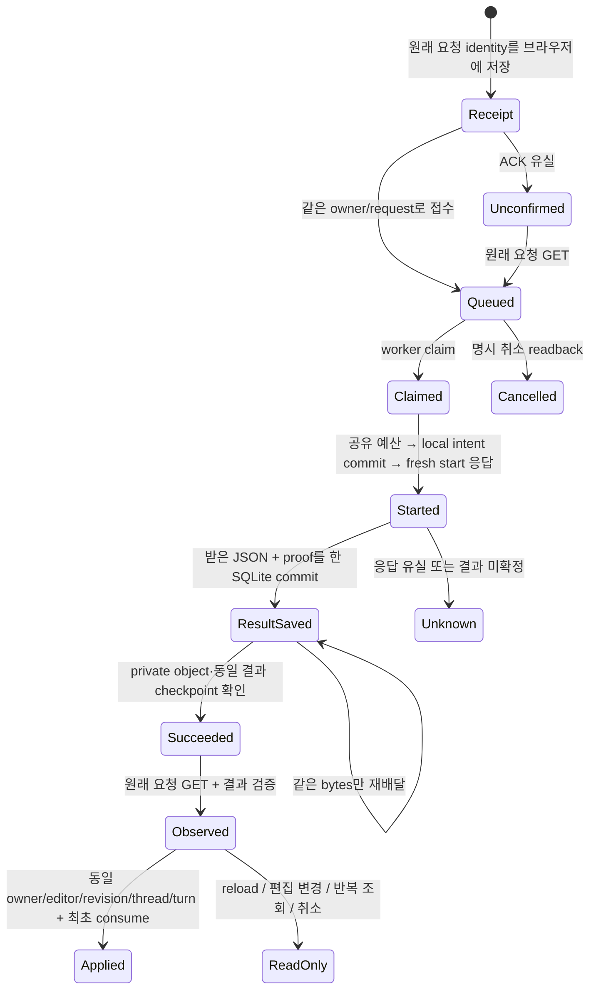

# 썸네일 Gemini 채팅 연결 후보

기준은 `88d3f08ddcfc141c64700cba3480a61541caf4de`이며, 이미지 큐에 텍스트 채팅을 연결한 로컬 후보다. 운영 설치·모델 가용성·실제 답변 품질·배포 완료 증거가 아니다. 기존 전체 목표와 운영 반영 승인은 유지한다.

## 실행 경계

- 편집기 자유 대화·문구 편집·생성 의도는 고정 `gemini-3.8-flash`, credits key 전용 client, 기존 프로젝트 예산을 사용한다. 새 key/결제/한도를 만들거나 바꾸지 않는다. catalog의 이름을 확인할 수 없으면 claim을 보류한다. 다른 LLM으로 대체하지 않는다.
- 기존 이미지 job과 동일한 DB queue·worker identity·global active slot·fresh start·SQLite outbox를 사용한다. 별도 예산 DB와 두 번째 polling worker를 만들지 않는다. 이미지/채팅 input·결과는 서로 다른 strict 계약이다. 이미지 API는 채팅 job을 반환하지 않는다.
- 대화 양쪽 role 최대 32개, text layer 최대 64개, focus와 참고 이미지 **metadata** 최대 8개를 보존한다. 픽셀을 채팅 모델에 전달하지 않으므로 첨부 사진을 보았다고 주장하지 않는다. 이미지는 실제 이미지 생성 단계의 별도 byte 계약을 따른다.
- context 전체는 최대 65,536 UTF-8 bytes, 결과는 최대 48,000 bytes다. 각 문자열은 공유 privacy sink와 맞춘 최대 4,096 UTF-16 code units 및 필드별 UTF-8 상한을 함께 적용한다. 예: 대화 content 8,000 bytes는 한글 최대 약 2,666자다. 입력은 접수 전에 검증하고, 출력은 local outbox 및 private Storage 쓰기 전에 다시 검증한다.
- DB에는 owner/request에 결속된 private JSON object path·byte 수·SHA-256만 저장한다. raw HTTP envelope·key·cookie·진단을 저장하거나 로그에 남기지 않는다. 문서·결과는 owner, job, attempt, fence, digest를 검증한 후 읽는다.
- 이전 `/chat` SSE endpoint는 인증·동일 출처 확인 후 body를 읽지 않고 410을 반환한다. 실행 중인 새 UI는 `/chat/jobs`를 사용한다. 과거 archive decoder와 테스트용 adapter는 기존 자료 호환을 위해 남아 있으며 운영 실행 허가가 아니다.

## 상태와 조건부 안전성

같은 실행 identity를 `A=(origin,owner,worker,job,attempt,fence,inputSha256,model)`로 둔다. 협력하는 writer, SQL row lock, 정상 SQLite durability 및 fresh receipt를 한 live closure가 소비한다는 조건에서 같은 A의 새 local intent INSERT 승자는 최대 하나다. SDK 시작은 fresh receipt 뒤 한 번뿐이다. ACK 유실·기존 tombstone·snapshot은 새 실행 허가가 아니다. 이는 provider 청구의 무조건적 exactly-once 정리나 전체 상태 공간에 대한 형식 증명이 아니다. SDK 수신과 첫 local commit 사이 crash window는 남는다.

브라우저 채팅 receipt는 이미지 receipt와 별도 namespace이며 request/model/editor session/revision/cancel intent/thread/turn/**미리 정한 image request ID**만 보관한다. 본문과 결과는 넣지 않는다. 자동 적용 권한은 해당 instance가 enqueue ACK를 직접 받았을 때만 생긴다. `consume`은 수정·reset·후속 이미지 실행 전에 한 번만 성공한다. 반복 GET/답변 보기/새로고침은 image request ID를 새로 만들지 않는다. reload는 답변을 읽을 수 있지만 자동 편집·생성하지 않는다.

`unknown` 하나는 기존 global slot 정책에 따라 다른 이미지·채팅도 보류시킨다. 이 liveness 제한을 임의 retry, 시간 경과에 따른 삭제 또는 새 request ID로 우회하지 않는다. 원본 확인을 통해 같은 결과를 복구해야 한다.

## 검증과 반례

- 실제 Chrome의 React 편집기·project CSS·Canvas에서 1440/768/390px document overflow 0, 채팅 편집, 늦은 답변 보호, 취소 readback, 접수 ACK 유실 후 reload GET, 후속 이미지 request ID 결속 및 반복 결과/reload의 추가 enqueue 0을 확인했다. Auth·API·모델 출력은 합성 seam이며 운영 브라우저 증거가 아니다.
- 실제 PG17.11 전체 30 methods와 실제 API/HTTP/SQLite를 연결했다. 새 채팅 4개 journey는 각각 browser POST 1, enqueue 1, start 1이며 SDK는 정상/배달 유실/수신 후 중단 각각 1, start ACK 유실 0이다. 배달 유실은 같은 결과의 completion RPC가 2회일 수 있으며 SDK 2회와 구별한다. Storage와 Gemini는 합성이다.
- 같은 React hook에서 owner A의 접수 ACK를 지연시키고 중단 뒤 B로 전환한 실제 Chrome 2개 사례(정상 ACK/503)도 확인했다. A의 늦은 처리와 보관한 취소 함수는 B의 상태·receipt를 바꾸지 않으며 B 취소 POST는 0이다. owner guard를 가상 제거한 반례는 실제 검사 실패를 검출했다.
- 문자열 상한 불일치, 취소 완료 후 이전 오류 문구 잔류, 이전 render의 취소 함수가 새 owner를 읽을 수 있던 경계를 수정했다. 미존재 layer patch, owner/attempt/hash/bytes/kind 변경, 출력 개인정보 및 malformed UTF-8는 저장·자동 적용을 거부한다.
- 실제 provider 호출, hosted SQL, worker 활성화, key 등록, push/merge/배포는 이 검증에서 0회다. 결정적 pass/fail에 95% 신뢰구간을 붙이지 않으며 운영 속도·비용·품질 개선율은 측정하지 않았다. 최종 체크포인트의 commit·로그·artifact map으로 실행 수치를 결속한다.

## 운영 반영 전 남은 작업

1. 필수 Pro thesis → Gemini maximum-thinking 반대 검토 → Pro reverse 검토를 현재 source bundle에 결속한다. 기존 예약은 그대로 두며 이전 bundle의 예약을 현재 소스로 덮지 않는다. 외부 검증은 아직 미완료다.
2. 현재 G014 source/catalog와 호환되는 forward SQL 및 private bucket·최소 worker 권한을 준비·검증한다. candidate SQL은 unapplied이며 applied migration을 수정하지 않는다.
3. 기존 운영 승인을 사용해 보호된 `develop → data → main` PR/필수 CI, 현재 운영 rollback SHA, Vercel 실제 deployment SHA·live URL, 관리자 로그인·Mac worker·취소·원본/답변 readback을 마친다.
4. image-only 구버전 worker는 chat identity나 3-model advertisement를 해석하지 못한다. mixed journal 또는 설치된 chat contract에 구버전 binary를 바로 연결하는 rollback을 금지한다. outbox table/index/application ID/version 1 물리 형식은 유지하지만 의미 계약의 하위 호환을 과장하지 않는다. 먼저 진행·미확정 작업을 보존하고 현행 계약을 읽는 worker로 복구하는 rollout/rollback 순서를 검증한다.
