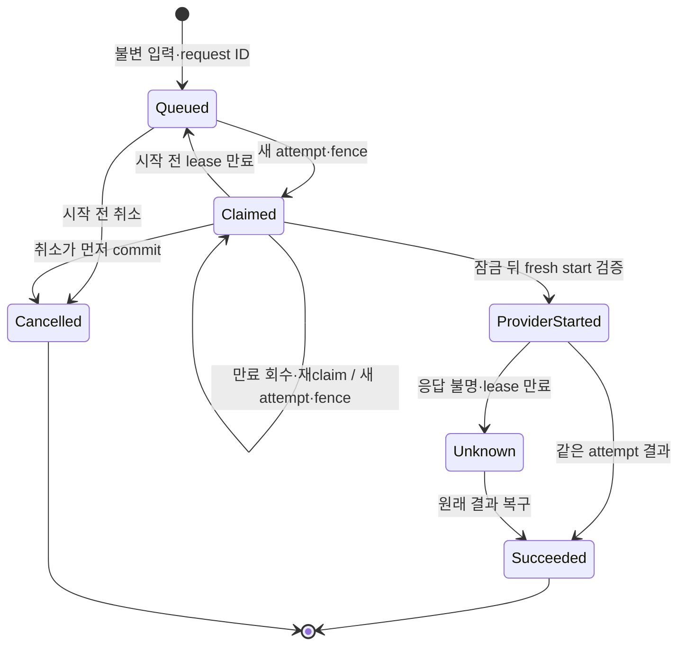

# 단일 Gemini 썸네일 큐 후보

기준은 worker 후보 `121451f5ebbb8c45bf4aec0d4a8eeedc27e2ecbc`다. SQL은 `backend/supabase/candidates/20261023_thumbnail_gemini_queue.sql`에 보관하며 **운영 migration이 아니다.** 기존 applied migration, 운영 DB·worker·모델·키·한도를 바꾸지 않았다. 기존 스토리보드의 장면 수/문서 계약은 유지한다.

## 실제로 구현한 경계

- 별도 jobs/workers/events와 owner-scoped RPC를 추가했다. request ID 고유 제약은 같은 요청의 같은 입력을 같은 job으로 돌려주며 다른 입력은 `request_conflict`로 거부한다. queued/claimed/provider_started/unknown에 대해 owner+input digest가 고유하므로 새 request ID나 업로드 경로만 바꿔 unresolved 생성을 우회할 수 없다.
- 실제 provider 입력의 모델·prompt·정규화 참조 bytes/역할/순서·변환 정책으로 digest를 만든다. 키/queue identity 없이 사용할 수 있는 서버·worker 공통 preparation을 분리했다. 서버가 저장한 metadata 없는 PNG를 다시 준비해도 같은 digest여야 한다. request/job/attempt/fence·Storage path·시각은 digest에 넣지 않는다.
- queued → claimed는 새 attempt UUID와 단조 증가 fence를 발급한다. 만료된 **미시작** claim만 재접수할 수 있다. start는 실제 job lock 획득 뒤 lease·owner·worker·attempt·fence·digest·cancel·모델을 다시 확인한다. 시작 전이는 한 번만 fresh permission을 반환하며 재조회/재호출에는 허가를 재발급하지 않는다.
- worker row → job row 순서로 잠근다. claim만 transaction try-advisory lock을 사용하여 전역 queue admission을 직렬화하고, 작은 정렬 배치와 `SKIP LOCKED`를 사용한다. try-lock에 실패하면 기다리면서 job을 보유하지 않는다. 새 RPC는 SECURITY INVOKER이며 service_role만 호출할 수 있다. active-admin 검사는 기존 `storyboard_control.assert_owner`의 실제 소스 계약을 재사용한다.
- 이 썸네일 큐 전체에서 claimed/provider_started/**unknown**은 합계 1개다. unknown은 늦은 provider 시작/실행이 끝났다는 증거가 아니므로 슬롯을 유지한다. 다른 입력도 original result의 확정 복구 전에는 시작하지 않는다. 다른 owner의 만료 작업은 임의 변경하지 않으며 해당 owner의 복구가 필요하다. 이는 가용성보다 중복 유료 실행 방지를 우선하는 명시적 hold다.
- 시작된 attempt/worker/fence/시각과 입력은 DB trigger로 불변이다. unknown에서 원래 attempt의 결과 복구는 가능하지만 재시작은 불가능하다. checkpoint는 같은 manifest면 같은 성공, 다른 manifest면 `result_conflict`다. 상태와 manifest 연결은 한 트랜잭션이다.
- 시작 전 취소는 cancelled로 전이한다. 시작 후에는 cancel_requested만 기록하고 받은 결과를 보존할 수 있다. 생성 완료는 승인·공개와 다르며 이 SQL은 공개하거나 YouTube에 전송하지 않는다.
- 목록은 prompt/참조/result 없이 32개씩 `(created_at,id)` cursor로 조회한다. 실제 35개 기록을 32+3으로 빠짐·중복 없이 조회했다. 삭제/보존 기간은 새로 정하지 않았다.
- 기존 같은 이름의 namespace는 자동 채택하거나 권한을 다시 쓰지 않고 중단한다. 실제 재적용 실패 뒤 기존 job이 유지되는지 확인했다.

## 반례와 수정

| 경계 | 수정 전 재현 | 현재 구현·검증 |
|---|---|---|
| 입력 digest | 메타데이터만 다른 두 원본이 같은 inline PNG를 보내도 서로 다른 digest | 원본 파일 metadata를 digest에서 제외. 같은 실제 provider PNG는 같은 digest. 정규화 재적용도 같은 digest |
| unknown 슬롯 | A 시작 후 만료 → unknown → 다른 입력 B claim 허용. 늦은 A 시작과 겹칠 수 있음 | unique index와 claim guard 모두 unknown을 포함. B는 original 결과 복구 전 차단 |
| 잠금 뒤 권한 | owner 확인 후 start가 job lock 대기 → owner suspend commit → 시작 허가 발급 | 실제 lock 대기 후 owner 재검사. 해당 start는 owner_forbidden |

세 반례 모두 수정 전 실행 실패를 보관했다. 위 표는 결정적 계약의 반례 수정이며 발생률·비용 절감·운영 성능의 통계적 개선은 아니다. 95% 신뢰구간을 적용할 무작위 표본 실험은 수행하지 않았다.

## 상태와 조건부 증명

`ProviderStarted/Unknown`의 cancel_requested는 별도 flag이고 두 상태 모두 취소로 슬롯을 해제하지 않는다. 미시작 만료 회수와 재claim은 한 RPC의 같은 트랜잭션에서 일어날 수 있으며 중간 queued가 외부에 관측된다는 뜻은 아니다. partial unique index가 `Σ 1[state ∈ {claimed,provider_started,unknown}] ≤ 1`을 이 큐에서 강제한다. 고유 request ID와 unresolved digest는 각각 DB 제약이며, 시작된 identity의 불변성과 start의 claimed-only 검사는 재허가를 막는다. worker가 새로 commit된 허가만 한 번 사용한다는 adapter 조건은 별도로 필요하다. 이것은 전체 시스템에 대한 무조건적 exactly-once 증명이 아니다.

fresh permission은 SQL 함수의 반환값만으로 commit 증명이 되지 않는다. 실제 adapter는 **트랜잭션 commit이 확인된 RPC 응답 뒤에만** 이를 SDK에 전달해야 한다. 실제 TS 통합 검증에서는 psql의 성공 종료/commit 후 전달했다. worker RPC는 READ COMMITTED만 허용하여 오래된 권한 snapshot을 거부한다. 잠금 뒤 owner 재검사는 그 시점의 권한을 확인하며, 이후 권한 철회·SDK 원격 실행까지 하나의 원자적 트랜잭션으로 만드는 증명은 아니다. 실제 PostgREST와 배포 runtime 계약은 아직 검증하지 않았다.

## 검증 기록

- PostgreSQL **17.11**, 실제 SQL **21 methods pass / 0 fail, 3.992초**. 두 worker claim, 같은 request 동시 접수, fence ABA, start ACK 유실, 실제 row-lock 대기 뒤 만료·권한 철회, unknown hold·원래 attempt 복구, 취소, checkpoint idempotency/MVCC, 모델·경로·권한·불변성·cursor·기존 namespace 중단을 검증했다.
- 위 21 methods 중 하나가 실제 TypeScript 클라이언트와 실제 PG RPC를 다섯 경로로 연결한다. 정상 1회, stale fence의 옛 worker 0회/새 worker 1회, start ACK 유실 0회, provider 응답 유실 1회, 시작 후 취소 1회다. Bun 1.4.0을 각 경로에서 확인했다. SDK/Storage는 합성이며 외부 유료 호출은 0회다.
- 관련 Bun 검증: **43 pass / 0 fail / 323 assertions, 2.56초**. 실제 SDK 합성 HTTP wire와 실제 Python/SQLite 예산을 포함한다. 시간은 실행 기록이며 속도 개선 수치가 아니다.
- TypeScript native/compat parity **3,401 logical inputs, diagnostics 0**, 대상 ESLint 오류·경고 0.
- PG 검사 전후 5개 소스 hash가 같고, 소유 PID 88950은 종료됐다. pg_ctl status=3, PID·socket 파일 없음, TCP 닫힘을 확인했다. 로컬 cluster 증거만 보관하며 운영 DB나 타인의 process를 종료하지 않았다.

실제 증거: 이 대화의 `thumbnail-gemini-queue-20261023/` 폴더. 초기 harness 오류와 수정 중간 검사는 성공 기록으로 세지 않는다.

## 아직 완료하지 않은 운영 연결

후속 [비공개 저장/API 후보](thumbnail-private-store-20261023.md)에서 아래 1·2의 코드와 격리 DB 검증을 진행했다. 이 목록은 당시 상태를 보존한 것이며, 실제 Mac/UI·운영 설치/배포 완료를 뜻하지 않는다.

1. 공통 preparation → 비공개 Storage의 비덮어쓰기 입력 upload/readback → enqueue adapter. worker는 읽은 실제 bytes로 digest를 재계산해야 한다.
2. 새 worker 인증 endpoint·취소/heartbeat·결과 durable 보관·checkpoint ACK 복구. 불확실한 commit/row 부재는 파일 삭제나 새 유료 호출의 허가가 아니다. 현재 검증의 Storage manifest는 합성이므로 실제 파일 저장 성공을 주장하지 않는다.
3. 현재 operating G014 catalog·권한에 맞춘 forward migration과 private bucket 설치. 후보 SQL 전체를 그대로 운영에 적용하면 안 된다. 새 credential 발급/권한 확대는 아직 실행하지 않았다.
4. 편집·기존 이력 decoding을 유지하는 Gemini-only 접수/status UI와 실제 Mac/Actions worker 연결. 현재 UI의 legacy 실행 제거도 남아 있다.
5. 기존 웹 Pro → Gemini maximum ordinary review → Pro reverse의 material delta 감사와 보호된 develop → data → main 배포, 운영 readback. native Astra는 소스 반례를 제공한 별도 검토다. 공유 scheduler는 다음 owner가 이 대화가 아니고 현재 사용 가능한 review admission이 없으며 기존 소유 대기 7건을 유지했다. bundle 준비는 전송/완료가 아니다.
