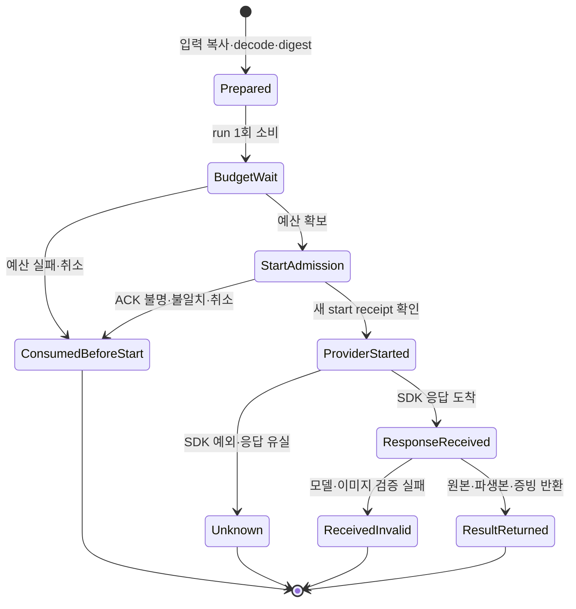

# Gemini 썸네일 worker 후보

기준 소스는 `40bc5d4d3d3db804d9869c9c61627bc94984914e`이다. 이 문서의 42개 검증은 초기 worker 후보 `121451f5` 기록이며, [후속 큐 구현·digest 정정 및 최신 검증](thumbnail-gemini-queue-20261023.md)을 함께 확인한다. API·UI·운영 큐에는 아직 연결하지 않았다. 스토리보드의 5~12개 장면 계약을 바꾸거나 가짜 장면을 만들지 않는다.

## 구현과 불변식

- 기존 모델 정책의 Nano Banana 2 / Pro (`gemini-3.1-flash-image`, `gemini-3-pro-image`)만 허용한다. 키는 `GEMINI_CREDITS_API_KEY`만 선택하며 다른 프로젝트 키·LLM·모델로 fallback하지 않는다. Google의 현재 [모델 문서](https://ai.google.dev/gemini-api/docs/models/gemini-3.1-flash-image)와 [이미지 생성 문서](https://ai.google.dev/gemini-api/docs/image-generation)를 확인했다. 새 2.1 모델은 승인된 기존 pin을 바꾸지 않는다.
- 첫 await 전에 선택 모델·확정 prompt·참조 이미지 bytes·역할을 복사한다. 실제 픽셀을 decode하고 MIME·장수·파일/합계 크기를 제한한 뒤 metadata 없는 PNG로 요청한다. 현재 입력 digest는 모델·prompt·참조 순서/역할·실제 provider에 전달하는 정규화 bytes SHA-256·출력 변환 계약을 포함한다. 초기 후보의 원본 bytes SHA 포함은 metadata만 바꾼 중복 우회를 허용해 후속 변경에서 제거했다.
- 기존 Python/SQLite 프로젝트 예산을 획득한 **뒤** owner/job/attempt/fence/input digest에 결속된 새로운 start receipt를 요구한다. 응답 유실 또는 일치하지 않는 receipt에는 SDK를 호출하지 않는다. `provider_started`의 과거 readback은 새로운 start 허가가 아니다.
- prepared 객체 하나의 SDK 호출 수는 최대 1이다. `run()`은 첫 await 전에 소비되며, 잘못된 budget 구현이 callback을 두 번 호출해도 두 번째 SDK 호출을 막는다. SDK timeout 120초, attempts 1을 명시한다.
- SDK 전송 후 오류는 `unknown`이며 원래 오류 본문을 노출하지 않는다. 이미 소비된 객체는 `already_consumed`로 구분한다. 재호출 오류를 `not_started`로 표시하여 원래 실행 상태를 덮는 오류를 독립 검토에서 발견하고 수정했다.
- 응답이 도착한 뒤 취소·예산 해제·선택적 사용량 counter 오류가 발생해도 받은 이미지를 버리지 않는다. 정확히 한 개의 비사고 이미지, canonical base64, 실제 MIME/픽셀, 허용 모델의 응답 modelVersion을 확인한다. 원본 bytes/hash/크기와 1280×720 PNG 파생본을 구분하여 반환한다. C2PA 증명이나 숨겨진 backend 식별을 주장하지 않는다.

이 그림은 클라이언트 제어 흐름 설명이다. DB 전이 구현이나 분산 실행의 형식 증명이 아니다. 소비된 객체의 추가 호출은 `already_consumed` 오류만 반환하며 첫 실행이나 durable 상태를 바꿀 권한이 없다.

## 검증

2026-10-23, Bun 1.4.0 / Node 24.22.0 / 저장소에 pin된 Google SDK·sharp 기준:

- 새 클라이언트 17개 + 관련 storyboard 모델/실행 계약 및 썸네일 publication 복구: **42 pass, 0 fail, 319 assertions, 718ms**. 시간은 이번 실행 기록이며 성능 개선 측정이 아니다.
- 참조 bytes/model/prompt/role의 await 전 변경, 입력 digest의 순서/역할/bytes 변경, 잘못된 MIME·깨진 이미지·크기 제한, 동시 run, 반복 budget callback, admission 유실·다른 fence/owner, 취소, provider timeout, 잘못된 응답/model/base64를 검증했다.
- 실제 pin된 SDK를 사용한 합성 HTTP transport: 정상 응답 decode와 참조 inlineData 직렬화, 503 응답에 **전송 1회**. 외부 Gemini 요청은 보내지 않았다.
- 실제 Python subprocess와 SQLite 예산: fresh admission과 SDK 실행 중 lease **1개**, 결과 반환 뒤 **0개**. 임시 별도 경로/프로젝트로 검사하고 제거했다. provider와 start admission은 합성이다. 운영 예산 상태는 바꾸지 않았다.
- TypeScript native/compat parity: **3,401 logical inputs, diagnostics 0**. 대상 ESLint: 오류·경고 0.
- 위 수치는 결정적 계약 검증이다. 실패 확률·비용·속도의 전후 비교나 95% 신뢰구간을 산출할 표본 실험은 수행하지 않았다.

증거는 이 대화의 `thumbnail-gemini-worker-20261023/` 폴더에 별도로 보관한다. 기존 배포/실험 영수증은 수정하지 않는다.

재현: `apps/web`에서 `RUN_DAILY_PYTHON=<프로젝트 Python> bun test tests-unit/thumbnail-gemini-worker-client.test.ts tests-unit/storyboard-gemini-client.test.ts tests-unit/storyboard-gemini-execution-contract.test.ts tests-unit/thumbnail-release-publish-recovery.test.ts`. Python 지정이 없으면 기존 예산 도구와 같은 `python3`를 사용하므로 개인 Mac 절대 경로가 CI에 강제되지 않는다.

## 운영 반영의 남은 경계

1. 별도 단일 이미지 durable 접수/큐/RPC: 같은 client requestId + 같은 입력은 동일 작업, 다른 입력은 충돌. 비공개 참조 bytes를 고정한 뒤 enqueue한다. 원자적 start 전이는 owner·job·attempt·fence·입력 digest를 확인하고 신규 start 허가를 한 번만 발행해야 한다.
2. `unknown`은 자동 재생성하거나 새 requestId로 우회하지 않는다. 결과 저장 재시도와 유료 생성 재시도를 분리한다. worker crash/lease 만료/취소와 완료 경합에도 이미 시작한 attempt를 재할당하지 않는다. **현재 클라이언트는 새 객체/다른 프로세스의 중복 실행을 막는 DB 구현을 제공하지 않는다.**
3. 받은 원본·증빙의 durable 보관과 checkpoint ACK 복구를 구현한다. 조회 시 row가 없다는 이유만으로 불확실한 쓰기의 파일을 삭제하면 안 된다. 이 클라이언트는 bytes를 반환할 뿐 durable 저장을 완료하지 않는다.
4. 실제 운영 G014 catalog에 맞는 forward migration으로 private bucket·최소 RPC 권한·Gemini publication 계약을 반영한다. 여러 기능이 섞인 과거 local convergence SQL을 통째로 적용하지 않는다.
5. UI 편집·과거 이력 decoding을 보존하면서 새 실행 선택지를 Gemini-only로 바꾸고 AnyCap/OpenAI readiness/direct 실행을 제거한다. API는 장시간 생성 대신 접수와 상태 조회를 담당한다.
6. 두 worker 경합·예산 대기·start ACK 유실·provider 응답 유실·수신 직후 종료·지연 commit·취소 경합·다른 owner 접근을 실제 DB 경계에서 검증한다. 그 뒤 기존 외부 Pro → Gemini → Pro delta 검토와 보호 브랜치 승격·배포·운영 readback을 거친다.

외부 공유 scheduler 조회에서 ChatGPT free slot 0, Gemini eligible account 0이며 현재 대화가 다음 owner가 아니었다. 기존 소유 대기 7건을 유지했고 새 외부 요청·예약 변경은 하지 않았다. native Astra 소스 검토는 별도이며 필수 웹 3단계 감사의 대체가 아니다. 이 후보의 외부 검증과 운영 적용은 미완료다.
