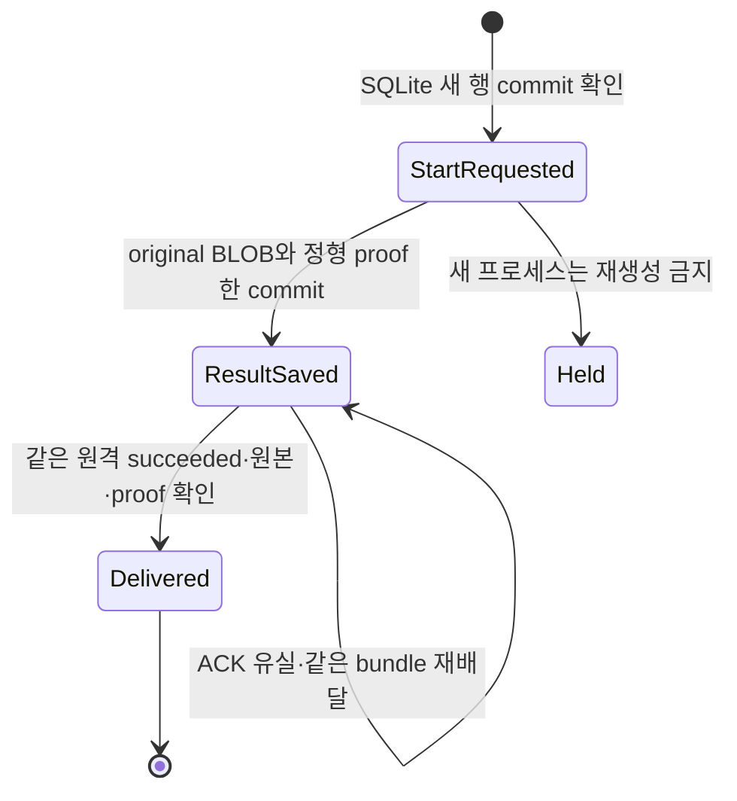

# Gemini 썸네일 outbound worker 후보

기준 commit은 `04bc30a24acf84ee50da5bec789f427a4bd43de4`다. [이전 저장/API 후보](thumbnail-private-store-20261023.md)의 실제 Mac worker 및 durable outbox 연결을 구현했다. 설치·활성화·운영 배포 영수증은 아니다.

## 사용자 동작과 소유 경계

`npm run thumbnail:gemini-worker -- --help`로 실행 인수를 확인한다. origin, 기존 scoped token의 private 파일, 전용 outbox 디렉터리를 명시해야 한다. 선택적 operator env 파일도 소유자·일반 파일·0600·symlink/hardlink·실제 byte 상한을 검사한다. 새 key/token을 발급하거나 복사하지 않고, 명령행 key·로그의 credential/body/provider diagnostic을 허용하지 않는다. 실제 실행·launch agent 변경은 하지 않았다.

새 작업은 credits key 전용 Gemini client가 고정된 두 이미지 모델의 metadata name을 확인한 뒤에만 claim한다. catalog는 5분 재사용하며 401/403/429는 즉시 중단한다. 없는 모델을 다른 모델로 대체하지 않는다. 이 metadata 확인은 생성 성공이나 숨은 backend의 암호학적 신원 증명이 아니다. 원본 재배달은 Gemini client를 생성하기 전에 수행하므로 생성 key가 없어도 worker API 권한이 있으면 진행할 수 있다.

worker는 저장된 reference PNG를 완전히 decode하고 **그대로의 bytes**로 digest를 재계산한다. enqueue 때 승인된 pixels를 다른 OS의 PNG encoder로 다시 쓰지 않는다. digest/model/prompt/역할·순서가 다르면 provider를 호출하지 않는다. outbound용 실행은 검증된 original/provenance를 즉시 반환하고 사용하지 않는 로컬 파생 이미지는 만들지 않는다. 서버가 normalized 1280×720을 소유한다.

HTTP는 고정된 운영 origin 또는 명시된 loopback만 허용하고 redirect·proxy·helper retry를 사용하지 않는다. 실제 응답 byte·deadline·JSON member를 제한한다. 기존 project budget을 획득한 후에만 local intent와 원격 start를 실행한다. 기다리는 동안 heartbeat가 정확한 owner/worker/job/attempt/fence/digest와 cancel 상태를 확인한다.

## 별개인 두 상태기계

이 그림은 로컬 journal이다. 원격 queued/claimed/provider_started/unknown/succeeded는 [큐 상태도](thumbnail-gemini-queue-20261023.md)가 소유한다. StartRequested는 원격 unknown과 동의어가 아니다. SQLite commit 직후 HTTP 전에 중단하면 원격은 아직 claimed일 수 있다. 관찰한 두 번째 worker는 실행 중인 첫 번째 worker일 가능성을 보존하여 **원격 상태를 변경하지 않는다**. 원래 실행이 불명확한 provider 결과를 확인했을 때만 같은 attempt의 unknown을 보고한다.

원본 없는 tombstone은 새 생성을 보류한다. 다만 뒤에 이미 저장된 결과가 있으면 그 결과를 먼저 배달한다. SQLite `(phase)` index와 `ORDER BY phase,rowid`로 result_saved를 start_requested보다 먼저 읽으며, scan은 BLOB 없이 최대 32개 metadata만 반환한다. delivered 원본·proof도 삭제하지 않는다. 디스크는 보존된 n개 결과·평균 B bytes에 대해 O(nB)로 증가하며 retention 기간·자동 삭제를 새로 정하지 않았다. aggregate RSS나 운영 latency를 측정한 것은 아니다.

## 안전성 주장과 실제 원자경계

실행 identity를 `A=(origin,owner,worker,job,attempt,fence,inputSha256,model)`로 둔다. 같은 `(job,attempt)`의 SQLite UNIQUE insert에서 **새 commit 성공을 확인한 한 호출만** 원격 start를 한 번 시도할 수 있다. 기존 행·BUSY·commit 불확실 readback은 실행 허가가 아니다. 원격은 job row lock 아래 claimed→provider_started 한 번만 fresh receipt를 주고, client closure는 첫 await 전에 consumed를 기록한다. 재시작 시 pending을 먼저 처리하므로 기존 A로 새 paid 실행을 만들지 않는다.

이는 통제된 writer, SQLite/OS의 정상 durability, 원격 commit 후 응답, 원래 fresh receipt를 한 live 실행에서만 소비한다는 조건 아래의 safety 근거다. 전체 분산 시스템의 무조건적 exactly-once 정리·provider 청구 횟수 증명·eventual completion 증명은 아니다. 로컬 SQLite는 WAL/FULL을 요청하고 값을 readback하며, SQL transaction 동안 network await를 하지 않는다. 원본 BLOB와 정형 proof를 한 commit에 저장한다. SQLite가 FULL을 사용해도 SDK 응답 수신→첫 local commit 사이 crash, 지속적인 디스크 장애, 저장장치가 sync를 지키지 않는 경우까지 보장하지 않는다.

수신 결과는 stop 검사보다 먼저 저장한다. local commit 실패 시 같은 RAM bundle만 최대 한 번 추가 저장하며 provider를 재호출하지 않는다. 권한/손상/다른 schema/다른 origin/worker/attempt/fence/digest는 보류한다. 기존 DB나 WAL/SHM/journal symlink를 빈 저장소로 자동 복구하지 않는다. 초기 schema·application ID·version·권한을 검증하고 외부 파일을 chmod/삭제하지 않는다.

서버에 구버전 recovery manifest가 있으면 그 manifest와 동일한 원본/proof인지 확인하고 원본을 먼저 보충한다. 이전 normalized hash를 현재 encoder로 만들 수 없으면 원본은 남기고 완료를 보류한다. 원본·proof만으로 모든 미래 encoder 버전을 넘는 자동 복구를 주장하지 않는다.

## 반례와 검증 범위

| 반례 | 관측·수정 |
|---|---|
| 기존 recovery manifest와 새 encoder 차이로 원본 보충 전 중단 | 수정 전 실제 저장 경로 1 fail. 원본 먼저 보충 후 이전 파생본 hash 불일치는 보존·보류하도록 수정 |
| 두 번째 worker가 live intent를 unknown으로 바꿔 진행 중 SDK 중단 | 실행 중 SDK를 대기시킨 반례. 관찰자는 원격 상태를 쓰지 않도록 수정 |
| 오래된 tombstone이 뒤의 result_saved를 가림 | 과거 attempt와 새 결과를 같은 SQLite에 보관한 반례. 결과 우선 delivery, 새 생성 보류 유지 |
| 사용하지 않는 로컬 정규화가 원본 반환을 막을 수 있음 | outbound에서는 정규화 자체를 생략. stored byte 보존·normalized=null·stop 직후 원본 commit 검사. 이전 encoder 실패를 별도 fault injection으로 재현했다는 주장은 아님 |

동시 실행의 두 guard를 깨뜨린 variant는 Bun bundle의 가상 module에서 실행했다. 현재 checkout을 바꾸지 않고 각각 의도한 regression failure를 검출했으며, 현재 소스 hash 전후 일치를 확인했다. 최초 동시 실행 테스트의 abort listener는 정상 종료 cleanup도 세는 문제가 있어 수정했다. 해당 최초 로그만으로 결함을 입증하지 않고, 수정된 fixture와 두 negative-control 영수증을 근거로 삼는다. 네이티브 Astra의 반례 검토는 필수 웹 3단계 감사의 대체가 아니다.

검증은 소유한 PG17.11, 실제 TS API/store/client, 실제 outbound HTTP, 실제 SQLite에 연결했다. 원격 Storage와 Gemini 응답은 합성이며 외부 유료 호출 0회다. 실제 SIGKILL 뒤 WAL 복구, 두 process의 intent 경쟁, immutable result, 손상·외부 schema·파일 권한, 응답 유실·재시작·취소·live observer·tombstone 우선 복구를 포함한다. 초기에 sandbox가 loopback listener를 거부한 harness 실패를 유지했고, loopback bind/inbound만 허용하여 수정했다. 인터넷 egress는 허용하지 않았다.

최종 수치와 source/receipt hash는 대화의 `thumbnail-outbound-worker-20261023/`와 후속 checkpoint에 보관한다. 테스트 수는 품질/속도/금액 개선율이 아니며 이 결정론적 검증에 95% 신뢰구간을 만들어 붙이지 않는다.

최종 검증: 관련 Bun **182 pass / 0 fail / 1,571 assertions, 10.77초**, 실제 PG17.11 **26 methods pass / 0 fail, 13.481초**, TypeScript native/compat **3,412 logical inputs / diagnostics 0**, 대상 ESLint **오류·경고 0**. PG의 한 method가 API/store/client 11개 경로를 실행하며, 그중 outbound HTTP+SQLite 연결은 7개다. 정상·재배달·stop 수신·live observer·우선 복구는 SDK 1회, start ACK 유실은 SDK 0회다. provider 응답 유실은 SDK 1회 후 보류한다. 재배달은 complete RPC를 idempotently 두 번 실행할 수 있으며 ‘모든 checkpoint가 1회’라고 주장하지 않는다.

15개 PG covered source의 검사 전후 hash가 같고 최종 checkout과도 일치했다. 소유 PG PID 44491을 종료했고 pg_ctl status=3, PID/socket 파일 없음, TCP 닫힘을 확인했다. 앞선 sandbox listener·TypeScript definite-assignment·테스트 cleanup 오류는 최종 성공으로 세지 않는다.

현재 publisher 문서와 설치된 API를 확인했다: [Bun node:sqlite](https://bun.com/docs/runtime/nodejs-compat#node-sqlite), [SQLite synchronous](https://www.sqlite.org/pragma.html#pragma_synchronous), [Gemini model metadata](https://ai.google.dev/api/models#method:-models.get). 설치 Bun 1.4.0/SQLite 3.51.0을 실제 실행했고 임의 upgrade는 하지 않았다. 최종 type/lint에는 프로젝트 Node 24.22.0을 명시했다.

## 운영 반영 전 남은 일

후속 browser 접수/복구 경계와 native Web Locks/PG 검증은 [browser queue safety](thumbnail-browser-queue-safety-20261023.md)에 기록한다. 기존 editor 연결 완료와는 구분한다.

Gemini-only 접수/status/result를 기존 편집·이력 UI에 연결하고 legacy 실행을 제거해야 한다. current hosted G014 catalog에 결속한 forward migration/private bucket/최소 scoped worker provisioning, 필수 Pro→Gemini maximum→Pro reverse material delta 감사, CI와 보호된 develop→data→main, 정확한 배포 SHA 및 실제 관리자·Mac worker readback이 남았다. 원본 없는 시작 후 unknown, 폐기된 worker 권한, 지속적 디스크 장애, 이전 encoder를 재현할 수 없는 결과는 operator 복구 조건이다. 이를 유료 재생성이나 임의 파일 삭제로 해결하지 않는다.
