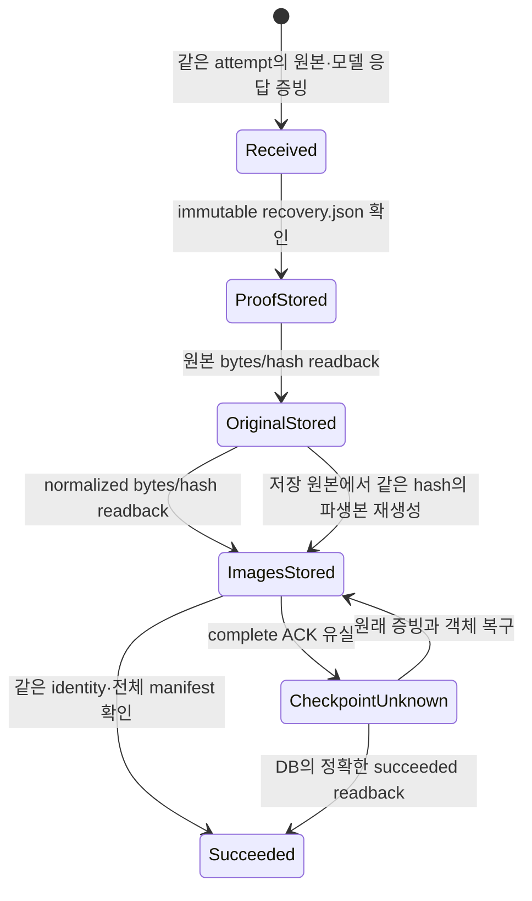

# Gemini 썸네일 비공개 저장과 API 연결 후보

이 문서는 `f5e9f3fc1366bdca6bb0ae2d3ee0e4c27379b310`의 큐·클라이언트 위에 추가한 소스 후보를 설명한다. 운영 적용 영수증이 아니다. 이전 큐 검증과 범위는 [큐 기록](thumbnail-gemini-queue-20261023.md)을 보존한다.

## 입력과 실행 경계

- `/api/admin/youtube-thumbnail-generator/jobs`에서 실제 관리자 인증·같은 origin·실제 multipart stream 크기·중복 필드/JSON member·고정 두 이미지 모델·기존 안전/인물 reference 정책을 검사한다. 임의 provider, 프롬프트, owner, Storage path는 접수하지 않는다. 실행 provider와 무관한 기존 prompt/safety 함수의 타입만 좁혀 재사용한다. 기존 편집·이력의 legacy provider decoding은 유지한다.
- 소유자는 세션에서만 정한다. 비공개 bucket `youtube-thumbnail-jobs`와 owner/request/index/hash 경로는 서버가 도출한다. 입력은 실제 pixels를 canonical PNG로 만든 동일 byte snapshot과 역할·순서·모델·서버 prompt로 digest를 계산한다.
- `thumbnail_production_admin(action='request')`는 owner+request ID로 정확히 조회한다. enqueue ACK를 잃어도 임의의 최근 job을 고르지 않는다. 같은 요청의 불변 입력이 다르면 충돌이다. 이미 claimed인 같은 요청은 현재 상태로 반환한다.
- 관리자 status/cancel/이미지 읽기와 worker 인증/models/claim/start/heartbeat/unknown/원본 보관/recover endpoint를 추가했다. 각 worker RPC는 DB에서 다시 권한과 실행 identity를 검사한다. claim은 작업의 lease이며 원격 실행 완료 증명이 아니다.
- start는 SQL의 **flat fresh receipt**를 별도 schema로 검사한다. 성공한 직접 RPC 응답만 Gemini 클라이언트에 전달한다. 스냅샷이나 ACK 유실 뒤 readback에서 새 실행 허가를 만들지 않는다. PostgREST mutation은 `.retry(false)`다.
- 이 후보의 새 API에는 provider 호출을 넣지 않았다. 실제 Mac worker loop/outbox와 브라우저 접수 UI 연결은 다음 단계다. 새 route의 존재만으로 운영 생성 기능을 완료했다고 하지 않는다.

## 결과 저장과 복구

위는 저장 단계의 조건부 전이이며 DB 상태 enum을 추가하는 그림이 아니다. queued/claimed/provider_started/unknown/succeeded/cancelled는 기존 SQL 큐가 소유한다. `unknown`은 여전히 global generation slot을 점유하며 유료 재실행 허가가 아니다.

원본과 정형 provenance를 복사한 뒤 첫 await를 시작한다. worker/attempt/token hash도 검증된 독립 snapshot으로 고정한다. 서버가 원본을 완전히 decode하고 최대 1,600만 pixels를 검사하며, 정규화 1280×720 PNG를 직접 만든다. worker의 파생본 bytes를 무조건 신뢰하지 않는다. original은 재인코딩하거나 provider watermark를 제거하지 않는다. 모델 응답 version은 API가 반환한 증빙이며 숨은 backend의 암호학적 증명은 아니다.

proof가 pixels보다 먼저 저장된다. 각 객체는 `upsert:false`로만 저장하며, upload ACK 유실 뒤 정확한 bytes를 독립 readback한다. overwrite/remove/list 권한을 이 Storage 인터페이스에 제공하지 않는다. 기존 객체가 다르면 충돌로 남기며, 아직 보이지 않거나 읽기가 실패하면 확정 실패/rollback으로 단정하지 않는다. upload 대기 상한 뒤 요청은 실제로 늦게 commit할 수 있으므로 같은 path와 bytes를 유지한다.

복구는 먼저 인증된 owner의 DB job과 worker/attempt/fence/input digest를 확인한 뒤 Storage를 읽는다. recovery JSON의 전체 identity·두 이미지 manifest·원래 provenance를 검증하고, 실제 길이/hash/MIME/pixels/크기를 대조한다. normalized만 없으면 원본에서 재생성하고 **원래 manifest의 bytes/hash/크기와 일치할 때만** 저장한다. 다른 encoder 버전으로 byte가 바뀌면 원래 증거를 덮지 않고 중단한다. 이미지가 없는데 manifest만 존재하는 것은 완료가 아니다.

Storage download는 설치된 SDK의 `.asStream()`을 사용하여 허용 byte 초과 시 cancel하고 15초 deadline을 둔다. 새 `NoSuchKey`만 객체 없음으로 취급하며 `NoSuchBucket`와 의미가 불명확한 legacy `not_found`는 설치/권한 불확실 상태로 둔다. 원본·파생본 각각 최대 12MiB, reference 각각 8MiB/합계 canonical 16MiB, raw multipart 약 32MiB 상한이다. 이 값은 입력/객체 경계이며 동시 요청 전체 RSS 측정이나 전역 메모리 상한 증명이 아니다.

현재 publisher 문서와 설치 소스를 대조했다: [Storage 오류 코드](https://supabase.com/docs/guides/storage/debugging/error-codes), [비공개 download](https://supabase.com/docs/reference/javascript/storage-from-download), [비덮어쓰기 upload](https://supabase.com/docs/reference/javascript/storage-from-upload). 설치 pin `@supabase/supabase-js`/`storage-js` 2.117.2, `@google/genai` 2.24.0, sharp 0.35.5를 유지했다. 문서 예제의 raw diagnostic 로깅은 사용하지 않는다.

## 재현한 결함과 수정

| 반례 | 수정 전 관측 | 수정·검증 |
|---|---|---|
| SQL start의 flat receipt를 job으로 파싱 | DB 시작 기록 후 persistence_unavailable | receipt 전용 schema, 기존 client descriptor와 실제 PG 연결 |
| 원본 저장 후 normalized 업로드 실패 | 원본·증빙이 있어도 recover 중단 | 원본에서 같은 manifest/hash의 파생본만 재생성 |
| await 중 호출자 worker/attempt 변경 | attempt_conflict 또는 변경 identity 재참조 | 진입 시 검증된 독립 identity snapshot 고정 |

세 반례는 수정 전 각각 실패했고 수정 후 통과했다. 확률적 실험이나 처리속도 비교가 아니므로 변화율·95% 신뢰구간을 임의 산출하지 않는다. 네이티브 Astra의 소스 검토는 반례 탐지에 사용했으며, 실제 Pro→Gemini maximum→Pro reverse 감사의 대체가 아니다.

## 증거와 남은 배포 조건

고정된 최종 검증 수치는 이 대화의 `thumbnail-private-store-20261023/` 증거와 후속 checkpoint에 기록한다. 실제 API handler→store→SQL→client→원본 읽기 경로를 소유한 PostgreSQL 17.11에서 확인한다. Storage HTTP와 Gemini 응답은 합성이며 유료 외부 호출·hosted DB 쓰기는 0회다. 별도 deny-network child에서 실제 설치된 Supabase Storage/PostgREST SDK의 비덮어쓰기·stream cancel·no-store·start RPC 재시도 없음도 확인한다.

최종 실행: 관련 Bun **157 pass / 0 fail / 1,432 assertions, 11.10초**, 실제 PostgreSQL **26 methods pass / 0 fail, 9.530초**, TypeScript native/compat **3,409 logical inputs / diagnostics 0**, 대상 ESLint **오류·경고 0**. 새 private store/API 자체는 위 Bun 중 28 tests다. PG 26 methods 중 한 method가 새 API/store/client의 네 경로를 연결한다: 정상·완료 ACK 유실·normalized 복구 각각 SDK 1회/complete 1회, start ACK 유실 SDK 0회/complete 0회. 네 경로 모두 enqueue를 실제 commit한 후 ACK를 잃고 정확한 request ID로 복구했다. 테스트 시간은 비교 실험이나 운영 성능 개선치가 아니다.

PG 실행 전후 11개 source hash가 일치했다. 소유 PG PID 84650은 종료됐고 pg_ctl status=3, PID/socket 파일 없음, TCP 닫힘을 receipt로 확인한다. 해당 PID는 receipt를 기준으로 하며 운영/공유 DB를 종료한 기록이 아니다.

남은 일은 Mac의 durable result outbox/worker loop, 기존 편집·이력을 보존하는 Gemini-only UI 접수·status 연결, 실제 G014 catalog에 결속한 forward migration/private bucket/최소 worker 자격 발급, 웹 3단계 material delta 감사, 보호된 develop→data→main 및 정확한 배포 SHA·실제 관리자 readback이다. 원격 manifest를 저장하기 **전** 프로세스가 종료되는 구간은 현재 보장 밖이며, outbox 구현 전에 crash-safe라고 하지 않는다. 새 큐 SQL은 아직 candidate이고 기존 운영 migration을 수정하거나 전체 후보를 그대로 적용하지 않았다. 공유 scheduler의 소유 예약은 유지한다.

후속 [outbound worker/outbox 후보](thumbnail-outbound-worker-20261023.md)가 Mac 실행 코드·local original/proof 보관·실제 HTTP/PG/SQLite 연결을 추가했다. 위 목록은 당시 상태를 보존하며 설치·운영 활성화·배포 완료로 해석하지 않는다. 구버전 manifest가 이미 있으면 원본을 먼저 보충하는 후속 수정도 포함한다.
