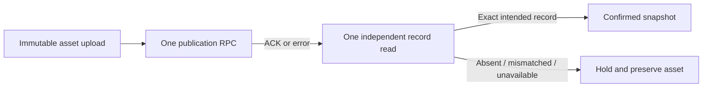

# Thumbnail publication: preserve committed images after ACK loss

Base: `65e0a1c761e651f94f267b044f2022265e1fc6a2`. This is a local source candidate. Operating schema recovery, Gemini integration, external delta review and deployment remain incomplete.

## Confirmed defects and behavior

| Risk | Reproduction | Correction |
| --- | --- | --- |
| RPC commits, response is lost, catch deletes the uploaded object | The adapter retains one active row but the image count becomes zero. A later commit can also happen after an independent read observes no row. | Never treat an error or absent read as a rollback receipt. Read the current record once; accept only the exact intended identity, metadata, hash and paths. Keep bytes when completion is uncertain and return a fixed failure. |
| An existing release path can be overwritten before a duplicate DB publication is rejected | Actual Supabase Storage SDK, synthetic HTTP and a deny-network child: `x-upsert=true`, previous bytes replaced, publish attempted. | Upload with `upsert=false`. The same fixture observes one rejected upload, unchanged previous bytes, zero publish/delete calls. |
| An unrelated current record could be presented as successful publication | Readback must match every selected expected field, including normalized numeric score/time and deep JSON values. | Return a confirmed payload from that single matching snapshot. A mismatch or unavailable read returns `thumbnail_durable_release_publish_unconfirmed`. |

Unknown outcomes retain their uploaded object even when a follow-up read is empty. This can leave an unreferenced object after a genuine failure. Cleanup needs separate authoritative reconciliation; this patch invents no expiry, retention period, automatic deletion or retry. The existing missing-schema/RPC response remains unavailable, with its object preserved. No second publication RPC is sent to recover an ACK.



This describes the code path, not an implementation proof or unconditional eventual-completion guarantee.

## Verification

- Corrected pre-fix regression set: **6 failed**, including committed-image deletion and raw error propagation. Separate actual SDK overwrite case: **1 failed**. These deterministic counterexamples are retained.
- Final related Bun suite: **116 methods passed, zero failures, 1,210 assertions**, 14.80 seconds. Includes seven new publication/Storage cases and existing thumbnail/storage coverage. Bun 1.4.0; automatic `.env` loading disabled.
- Real PostgreSQL 17.11 + actual TypeScript publication code: **2 methods passed**, 3.206 seconds. The exact frozen thumbnail DDL/RPC subset executes under a synthetic service role in a private loopback cluster. The first case commits then drops the ACK; the second holds an open transaction while another connection observes no row, then commits it. Both retain the exact image bytes, with one publication and zero deletion calls.
- The PG receipt binds five source files and the extracted DDL hash; source hashes are stable. Owned PID/socket are absent, `pg_ctl status` is 3 and the loopback port is closed. Receipt SHA-256: `b4be109002c403115de8fa12cdbc66b534cf92fb8f953f2df3b4a547bcd77a21`.
- TypeScript native/compat parity: **3,400 logical inputs, diagnostics 0**. Targeted ESLint passes with zero warnings. Runtime for these checks is Node 24.22.0.

```sh
bun --no-env-file test tests-unit/thumbnail-release-publish-recovery.test.ts tests-unit/admin-youtube-thumbnail-generator.test.ts tests-unit/storage-server-client.test.ts
PATH=/opt/homebrew/Cellar/node@24/24.22.0/bin:$PATH npm run typecheck:parity
/Users/twoimo/Documents/projects/tzudong/.venv/bin/python3 -m unittest -v backend.supabase.tests.test_thumbnail_publish_recovery_pg17
```

The Bun and SQL cases cover different boundaries. They are not random samples and imply no production error rate, speedup, financial saving or 95% interval. The Storage server is synthetic, and the PG harness does not verify HTTPS/PostgREST, actual Supabase Storage, G014 or hosted permissions. Real product Gemini calls and operating DB writes: **0**.

## Operating and Gemini follow-through

Current read-only operating catalog snapshot still shows table absent, publication RPC count 0, private bucket absent. Three G014 assertion bodies were saved from one snapshot and their server-provided SHA-256 values rechecked against the same local bytes. Their owner is `privacy_workflow_owner`; current membership/ACL metadata is preserved. The old local convergence migration must not overwrite these later contracts.

The current thumbnail registry/providers still admit legacy `local-codex/gpt-image-2`; this repair is data preservation, not fulfillment of Gemini-only generation. The next integration must use the already pinned Nano Banana 2/Pro IDs (`gemini-3.1-flash-image`, `gemini-3-pro-image`) and credits key, remove selectable non-Gemini execution, preserve historical decoding and canvas editing, and keep long-running generation in a durable worker. New generated artifacts need durable private storage and verified model provenance before publication. Current Google [image-generation guidance](https://ai.google.dev/gemini-api/docs/image-generation) and [model IDs](https://ai.google.dev/gemini-api/docs/models) confirm these names; newer models do not authorize changing the user's pins or limits.

Prepare a forward-only migration against the captured live G014 source, selected RPC identities, exact role/grantor restoration, private bucket and Gemini-capable table contract. Verify empty/read, permissions, commit-loss, concurrent publication and rollback in isolated PG17 before protected promotion or operating application. An empty 200 after creating a table is not generation/publication success. Existing Pro → Gemini → Pro reservations remain intact and this delta is externally unvalidated.
